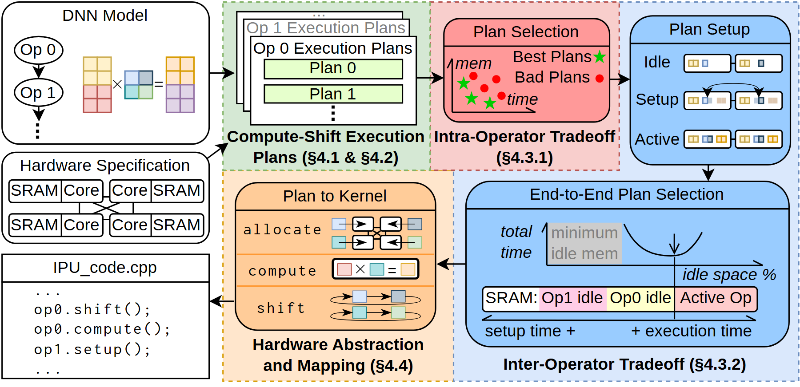
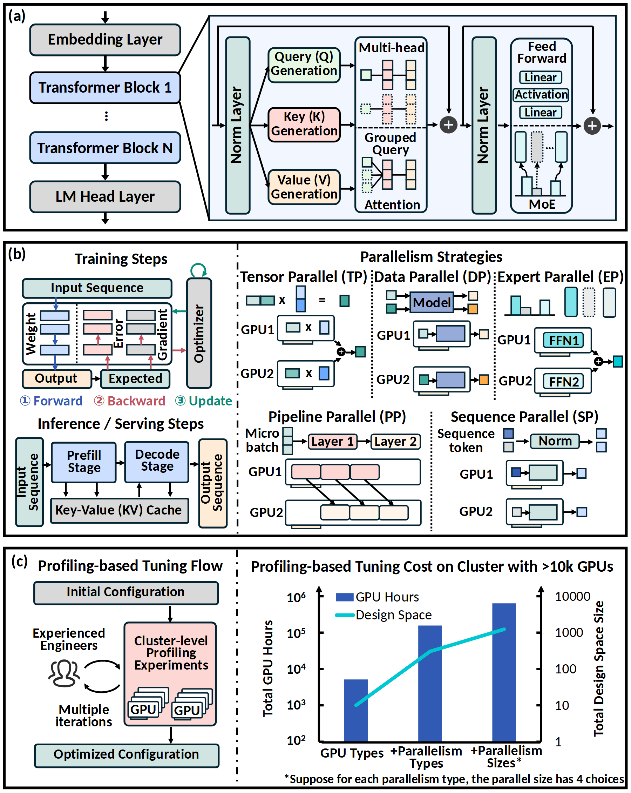
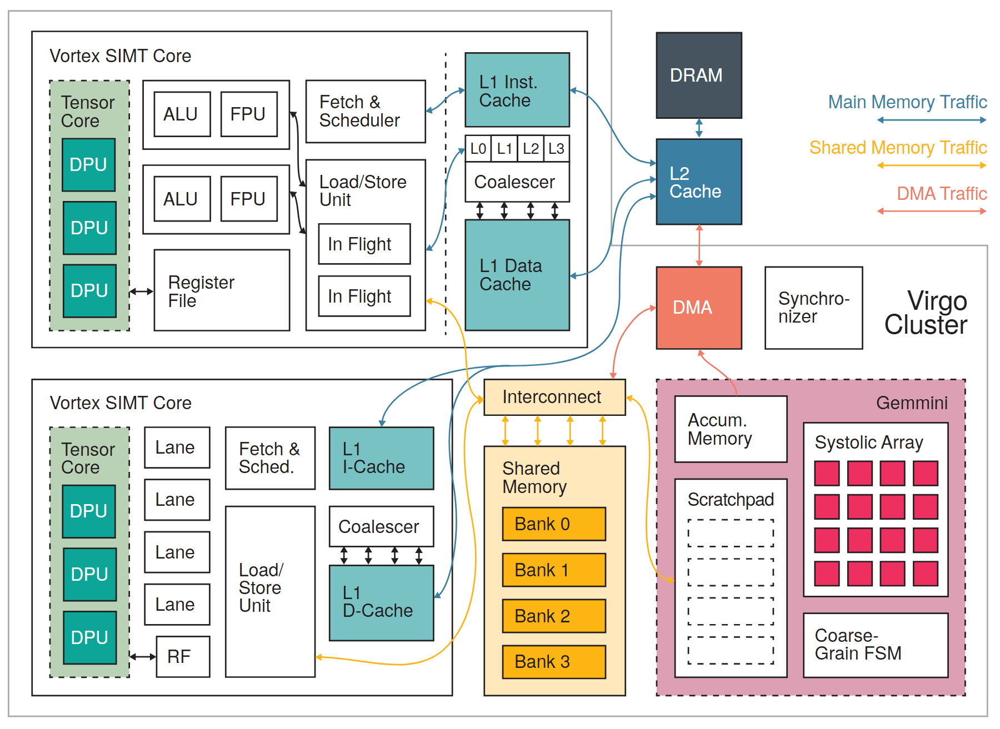
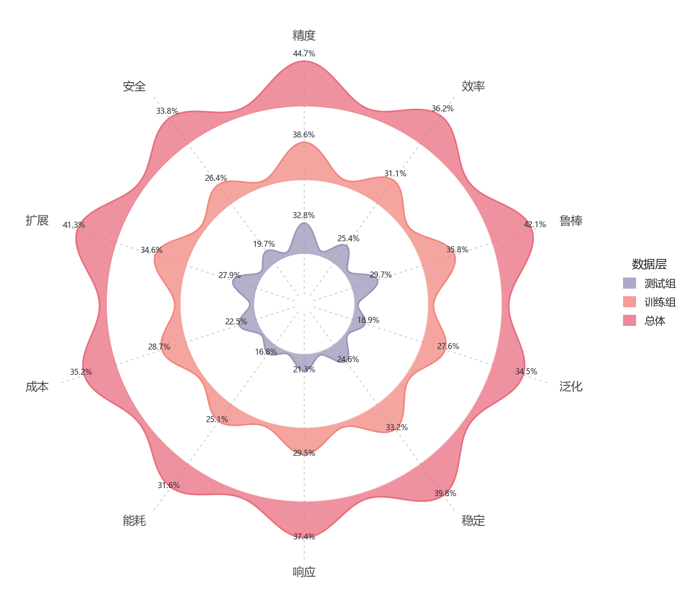
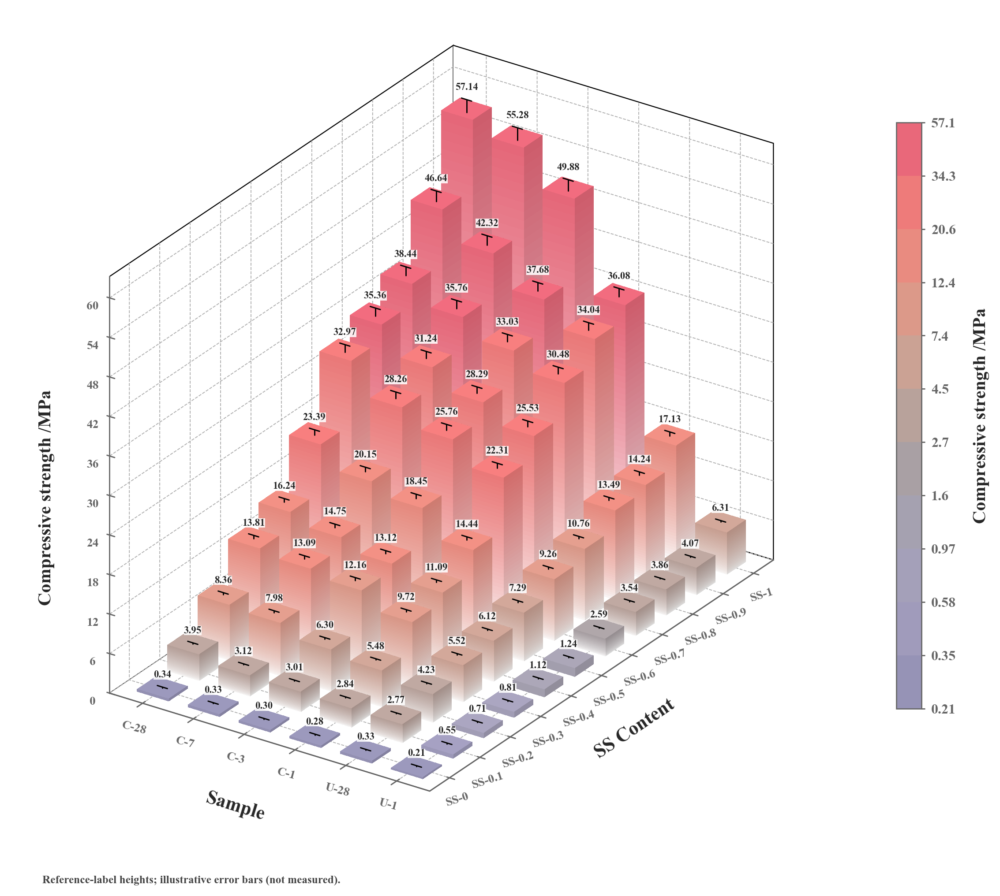
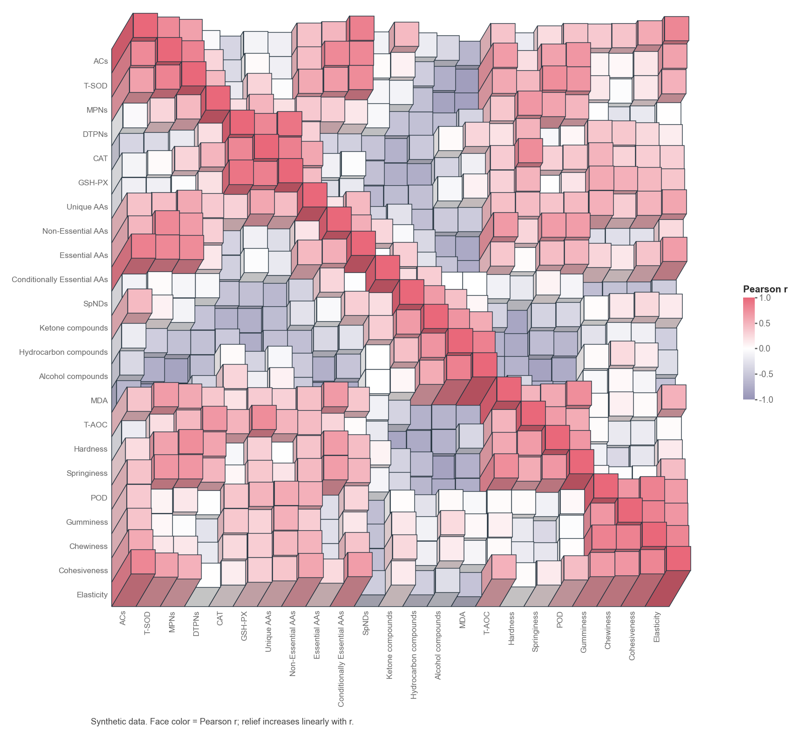
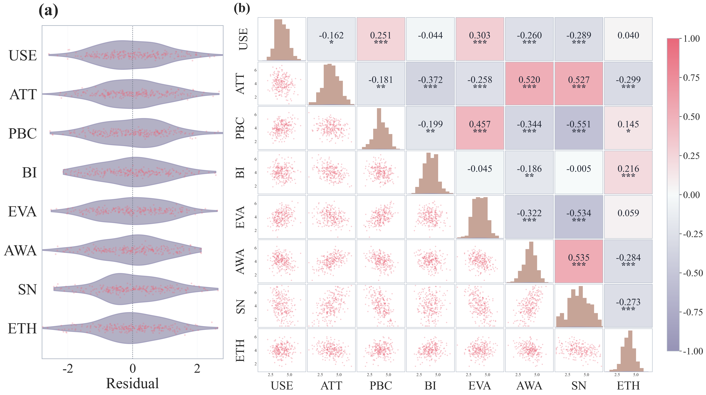
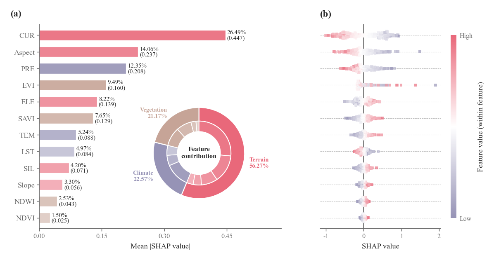

# Vivid Illustration Skill · 科研数据图、架构图与可编辑 PPT

**从完整数据图模板与可复用 SVG 架构资产出发，完成选图、适配、审图、修改与交付。**

Vivid Illustration Skill 面向论文、数学建模、系统设计与实验报告，提供 **148 个数据图模板（145 个配方 + 3 套完整组合）**、**196 套统一 SVG 架构资产**和 **7 套配色**。你可以自己在本地网页中选图和编辑，也可以让 AI 按 Skill 使用完整源码；架构图还能导出为可改字、可移动模块的原生 PowerPoint。

Skill 使用**轻量总入口 + 数据图 / 架构图两个按需通道**：按当前任务读取对应规则，资源仍随一个完整仓库包发布。

[下载完整源码](https://github.com/yjz211/vivid-illustration-skill/archive/refs/heads/main.zip) · [Skill 安装](docs/INSTALL.md) · [工作台说明](workbench/README.md) · [数据图目录](catalog/index.html) · [架构图目录](architecture/index.html) · [更新记录](CHANGELOG.md)

> **仅限个人、非商业使用；未经书面许可，禁止二次开发及商业使用**。完整限制见 [LICENSE](LICENSE)。

**复杂架构资产示例 · VA-103：候选计划筛选与全局执行落地**

[](architecture/source-assets/sosp24-024_fig4/preview.png)

矩阵图案、层叠计划、筛选散点、资源占用和执行路径共同解释一个系统。上图是仓库现有资产底稿，图中的数值与曲线沿用来源示意，不是本项目的新场景实验结果。[查看资产说明](architecture/source-assets/sosp24-024_fig4/TEMPLATE.md) · [更多复杂架构示例](#复杂架构资产示例) · [查看数据图示例](#数据图保留完整模板与原有编辑能力)

| 能力 | 仓库提供什么 | 适合完成什么 |
|---|---|---|
| 数据图 | 完整绘图源码、说明卡、数据要求、中英文预览、保真要点 | 方法对比、分布与误差、相关性、时序、三维曲面、空间与工程数据表达 |
| 架构图 | SVG 底稿、逐图说明、稳定对象键、语义部件、字体与来源记录 | 系统总览、方法框架、处理流水线、分层平台、反馈与资源调度 |
| 本地工作台 | 图库、表格、画布编辑、项目与版本、导出 | 手动换数据、改标签、拖动对象或模块，保存可继续编辑的作品 |
| AI 辅助 | 文件式 Skill，以及本地网页的数据图 / 架构图 Agent | 依照真实输入选图，适配源码或模板，查看结果并修复 |
| 图件交付 | 数据图图片与复现源码；架构图 SVG、PDF、原生可编辑 PPTX 与字体包 | 论文排版、汇报展示、后续人工修改与复现 |

## 导航

- [两个绘图通道](#两个绘图通道)
- [选择使用方式](#选择使用方式)
- [快速开始](#快速开始)
- [架构图：从资产到完整交付](#架构图从资产到完整交付)
- [数据图：保留完整模板与原有编辑能力](#数据图保留完整模板与原有编辑能力)
- [中英文与字体](#中英文与字体)
- [七套配色与项目一致性](#七套配色与项目一致性)
- [可以直接使用的提示词](#可以直接使用的提示词)
- [能力边界与常见问题](#能力边界与常见问题)
- [文档与仓库结构](#文档与仓库结构)
- [最近更新](#最近更新)

## 两个绘图通道

根目录 [SKILL.md](SKILL.md) 负责识别任务和分派，不要求每次绘图都加载数据图与架构图的整套规则。已经明确图件类型时，可以直接让助手读取对应子入口。

| 入口 | 名称 | 负责的任务 |
|---|---|---|
| [SKILL.md](SKILL.md) | **Vivid Illustration Skill**<br>`vivid-illustration-skill` | 任务分流、整篇论文或整题混合图集规划，以及科学场景插图等路线分派 |
| [channels/vivid-figure-skill/SKILL.md](channels/vivid-figure-skill/SKILL.md) | **Vivid Figure Skill**<br>`vivid-figure-skill` | 145 个数据图配方、3 套完整组合、数据适配、保真与审图 |
| [channels/vivid-architecture-diagram-skill/SKILL.md](channels/vivid-architecture-diagram-skill/SKILL.md) | **Vivid Architecture Diagram Skill**<br>`vivid-architecture-diagram-skill` | SVG 架构、部件复用、A/B、语义配色、字体与 PPTX；按需使用 Draw.io / TikZ / HTML / Mermaid 技术图路线 |

单独画数据图时不加载架构图规则；单独画架构图时不加载数据图规则。整题同时包含两类图件时，由总入口先规划，再为每张图分派对应通道。共享资源按实际需要读取，两个通道的默认配色、审图与交付规则各自生效。

这仍是**一个完整安装包**。`channels/` 是按需读取的入口目录，不是两个可单独复制安装的资源包；宿主也不一定自动发现子目录里的 Skill。模板、架构资产与脚本位置不变，文档中的 `<SKILL>` 始终指整个 `vivid-illustration-skill` 包根目录。

## 选择使用方式

三种方式共用仓库里的模板和资源，但运行环境与自动化范围不同。

| | 文件式 AI Skill | 普通本地绘图工作台 | 完整 Agent 工作台 |
|---|---|---|---|
| 主要入口 | [SKILL.md](SKILL.md) | `manage.py serve` | `manage.py agent` |
| 操作方式 | 在能读文件、执行代码、看图的 AI 助手中描述任务 | 自己搜索模板、导入数据、编辑图形 | 手动编辑，或在网页中对话绘图 |
| 是否需要模型 | 需要可用的 AI 助手 | 不需要 | 手动操作不需要；对话时需要 |
| 数据图 | 完整源码适配、审图、复现 | 表格、字段对应、图形编辑与导出 | 原数据图编辑器 + 选图、数据整理、修改和图片检查 |
| 架构图 | 196 套 SVG 资产、源码改造、A/B 候选与最终交付 | 可浏览架构资源；不提供架构编辑 API | 模块编辑、单候选架构 Agent、版本与导出 |
| 新建架构图的 A/B 流程 | 支持；可并行或依次生成两份独立结果 | 不提供 | **当前是单画布、单候选，未实现完整 A/B 调度与成对交付** |
| Python | 3.10+ | 3.11+ | 3.11+ |
| 详细说明 | [安装与宿主要求](docs/INSTALL.md) | [工作台说明](workbench/README.md) | [数据图 Agent](workbench/docs/AGENT-WORKBENCH.md) / [架构 Agent](architecture/AGENT.md) |

只想看图时，下载并解压仓库后，可以直接用浏览器打开 `workbench/index.html`、`catalog/index.html` 或 `architecture/index.html`。GitHub 页面中的 HTML 链接用于查看文件；交互图库请在本机打开。数据编辑、生成新图和架构模块编辑需要下面的本地服务。

## 快速开始

先[下载并解压完整源码](https://github.com/yjz211/vivid-illustration-skill/archive/refs/heads/main.zip)，或使用 Git：

```sh
git clone https://github.com/yjz211/vivid-illustration-skill.git
cd vivid-illustration-skill
```

以下命令都从仓库根目录开始，`python` 指你选定的 Python 环境；macOS / Linux 可按环境替换为 `python3`。推荐使用独立虚拟环境，分平台安装步骤见[安装指南](docs/INSTALL.md)。

### 方式一：交给 AI Skill

安装依赖；需要 SVG 架构渲染与 PPTX 导出时，同时安装 Chromium：

```sh
python -m pip install -r requirements.txt
python -m playwright install chromium
```

在 AI 助手中导入整个 `vivid-illustration-skill` 文件夹，或将它放到该助手规定的 Skill 目录。保留根 `SKILL.md`、`channels/` 和全部资源；不能只复制某个入口文件或通道子目录。助手没有自动发现能力时，也可明确要求它读取本仓库的 `SKILL.md`。

```text
使用 vivid-illustration-skill，Python 使用我刚安装依赖的环境。
读取当前项目里的输入文件，按 Skill 选择模板并完成图件。
```

任务明确时，也可直接指定子入口，例如：

```text
读取 <安装目录>/vivid-illustration-skill/channels/vivid-figure-skill/SKILL.md，
使用 vivid-figure-skill 绘制 results.csv 的方法对比图。
<SKILL> 是 <安装目录>/vivid-illustration-skill，不是 channels/vivid-figure-skill。
```

架构任务对应读取 `channels/vivid-architecture-diagram-skill/SKILL.md`，使用 `vivid-architecture-diagram-skill`。这里的名称用于标识通道；能否直接用名称或斜杠调用取决于宿主，明确提供文件路径即可避免依赖子目录自动发现。更多写法见[使用指南](docs/USAGE.md#选择入口与绘图通道)。

仅使用架构图 / PPT 能力时，可将上面的依赖清单换成 `requirements-architecture.txt`，仍需安装 Chromium。文件式 Skill 的工具能力由所用 AI 助手提供；无需启动网页服务。宿主接入见 [host-adapter.md](host-adapter.md)。

### 方式二：自己操作数据图工作台

```sh
cd workbench
python -m pip install -r requirements.txt
python -X utf8 scripts/manage.py serve --open
```

浏览器打开 [http://127.0.0.1:8766/index.html](http://127.0.0.1:8766/index.html)。Windows 安装依赖后，也可双击 `workbench/启动工作台.cmd`；服务运行期间保留启动窗口。

这套服务适合选模板、换数据、调整图形与导出。**`serve` 不包含架构模块编辑和架构 Agent API**；需要这些功能时使用方式三。普通数据图启动不需要 Node.js，Plotly 静态导出需要 Chrome / Chromium。

### 方式三：完整 Agent 工作台与架构模块编辑

```sh
cd workbench
python -m pip install -r requirements-agent.txt
python -m playwright install chromium
python -X utf8 scripts/manage.py agent --open
```

安装后，Windows 也可双击 `workbench/启动Agent工作台.cmd`。这套服务同时提供图库、数据图编辑、架构模块编辑和两个 Agent 入口：

| 页面 | 地址 | 用途 |
|---|---|---|
| 统一图库 | [index.html](http://127.0.0.1:8766/index.html) | 切换数据图 / 架构图，搜索并选择资源 |
| 数据图 Agent | [agent.html](http://127.0.0.1:8766/agent.html) | 导入表格、选模板、字段对应、对话修改 |
| 架构图库 | [architecture.html](http://127.0.0.1:8766/architecture.html) | 看说明、部件与源码，创建模块编辑项目 |
| 架构 Agent | [architecture-agent.html](http://127.0.0.1:8766/architecture-agent.html) | 描述结构、生成单候选、继续手动编辑 |

两个服务默认都使用 `8766` 端口；切换前停止旧服务，或在 `agent` 启动命令后追加 `--port 8767`。手动出图和模块编辑无需连接模型。要使用对话功能，在模型设置中连接已登录的 Codex CLI，或填写兼容 API 的地址、模型与密钥；Agent 数据整理另需 Node.js 18+。

**架构 Agent 的源码执行当前需要 Windows 上可用的 Codex sandbox 运行时**，即使模型连接的是兼容 API，也需要这个本地执行环境。当前源码执行器在 macOS / Linux 不可用，不能把上述跨平台服务启动命令理解为所有平台均支持架构 AI 源码生成。文件式 Skill 可使用其宿主提供的执行环境，手动模块编辑与架构 Agent 的代码执行也是不同能力。详见[架构 Agent 环境边界](architecture/AGENT.md)。

项目、样式、版本和会话默认保存在本机 `workbench/workspace/`，不随 Git 上传。模型调用会向所选服务发送当前任务需要的摘要与图片；本地存储不等于整个 AI 流程离线。

## 架构图：从资产到完整交付

### 196 套 SVG 资产，按结构选型

架构图库以 `VA-001` 至 `VA-196` 编号，提供搜索、构图分类、收藏、预览、逐图说明与部件入口。选择依据是对象、依赖方向、层级、共享资源和反馈关系；以一个主体为基础，确有需要时再补充其他资产的局部。

所有新任务统一从 **SVG 工作副本**开始。每套资源包含可编辑底稿、文字与几何信息、语义部件及生成入口；逐图说明解释适用场景、阅读顺序、字体、线条、配色和允许的改造范围。仓库包含所需架构资源，无需另行取得原始参考图库。VA-001–004 的历史 Python 生成器仍保留供旧项目兼容，新任务由目录指向对应 SVG 版本。

### 复杂架构资产示例

除首页展示的 VA-103，下面三张展示多层结构、跨区连线、局部图案和组合面板。图片均直接引用仓库资产预览，可点击查看大图；它们是供选型与改造的底稿，不代表已针对用户新场景生成或验证。

**VA-196 · 模型结构、执行方式与调参代价组合图**

[](architecture/source-assets/mlsys26-charon_fig2/preview.png)

把网络层栈、注意力与 MoE 局部、训练 / 推理路径、五类并行策略和调参循环放入分层面板。图中的成本图属于来源情景示意，正式使用需换成当前证据或明确标为示意。[逐图说明与适配范围](architecture/source-assets/mlsys26-charon_fig2/TEMPLATE.md)

**VA-113 · 异构核心与共享矩阵单元的硬件分区图**

[](architecture/source-assets/asplos25-110_fig2/preview.png)

两组核心、缓存层级、共享存储与矩阵阵列形成紧凑分区；三种颜色的连线区分主存、共享存储和 DMA 传输，保留内部重复单元与局部边界。[逐图说明与适配范围](architecture/source-assets/asplos25-110_fig2/TEMPLATE.md)

**VA-119 · 负载再分配时序与硬件支持并置**

[](architecture/source-assets/asplos26-013_fig13/preview.png)

左侧以拼接任务块与箭头解释负载调整前后的执行时序，右侧用阵列、调度器、缓冲区和表格说明实现支撑，适合同时表达机制与结构。[逐图说明与适配范围](architecture/source-assets/asplos26-013_fig13/TEMPLATE.md)

[浏览全部架构资源](architecture/index.html) · [机器可读目录](architecture/catalog.json) · [假设情景迁移示例](architecture/migration-examples/index.html) · [来源与权利记录](architecture/ATTRIBUTION.md)

迁移示例用于展示改造范围，示意曲线和对象关系不构成实证结果。部分资产几何与构图衍生自已有论文图，来源记录和字体许可随仓库保留。

### 文件式 Skill：A/B 自主修正，再由你选择

新建 SVG 架构图采用以下默认流程，详见 [A/B 双候选工作流](architecture/WORKFLOW.md)：

1. **共同选型。** 读取需求、查看实际资产，确定同一个主资产、事实输入、语言和展示宽度，形成简短任务说明。
2. **独立生成 A 与 B。** 两份独立源码分别适配；有子代理时可并行，无并发能力时可依次执行。
3. **各自看图与修正。** 核对语义、箭头、真实部件、字体和同宽效果，发现实质问题后自行修复并复看。文件式 Skill 的架构候选不设固定修复轮数。
4. **展示原图 + A + B。** 提供两张 PNG 和等宽对照页，说明构图取舍，由用户选择。
5. **交付所选版本。** 选择后直接生成该版原生可编辑 **PPTX + SVG + PDF**，附所需字体包；无需再确认是否导出 PPT。

| 候选 | 保留什么 | 可以怎样改变 |
|---|---|---|
| A：保留构图 | 主体布局、阅读路径与有用区域比例 | 根据任务替换对象、调整局部、补充必要关系 |
| B：重组构图 | 实际可复用部件与整体设计风格 | 重排分区、方向与比例，以适应新的结构 |

两路都使用相同事实和同一主资产，B 不必为了不同而强行变化。用户指定只要一个候选、续改已有作品、只换色或导出格式时，按指定范围处理，不重新启动 A/B。**当前网页架构 Agent 每次保存一个候选，未实现上述独立双候选流程。**

### 真正复用图元，按新语义改造图案

适配从原 SVG 中仍然有用的形状、路径、文字和部件开始。保留对象编号或相似配色本身不算完成复用；设备轮廓、网络节点、输入样例、层叠数据和张量示意等图形也属于表达内容。

- 语义仍适用：保留实际图形，修改标签、数量、布局和关系。
- 语义已经改变：用可编辑 SVG 形状与路径画出符合当前对象的图案，沿用原来的线宽、细节程度与视觉占比。
- 确实无关的图案：可以删除并说明原因；仍需图形表达的部分不能只替换成名称或普通文本框。
- 复用其他资产的局部：统一字体、尺寸、颜色角色、引用和对象编号，再核对它与主体的连接。

部件按实际对象集合导出为 SVG，不是对预览图做位图裁切。源码改造需同步文字键、部件成员和连接语义；跨区域连线、共享容器与遮挡关系仍要看实际成图。要求与工具入口见[共同制作与验收](architecture/COMMON.md)。

### 原生可编辑 PPTX

PowerPoint 导出将所选 SVG 转成**原生自由形状、路径、文本框和具名组**。你可以整体移动模块、进入组内改字和调形状，或取消组合；交付也保留同版本 SVG、PDF 和字体包。

```sh
python scripts/export_architecture_pptx.py figures/system/fig.svg --out figures/system/fig.pptx --structure figures/system/structure.json
```

这条命令从仓库根目录运行，路径替换为你的实际作品。工作副本中也包含导出入口；完整网页模块编辑器可直接导出当前保存版本。

需要了解的编辑行为：

- 移动模块后，普通连线**不会自动重接**；PPT 人工修改也不自动回写 SVG。
- 复杂遮挡可能让一个语义模块拆成多个具名组，以保持画序；共享对象可能单独保留。
- 公式字符与上下标可以作为文字编辑，但不是 PowerPoint 公式编辑器对象。
- 位图、渐变、滤镜、复杂 marker 或部分文字变换等不支持的 SVG 表达会明确报错，需先调整工作 SVG；不会默默把整图栅格化。
- 普通 PPTX 生成不依赖 Office。Windows 安装 PowerPoint 后可追加 `--office-verify` 做保存、重开及实际渲染检查；没有 Office 时不能把 SVG 预览当作 PowerPoint 视觉验证。

字体保留、转换范围和报告说明见 [PPTX 导出指南](architecture/PPTX.md)。已有样例检查不代表 196 套资源、所有改造或任意 SVG 均已验证。

### 网页里手动改模块，或交给架构 Agent

通过完整 Agent 服务，在架构详情中点击“打开模块编辑工作台”创建独立项目。模块编辑无需模型，支持模块整体拖动、Shift 多选、键盘与精确位移、单图元模式、标签替换、撤销重做、保存版本，以及当前版本的 SVG / PNG / PDF / PPTX 导出。

架构 Agent 可读取真实 Skill、比较候选资源、准备主体和补充源码、修改 SVG 或 `customize()`、运行 Python、查看图片并修复，随后把单候选结果送入同一模块编辑器。它与数据图 Agent 共享模型配置，工作区分别保存。网页运行时的自动修复次数有限，与文件式 Skill 的候选修正规则不同。

继续对话时以当前已保存作品为起点；先前手动位移和标签应保留。发生并发版本冲突时保留候选结果，不直接覆盖人工版本。网页目前不提供任意 SVG 导入、路径节点编辑、模块缩放、自动排版或自动布线；长标签也不会自动可靠地重排整张图。

[模块编辑器操作](architecture/EDITOR.md) · [架构 Agent 流程与边界](architecture/AGENT.md)

## 数据图：保留完整模板与原有编辑能力

数据图仍包含 **145 个配方 + 3 套完整组合模板**，通过说明卡、预览、数据要求与完整源码统一检索。可以直接指定模板，也可以只描述比较目标，让 AI 先理解数据再选图。

| 环形分组对比柱状图 | 雷达山脊融合图 | 三维分组渐变柱状图 |
|:---:|:---:|:---:|
| [](catalog/cards/advanced.grouped_radial_bar.md) | [](catalog/cards/advanced.radar_ridgeline.md) | [](catalog/cards/advanced.grouped_bar_3d.md) |

| 立体方块相关性热图 | 小提琴 + Pearson 组合 | SHAP 特征贡献组合 |
|:---:|:---:|:---:|
| [](catalog/cards/advanced.relief_correlation_heatmap.md) | [](templates/sem-violin-pearson/TEMPLATE.md) | [](templates/shap-composites/TEMPLATE.md) |

这些预览展示模板设计，使用示例数据或参考图数据，不是用户实验结果。环形分组图的默认柱长按**每个任务内部**的最小值与最大值缩放，柱长仅可在同一任务内比较；跨任务读取原始数值，或明确改用共享尺度。

### 可表达的数据与任务

| 输入或目的 | 模板方向 |
|---|---|
| 多组样本、重复实验 | 分布、小提琴、雨云、箱线、山脊及组间对比 |
| 预测、方法比较、训练结果 | 预测与真实值、误差分布、置信区间、混淆矩阵、ROC、收敛曲线 |
| 指标、特征与模型解释 | 相关性热图、重要性、SHAP 依赖与贡献组合 |
| 时序、实证分析结果 | 事件研究、动态效应、森林图、稳定性与残差诊断 |
| 空间坐标、曲面、网络与优化结果 | 地图、三维曲面、轨迹、网络路径、Pareto 前沿与工程图 |
| 完整论文或整题图集 | 按主题规划图件、记录图件清单，再选择对应模板执行 |

完整组合模板保留各自布局、源码和数据口径，不拆成普通配方后随意拼接。统计类模板需要对应的样本或分析结果，缺少重复试验、区间或真实 SHAP 值时，不能为了凑出外观而补造数据。完整目录见 [148 张说明卡与预览](catalog/index.html)。

### 网页操作流程

1. **选图。** 按类别、图名、别名、知识卡关键词和数据要求搜索，查看中文或英文预览。
2. **换数据。** 导入 CSV、TSV、XLSX，或直接编辑表格；Excel 可选择工作表，多表模板分别对应输入。
3. **核对字段。** 绑定标签、数值、分组、坐标或矩阵列，按模板的数据契约生成。
4. **调图。** 切换配色自动重绘；Matplotlib 图支持对象点选和文字拖动，Plotly 三维图支持旋转与缩放。
5. **保存与导出。** 保存项目、恢复版本，按渲染器能力导出 PNG、PDF、SVG、CSV、源码与完整复现包。

表格保留排序、筛选、转置、长宽表转换、分组汇总、撤销重做等功能。模板允许的数据行列数量可按实际输入调整；具体操作与限制见 [工作台使用说明](workbench/使用说明.md)。

数据图 Agent 在同一编辑器上增加选图、数据检查、字段绑定、数据整理、局部修改和图片检查。它围绕现有模板及声明式操作工作，不执行任意模型生成的绘图 Python，也不从截图自动发明新模板。需要完整源码级适配时使用文件式 Skill。

### 从完整源码开始，保留模板设计

文件式 Skill 会读取所选模板的完整配方和保真要点，将源码写成真实工作脚本，再适配数据。渐变、透明度、浅填充与深描边、边际分布、图层和关键标记都是设计的一部分；修图优先调整位置、间距和尺寸。

来源工具保存原始底稿与来源记录，差异检查帮助定位图层、字体和布局变化；最终仍要打开生成图片判断。必要的数据和布局调整允许保留，脚本成功或差异提示清零都不等于视觉通过。见[源码底稿与保真说明](template-fidelity.md)。

## 中英文与字体

数据图图库与模板详情支持中文 / English 预览，默认中文并记住选择。新项目沿用所选语言，已有项目保留自己的设置；编辑器也可切换“图内语言”。语言切换共用同一源码、数据、配色与图层，界面仍为中文。

标题、坐标轴、图例、刻度和注释按语言设置处理。原始数据名称通过显示名映射或点选文字修改，不直接改写数据；专业缩写、单位、公式和专有名称按需要保留。下载的模板包可运行：

```sh
python run_demo.py --language en
```

| 图件 | 字体处理 |
|---|---|
| 普通数据图 | 中文默认 MiSans，英文与数字默认 Arial；保留专门设计的衬线风格 |
| SVG 架构图 | 沿用所选资产的字体角色、真实字重、倾斜、字色、字距和字号层次；新增文字从同类对象继承 |
| 架构 PPTX | 随图提供实际可用的字体包与安装说明；未内嵌的系统字体需在目标机器具备 |

需要与数据图图库中文效果一致时，从 [MiSans 官方页面](https://hyperos.mi.com/font/zh/download/) 安装 TTF 格式的 Regular、Semibold、Bold。MiSans 与 Arial 文件不随本仓库分发；缺少时使用可用字体回退。数据图 PDF 支持嵌入中文 TrueType 字体。架构资源附带的开放字体遵守各自许可，部分底稿使用显式替代字体，不代表来源字形的精确复刻。

架构图的文字保真还包括**最终显示尺度**：原图与成图按相同宽度比较主要文字、字重、模块比例和线宽；整图等比缩放时只应用一次缩放。长标签优先精简、换行或调整局部布局，不能默认通过缩小、变细、变浅或横向压缩文字来塞入。仅增加留白不应让整个主体随之缩小。

原资产字体不覆盖中文时，按原有衬线、无衬线、等宽及字重角色选择支持当前文字的完整字体，复查布局；不能依赖缺字回退或擅自把中文改成英文。VA-001 的随附 portable 字体包不包含中文字形，中文配置方法见其 [FONTS.md](architecture/source-variants/network-inset-svg/FONTS.md)。

跨机器精确复现需要相同字体；PPT 嵌入字体也不能替代实际打开检查。详见[数据图语言与字体验证说明](workbench/docs/LANGUAGE-REPORT.md)、[架构字体与版面要求](architecture/COMMON.md)及 [PPTX 字体说明](architecture/PPTX.md)。

## 七套配色与项目一致性

七套配色与自定义颜色共用于数据图和架构图，统一维护在一份 [palettes.json](original/resources/assets/shared-scripts/palettes.json) 中。下面的模拟数据示例展示浅填充、轮廓、透明叠加与连续层次，点击可查看大图。

| 珊瑚青绿 · 7 色 | 橄榄杏棕 · 7 色 | 蓝粉浅彩 · 5 色 |
|:---:|:---:|:---:|
| [](docs/images/palettes/coral-teal.png) | [](docs/images/palettes/olive-apricot.png) | [](docs/images/palettes/blue-pink.png) |

| 蓝天绿地 · 8 色 | 柔绿森林 · 8 色 |
|:---:|:---:|
| [](docs/images/palettes/blue-sky.png) | [](docs/images/palettes/soft-forest.png) |

| 粉彩少女 · 8 色 | 海洋清风 · 8 色 |
|:---:|:---:|
| [](docs/images/palettes/pastel-girl.png) | [](docs/images/palettes/ocean-breeze.png) |

数据图 Skill 未指定配色时默认使用**橄榄杏棕**，数据图工作台图库预览使用**粉彩少女**；架构图默认沿用资产的语义配色。同一任务的补图和修图沿用已选配色；也可提供一组自定义 HEX 色值。换色不应顺带改变已选布局、字体、透明度和图层。

架构图通过**语义角色映射**使用项目色板：同一对象在不同区域保持同色，浅容器和深描边可属于同一身份，正文、中性色和警告色可按需保留。当前没有为全库预标注通用颜色角色，AI 需要根据实际图元填写本图映射；不能只按原色出现顺序一键替换。见[数据图配色](color-selection.md)与[架构图语义配色](architecture/PALETTE.md)。

[高清 PNG / SVG / PDF 与配色示例源码](examples/palette-posters/README.md)

## 可以直接使用的提示词

**让 Skill 按任务选架构图，并完成 A/B：**

```text
用 vivid-illustration-skill 为我的调度系统画架构图。
输入是任务队列与节点状态；规划器生成分配方案；执行节点回传状态给监控器；
监控器只向规划器提供反馈，不直接下发执行命令。
从架构资产中选一个合适主体，按默认 A/B 流程独立生成、看图和修正。
使用中文与海洋清风配色，保留有用的图形细节，给我原图和两个候选的同宽对照。
```

**选择候选并继续交付：**

```text
选 B。把“任务规划器”改成“在线规划器”，保留其他布局和文字大小。
交付这一版的可编辑 PPTX、SVG、PDF 和字体包。
```

**在网页架构 Agent 中生成单候选：**

```text
新建一张架构图：左侧是传感器输入，中间是状态估计与预测，
右侧是调度建议，实际执行结果反馈到状态估计。
请查找适合这个结构的资产，保留可复用图元，完成后放入模块编辑器。
这是网页中的单候选任务。
```

**让 AI 按真实数据选择模板：**

```text
用 vivid-illustration-skill 读取 results.csv，比较不同方法的得分分布与稳定性。
先检查数据是否包含重复实验，图型你来选。
使用珊瑚青绿配色，保留模板的渐变与层次，输出 PNG、PDF 和绘图源码。
```

**修改已有作品，保留已接受的设计：**

```text
继续修改当前保存版本：图例移到上方，解决右侧标签遮挡。
沿用已有数据、风格和配色，保留手动移动的位置。
如果是架构图，以我导出的当前 SVG 与结构文件为起点，不重新从原模板生成。
```

通常在任务目录的 `figures/` 下保存图件与源码。提供数据时说明字段与比较目的；提供架构需求时说明对象、输入输出、分支与反馈。已有图需要准确续改时，连同当前源码或 SVG / 结构资料一起提供。更多例子见[使用指南](docs/USAGE.md)。

## 能力边界与常见问题

| 问题 | 当前行为与处理方式 |
|---|---|
| 两个通道要分别安装吗？ | 不需要，也不能只复制通道子目录。安装一个完整包，由总入口分派，或直接读取指定子入口。 |
| 助手找不到 `vivid-figure-skill` / `vivid-architecture-diagram-skill`？ | 子目录不保证自动发现；直接给出该通道 `SKILL.md` 的完整路径，资源根仍是整个包目录。 |
| 打开 HTML 后为什么不能生成或保存？ | 离线图库用于浏览与源码获取；生成、持久编辑和导出需启动对应本地服务。 |
| 普通工作台能否进入架构模块编辑？ | `serve` 不含架构编辑 API；安装 `requirements-agent.txt` 与 Chromium 后启动 `agent`。 |
| 网页是否已经自动生成 A/B？ | 没有。网页架构 Agent 当前每任务保存一个候选；完整 A/B 使用文件式 Skill。 |
| 兼容 API 能否替代架构源码执行环境？ | 模型连接与代码执行分开；当前网页源码执行仍需 Windows Codex sandbox。 |
| 数据图与架构图是否都支持任意 Python？ | 文件式 Skill 按宿主能力执行；网页数据图使用现有模板工具，网页架构 Agent 才有受限源码执行入口。 |
| 拖动模块后箭头是否跟着重接？ | 不会。网页或 PPT 人工移动后需检查连接；结构重接可在 SVG / 源码中完成。 |
| 长标签能否自动适应所有模板？ | 不能保证。优先精简、换行与局部调整，再看实际成图。 |
| 是否所有模板、资产和 PPT 都已全面验证？ | 资源数量不等于逐一验证的数量。报告记录具体样例与范围；新数据、新场景和手动改图仍需实际检查。 |
| 数据、图片或分析结果缺失时怎么办？ | 补充真实输入，或明确采用示意表达；不能把示例数据当作正式结果。 |

Draw.io、TikZ、HTML、Mermaid 和 AI 科学场景插图仍可通过 Skill 对应路线使用，分别需要相应工具。普通数据图不需要图像生成 API Key；完整图集规划工具建议 Node.js 22.6+。可选工具与环境排查见[安装指南](docs/INSTALL.md)。

## 文档与仓库结构

| 想了解什么 | 入口 |
|---|---|
| 安装、虚拟环境、可选工具 | [docs/INSTALL.md](docs/INSTALL.md) |
| 数据图任务写法与输出 | [docs/USAGE.md](docs/USAGE.md) |
| AI 路由总入口与两个通道 | [SKILL.md](SKILL.md) / [数据图](channels/vivid-figure-skill/SKILL.md) / [架构图](channels/vivid-architecture-diagram-skill/SKILL.md) |
| 架构 A/B 流程与共同制作要求 | [WORKFLOW.md](architecture/WORKFLOW.md) / [COMMON.md](architecture/COMMON.md) |
| 架构模块编辑与网页 Agent | [EDITOR.md](architecture/EDITOR.md) / [AGENT.md](architecture/AGENT.md) |
| 原生 PPTX 与语义配色 | [PPTX.md](architecture/PPTX.md) / [PALETTE.md](architecture/PALETTE.md) |
| 工作台与数据图 Agent 操作 | [workbench/README.md](workbench/README.md) / [AGENT-WORKBENCH.md](workbench/docs/AGENT-WORKBENCH.md) |
| 数据图来源与保真 | [template-fidelity.md](template-fidelity.md) |
| 维护与已记录检查范围 | [MAINTENANCE.md](workbench/docs/MAINTENANCE.md) / [AGENT-QUALITY-REPORT.md](workbench/docs/AGENT-QUALITY-REPORT.md) |

```text
vivid-illustration-skill/
├─ SKILL.md                 轻量总入口：识别任务、规划与分派
├─ channels/
│  ├─ vivid-figure-skill/SKILL.md                 数据图通道
│  └─ vivid-architecture-diagram-skill/SKILL.md   架构图通道
├─ catalog/                 数据图目录、卡片、预览与来源快照
├─ original/                145 个配方、绘图指导、配色与辅助脚本
├─ templates/               3 套完整组合模板
├─ architecture/            196 套 SVG 架构资产、部件、字体、说明与工作流
├─ scripts/                 选型、准备副本、检查、候选对照与 PPTX 导出工具
├─ workbench/               本地网页、数据图与架构图编辑服务、Agent
├─ docs/                    安装、使用与图片资源
└─ examples/                可复现示例与配色海报
```

完整仓库包含网页服务；安装版 Skill 随附的离线演示图库不等于完整 Agent 应用。迁移时保留整个 Skill 的资源路径，更新时不要覆盖 `workbench/workspace/` 里的个人项目，也不要复制模型凭据或旧虚拟环境。

## 最近更新

- **2026-10-17 · 按需分流的双通道入口**：总入口负责路由与混合图集规划，数据图和架构图分别读取各自子入口；模板、资产、脚本与完整包安装方式保持原位。
- **2026-10-17 · 架构图与可编辑交付升级**：196 套资源统一 SVG 工作副本；逐图说明与语义部件；文件式 Skill 的 A/B 自主修正、同宽对照与选择后交付；项目语义配色、图案语义适配、字体与视觉保真要求；原生可编辑 PPTX、字体包、网页模块编辑和单候选架构 Agent。
- **2026-10-16 · 双语图库、字体与 Agent 数据图**：148 个模板提供中英文预览；中文 MiSans、英文与数字 Arial；保留手动文字和位置；发布环形分组对比柱状图、字段绑定、对话修改与版本恢复。
- **2026-10-14 · 本地工作台**：图库、数据导入整理、字段对应、对象编辑、文字拖动、本地项目与完整源码导出。

[完整更新记录](CHANGELOG.md) · [下载当前 main 分支完整源码](https://github.com/yjz211/vivid-illustration-skill/archive/refs/heads/main.zip)

[2026-09-15 历史发布包及粉彩少女图集](https://github.com/yjz211/vivid-illustration-skill/releases/tag/v2026.09.15)保留当时的 143 张高清单图和 16 张 3×3 九宫格，不包含后续新增模板、工作台与架构功能。需要当前版本请下载上面的完整源码。

## 使用限制

仅限个人、非商业使用。未经版权所有者事先书面许可，禁止修改、改编、二次开发、制作衍生作品、再分发、转售、提供付费服务或用于其他商业用途。第三方组件及材料仍遵循各自的许可证和声明。完整条款见 [LICENSE](LICENSE)。

本仓库采用 [Agent Skills 开放规范](https://agentskills.io/specification)描述宿主接口；格式开放不改变上述使用许可。架构资产另见[来源与许可说明](architecture/ATTRIBUTION.md)，字体及第三方组件保留各自声明。
