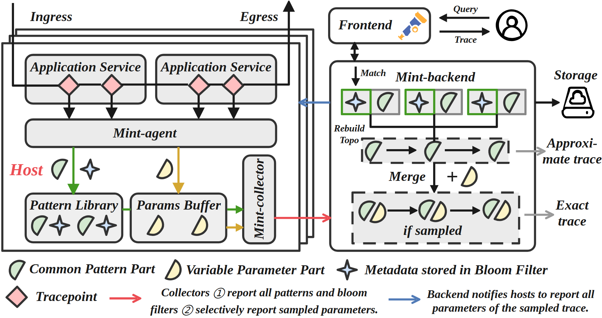

# VA-070 · 分解采集与按需重建架构

左侧主机把观测对象拆成公共结构、可变参数和元信息，右侧后端先匹配结构，再按是否取得参数形成不同完整度的重建结果。用户查询入口位于右上，后端还可反向要求主机补报。细小图元贯穿两区，是说明数据怎样分解并重新组合的关键。



## 适用范围

- 结构复用与参数分离的采集系统
- 按需补齐详细信息的观测架构

不适合：所有数据必须完整实时上报的流程；没有共同结构的独立对象仓库。

## 阅读顺序

1. 从左侧应用与采集点向下进入解析代理
2. 区分公共模式库和参数缓冲的两类内容
3. 沿上报通道到后端匹配及拓扑重建
4. 检查条件合并、查询入口与反向补报通知

## 图形表达

**布局**：左主机右后端，右上悬置查询入口，底部横排图例；主机叠框代表重复部署实例。

**对象**：绿色扇形是公共结构、黄色曲片是参数、星形是元信息、粉色菱形是采集点；不是装饰。

**连线**：红色通道上报模式及元信息，橙色关联选择性参数，蓝色反向通知补报；虚框标记条件路径。

**配色**：浅灰托住主要模块，绿色和黄色绑定两类被拆分的数据；对象与其存储框采用一致色意。

**文字**：衬线粗体标题较紧凑，底部图例要保留到论文尺寸仍可辨，不能只保留彩图而省略释义。

## 部件与复用

| 部件 | 含义 | 改造方法 |
|---|---|---|
| 端侧分解采集 (`host-collector`) | 应用观测经代理拆分存入模式库与参数缓冲，再由收集器上报。 | 先定义哪些字段稳定可复用、哪些可变，不能任意把数据切两半。 |
| 查询服务入口 (`query-frontend`) | 用户发出查询并接收后端重建结果。 | 按业务改成检索或诊断入口，保留请求返回的方向差异。 |
| 后端对象重建 (`backend-rebuild`) | 匹配模式、恢复结构，并在参数可用时合成为更完整对象。 | 明确两种输出的信息损失，删除不符合当前业务的近似或完整称呼。 |
| 对象与通道图例 (`semantic-legend`) | 说明四种图元和上报补报策略。 | 所有图元改义后必须同步图例；可用更贴近新场景的矢量形状替换。 |

## 改造步骤

1. 先确定结构复用前提，再决定模式与参数的拆分边界
2. 两种输出分别标注包含和缺少的信息
3. 保留条件分支语义，不能把采样合并画成每次必经
4. 增加对象类别时更新图例和所有匹配框，避免只改局部颜色

## 新情景示例（假设）

可用于工业设备诊断报告的按需汇集方案。

公共结构对应故障事件模板，参数对应传感器读数，元信息对应索引，后端先生成事件概要再按需补全细节。

用真实字段定义概要与完整报告，并把反向通知接到能补采数据的组件；无保留缓存时不能承诺补报历史参数。

## 编辑入口

**入口**：make_figure.py 读取 example.json；labels.json 查文字键，asset.json 查部件键；输出 SVG，可用配套渲染脚本导出 PDF。

**配置可改**：labels 修改文字及字体属性；components 可设 visible、dx/dy、attributes；elements 修改单个对象属性。平移使用图的坐标单位，重叠部件不要同时平移。

**需改代码**：改变模块数量、连接关系或分栏布局须编辑 customize()，不会自动布线。新对象需唯一 data-asset-key，并加入对应部件 element_keys，才会随部件导出。

**字体**：本图映射字体：Arimo-Bold.ttf, Tinos-Bold.ttf, Tinos-BoldItalic.ttf。沿用完整字体覆盖新字符；font_size 是元素局部单位，不是纸面 pt。改长标签后检查字宽、裁切及最终 PDF。

准备独立工作副本：

```text
python "<SKILL>/scripts/prepare_architecture.py" --id VA-070 --out figures/architecture
```

在工作副本运行：

```text
python make_figure.py --config example.json --out . --parts
python render_architecture.py fig.svg
```

## 本图检查

- 每种图元在左右区域是否保持同一含义
- 完整输出是否确实依赖所需参数
- 反向补报是否指向仍持有数据的组件

部件图用于复用局部对象；跨边界的连接和共享容器仍需按新关系处理。示例名称、数值和曲线不是当前研究结果。

来源与许可见 [ATTRIBUTION.md](ATTRIBUTION.md)。
