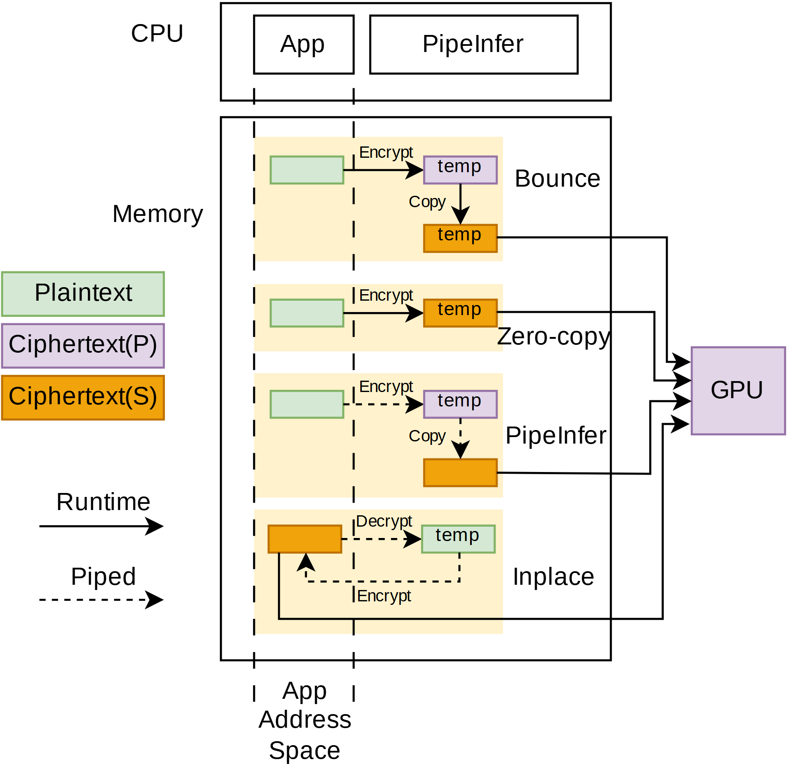

# VA-071 · 多策略缓冲区位置与转换路径对照

四行策略共享同一地址空间边界与执行端，通过缓冲块的颜色、位置以及转换箭头，比较数据在哪里加工、是否复制、何时进入设备。图的价值在于把同一对象的不同状态与不同执行顺序放在统一坐标中。



## 适用范围

- 比较加密、拷贝、就地更新等不同数据准备路线
- 多种方案跨越相同地址空间或权限边界

不适合：只比较最终性能而不解释转换过程；每行对象和边界完全不同的算法集合。

## 阅读顺序

1. 先看左侧三种数据状态颜色和实虚箭头说明。
2. 阅读上方主机模块以及中间竖向地址边界。
3. 逐行追踪从输入缓冲到临时缓冲的转换。
4. 沿各行汇入右侧设备的线路比较复制次数与流水关系。

## 图形表达

**布局**：上方主机条带，下方大内存框；四行横向小流程穿过相同竖向边界，再汇到右侧设备。

**对象**：小矩形表示缓冲区，浅黄背景标识每行处理范围；重复短标签让位置与颜色承担状态区分。

**连线**：实箭头表示顺序执行，虚箭头表示流水组织；竖边界是空间分隔，不能当作流程线。

**配色**：绿色表示明文，紫色表示私有区域密文，橙色表示共享区域密文；改场景时须同时替换状态图例。

**文字**：正文采用小型无衬线，策略名靠右，转换动作贴近箭头；左侧图例留足空间。

## 部件与复用

| 部件 | 含义 | 改造方法 |
|---|---|---|
| 主机运行环境 (`cpu-header`) | 应用与运行模块是各策略的共同上游。 | 按职责替换，不要与某一行策略使用同名造成混淆。 |
| 四策略地址空间 (`memory-strategies`) | 同一边界下不同缓冲位置和操作顺序。 | 逐行重新定义输入、临时对象和输出，保持可比条件。 |
| 共同执行设备 (`shared-device`) | 各策略最终送往同一执行端。 | 保持统一输出格式，否则比较需补转换成本。 |
| 数据状态图例 (`type-key`) | 三色标识内容状态和所在区域。 | 同名临时块最好增加短后缀，减少只靠颜色认对象。 |
| 执行方式图例 (`execution-key`) | 实线与虚线区分顺序和流水执行。 | 只有真实可重叠的操作才使用虚线，并说明重叠对象。 |

## 改造步骤

1. 先定义统一输入和输出，再逐行列明转换、复制及设备访问。
2. 竖向边界位置保持一致，显示差异来自路线而非版面漂移。
3. 明确临时缓冲的内容状态与归属区域，不能仅写相同的临时字样。
4. 减少策略数量后重排内存框；新增策略需保证线不交叉。

## 新情景示例（假设）

可用于比较传感数据在本地清洗、共享缓存与设备侧转换的路径。

绿色改为原始读数，紫色为校准中间值，橙色为可发布结果；各行分别表达复制、共享、流水和就地更新。

重画校准与复制操作，权限边界改成实际内存归属，并删除无加密意义的转换名。该映射不主张安全等价。

## 编辑入口

**入口**：以 make_figure.py 为入口，example.json 存修改参数；labels.json 定位文字键，asset.json 定位部件。运行后查看整图和独立部件。

**配置可改**：labels 改文字及字体；components 改显示、dx/dy 和属性；elements 改对象属性。位移采用整图 viewBox 单位，父子部件重叠时只选一个层级移动。

**需改代码**：增删策略、调整边界或更换操作链须改 customize()，并重接汇入设备的线；改颜色只改变视觉，不改变内存语义。

**字体**：文字为 Arimo Regular；箭头旁动作名很短，长英文宜换成缩写并在正文给定义。 font_size 是元素局部单位，受变换影响，不等于纸面字号。

准备独立工作副本：

```text
python "<SKILL>/scripts/prepare_architecture.py" --id VA-071 --out figures/architecture
```

在工作副本运行：

```text
python make_figure.py --config example.json --out . --parts
python render_architecture.py fig.svg
```

## 本图检查

- 每条进入共同设备的箭头携带的数据状态是否一致。
- 标为流水的两个操作是否真的可以并行。
- 跨越地址边界的缓冲访问是否有合法实现依据。

部件图用于复用局部对象；跨边界的连接和共享容器仍需按新关系处理。示例名称、数值和曲线不是当前研究结果。

来源与许可见 [ATTRIBUTION.md](ATTRIBUTION.md)。
