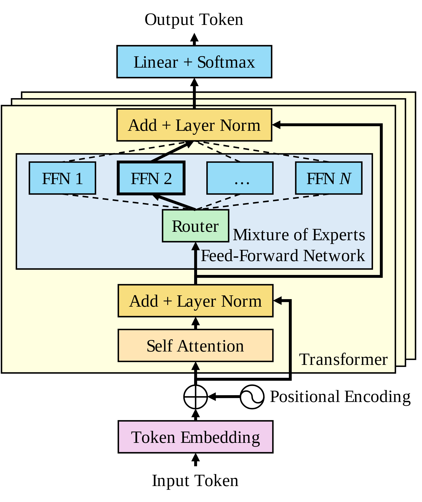

# VA-072 · 带残差的稀疏专家层结构图

这是一张自下而上阅读的模型结构图：输入编码经过位置注入、注意力、归一化与专家路由，最后由读出层形成输出。外侧叠片表示多层重复，内部虚线路径表示可选择的专家，粗实线突出当前示意中被选中的专家。残差绕行与路由选择承担不同含义，改造时不能合并。



## 适用范围

- 含稀疏专家子层及残差的序列模型
- 需要在整层结构中突出路由选择机制

不适合：简单多模型投票或所有模型同时运行的集成；没有顺序编码和残差机制的普通流程。

## 阅读顺序

1. 从底部输入及嵌入层进入圆加号位置
2. 向上读取注意力、残差相加与归一化
3. 进入绿色路由器，比较虚线候选与粗线选中专家
4. 经上方归一化和最终读出到输出，并识别层叠容器

## 图形表达

**布局**：竖向中心链保持输入输出对齐，残差绕行占右侧；专家组横向展开，模型重复层以向右上偏移的底板表示。

**对象**：矩形表示算子，圆加号表示特征相加，波形符号提示位置编码，叠放底板表示重复层而非多台设备。

**连线**：主链和残差为实线，专家候选为虚线，选中专家用更粗边线和实线路径；是否选择多个专家须另行明确。

**配色**：紫色输入嵌入、橙色注意力、金色归一化、绿色路由、蓝色专家及输出共同区分算子类型，浅黄底板标识整层。

**文字**：使用衬线标签，专家编号尽量短；长专家组说明放在容器空白处，不压住路由连线。

## 部件与复用

| 部件 | 含义 | 改造方法 |
|---|---|---|
| 输入与位置注入 (`embedding`) | 输入向量与位置信息在加号处结合。 | 修改输入类型时确认仍需要位置编码，取消时同步删掉波形和加号支路。 |
| 重复层容器 (`stacked-block`) | 同构模型层包含主链和残差绕行。 | 层数需由实际模型定义，叠片只作重复提示；移动时避免再次平移内部部件。 |
| 专家路由组 (`expert-router`) | 路由器从多个候选专家中选择执行路径。 | 按实际稀疏规则标出一个或多个选中专家，并更新虚实线。 |
| 注意力与归一化 (`attention`) | 注意力输出与残差结合后进入后续子层。 | 替换算子要核实输入输出维度及归一化位置，不能机械换名。 |
| 最终读出 (`readout`) | 把层输出映射为目标输出表示。 | 分类、回归、序列生成应使用不同读出名称，不一律保留概率算子。 |

## 改造步骤

1. 先核对模型真实的残差与归一化顺序，再改文字
2. 改变专家数量须同时调整专家横排、路由扇出和汇合路径
3. 若迁移到回归任务，替换顶部概率输出并声明输出维度
4. 模型层堆叠与专家并行是不同重复关系，需要分别命名

## 新情景示例（假设）

可用于假设的多类型传感器序列预测网络。

底部是时序特征嵌入，注意力提取历史关系，专家分别处理不同动态模式，顶部输出下一时刻预测值。

将输出层改成回归头；如果模型采用多专家加权，需要新增汇聚节点，不能只把第二个专家边框加粗。

## 编辑入口

**入口**：make_figure.py 读取 example.json 生成 fig.svg；加 --parts 导出部件，render_architecture.py 渲染预览及 PDF。

**配置可改**：labels 按 labels.json 对象键改字；components 支持 visible、dx/dy、attributes；elements 改对象属性。位移用图内坐标，连线不自动重布。

**需改代码**：增删模块、改连接和布局须修改 customize()。新对象须有唯一 data-asset-key 并登记部件归属；嵌套部件选一个层级平移，避免重复移动。

**字体**：当前完整字体为 Tinos-Italic, Tinos-Regular。font_size 是元素局部坐标单位，受缩放变换影响，不是纸面字号；改长标签后按最终版面宽度复核换行与字距。

准备独立工作副本：

```text
python "<SKILL>/scripts/prepare_architecture.py" --id VA-072 --out figures/architecture
```

在工作副本运行：

```text
python make_figure.py --config example.json --out . --parts
python render_architecture.py fig.svg
```

## 本图检查

- 残差是否接回正确的相加位置而非绕过归一化
- 虚实线路由是否与实际激活专家数相符
- 叠层数量、输入维度及读出类型是否与模型定义一致

部件图用于复用局部对象；跨边界的连接和共享容器仍需按新关系处理。示例名称、数值和曲线不是当前研究结果。

来源与许可见 [ATTRIBUTION.md](ATTRIBUTION.md)。
