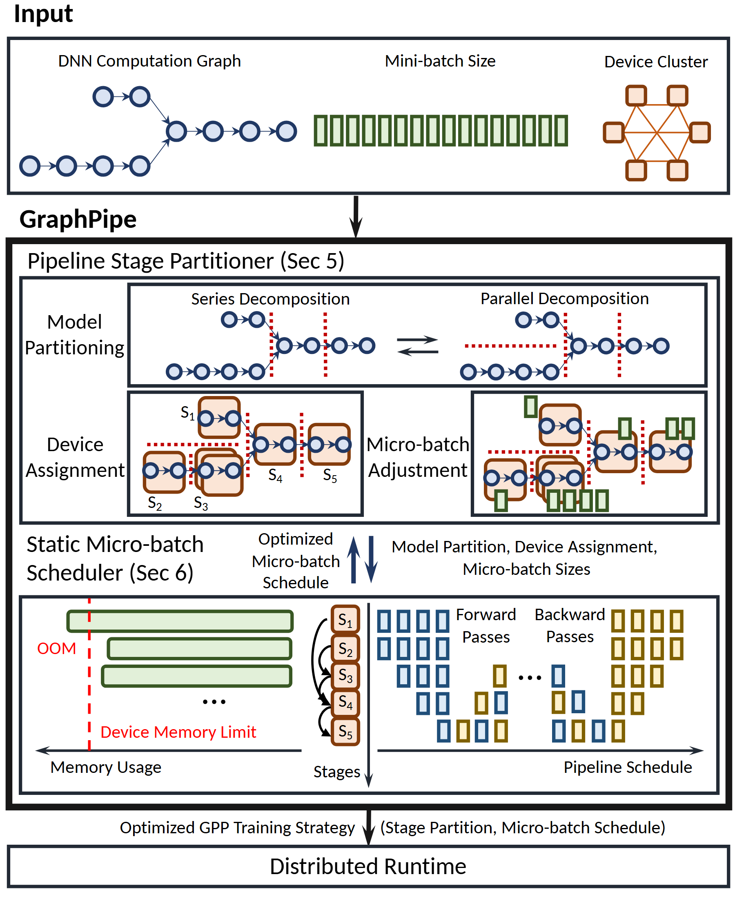

# VA-073 · 约束下的任务划分与日程联合设计

顶部用三种小图同时表达任务依赖、批量规模和资源拓扑；中间主框把任务划分与日程安排放进一个联合设计过程，底部输出可执行策略。内部既有结构分解图，也有容量约束和时间格，因此适合解释多种决策互相影响的优化体系。中间的双向箭头是核心，若实际只有单向编译过程就应删除反馈。



## 适用范围

- 任务划分、资源分配与排程协同优化
- 需要同时呈现依赖图、容量约束和时间安排的算法架构

不适合：仅输出一个分类或预测结果的单模块模型；没有可解释中间对象的黑箱优化概览。

## 阅读顺序

1. 读顶部三类输入，分别确认依赖、规模和资源图的定义。
2. 进入划分器，先看串并行分解，再看设备分配和批量调整。
3. 沿双向箭头进入日程模块，比较左侧容量限制与右侧阶段时间格。
4. 最后追踪整体策略如何交付执行端。

## 图形表达

**布局**：纵向输入、核心系统、运行端三层；主框内上大下小，划分与日程通过短双向箭头连接。

**对象**：圆点图表示操作依赖，橙色包框表示阶段分组，绿色条表示批量或占用，时间方格表示执行块。

**连线**：黑箭头表达处理流与阶段顺序；红虚线在不同局部表示分割或容量限制，须靠邻近标签明确区分。

**配色**：深蓝维持依赖身份，浅橙标阶段，蓝黄区分两种执行阶段；绿色不同时承担收益好坏编码。

**文字**：主标题较大，子面板标题次之；最小时间格标签宜省略，用行名和图例表达，保证论文尺寸仍能读。

## 部件与复用

| 部件 | 含义 | 改造方法 |
|---|---|---|
| 多类型输入规格 (`input-spec`) | 任务依赖图、批量和资源关系共同约束方案 | 每类输入换成真实对象；没有资源网络时不保留全连接图。 |
| 联合划分模块 (`partitioner`) | 先切分任务再分配资源并调整批量 | 按实际算法顺序更新子区，划分和分配不能仅凭几何叠框声称完成。 |
| 串并行图变换 (`partition-graphs`) | 同一依赖图在不同切分下的阶段结构 | 保留所有真实依赖，新增切分线不能切断语义连接。 |
| 容量约束包络 (`memory-envelope`) | 各阶段占用相对于允许上限的示意 | 图中横轴方向向左，改为常见方向时同时重画条和限制线；真实数值由计算提供。 |
| 阶段时间格 (`schedule-grid`) | 阶段顺序及两类执行块的安排 | 重新生成合法日程，方块位置与长度不能沿用作新结果。 |
| 策略运行端 (`runtime`) | 接收划分和日程的最终执行入口 | 输出标签应列明实际交付内容，区别算法方案与运行结果。 |

## 改造步骤

1. 先定义三类输入和优化输出，再确认划分与排程是否确实互相反馈。
2. 依据新任务重画串并行切分和阶段编号，同步调整资源映射。
3. 从真实容量口径和排程构建两幅小图，不能保留旧容量轮廓。
4. 检查阶段编号贯穿划分、约束与日程，再简化局部标签提升可读性。

## 新情景示例（假设）

假设设计带仓储上限的多工序生产排程。

依赖图对应工序，批量对应订单分批，设备图对应可用产线；阶段划分与日程共同决定中间品占用。

将前后向执行改为加工与换型两类活动；容量条使用中间库存量，运行端改为生产计划发布。

## 编辑入口

**入口**：在工作副本修改 example.json，运行 python make_figure.py --config example.json --out output --parts；再通过 Vivid 的矢量渲染入口检查 SVG 与 PDF。

**配置可改**：labels 按 labels.json 的元素键改字；components 按本页部件 id 设置 visible、dx、dy 或 attributes；elements 修改指定矢量元素属性。重叠部件可能共享元素，避免对父区域和内部区域重复位移。

**需改代码**：依赖图切分、阶段数、容量条和日程格都需在 customize 或独立生成代码中重建，不能只用标签替换迁移。这些接口不会自动重排，也不会随部件移动自动修复跨部件连线。

**字体**：本资产已记录的完整字形资源：Carlito-Bold.ttf, Carlito-Regular.ttf。修改英文标签优先沿用对应字体族与字重；文字变长时调整框宽和换行，不靠整体缩小压入。其他语言须另选覆盖所需字符的字体并实查导出。

准备独立工作副本：

```text
python "<SKILL>/scripts/prepare_architecture.py" --id VA-073 --out figures/architecture
```

在工作副本运行：

```text
python make_figure.py --config example.json --out . --parts
python render_architecture.py fig.svg
```

## 本图检查

- 同一个阶段编号在图划分、容量条和日程中是否一一对应？
- 容量轴方向与上限位置是否明确，读者会不会把越界区域读反？
- 双向反馈是否存在真实算法依据，输出是否包含两类决策？

部件图用于复用局部对象；跨边界的连接和共享容器仍需按新关系处理。示例名称、数值和曲线不是当前研究结果。

来源与许可见 [ATTRIBUTION.md](ATTRIBUTION.md)。
