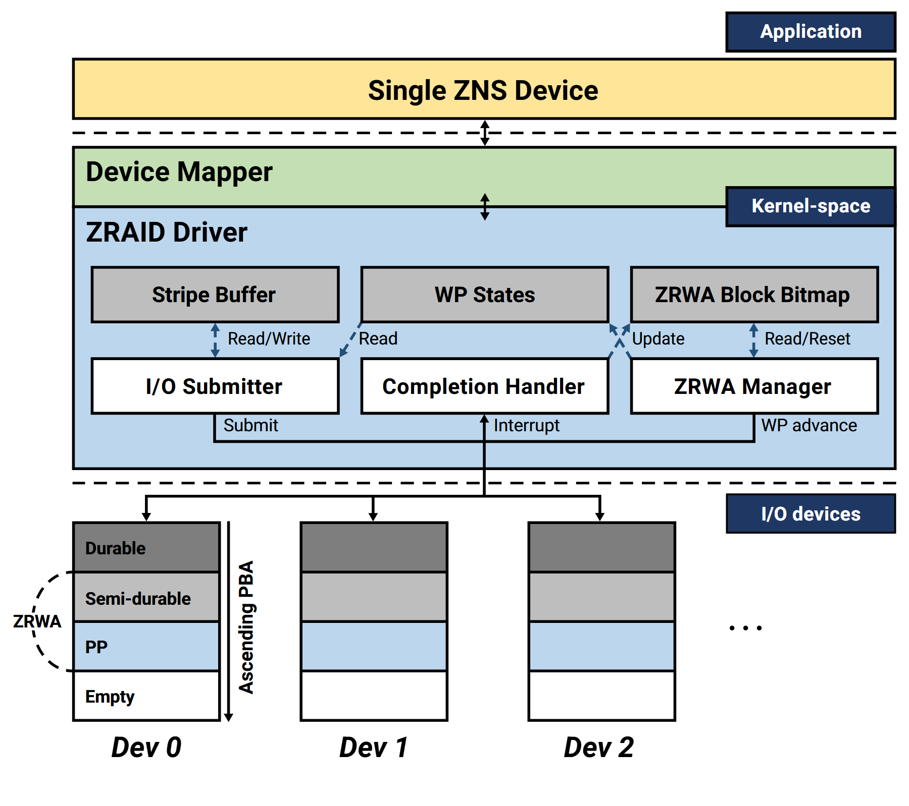

# VA-074 · 逻辑设备到多物理设备的驱动层

自上而下展示应用看到的单一逻辑设备、内部驱动以及多个实体设备。中部把缓存、写入状态与完成位图列成状态层，再用提交、完成处理和管理模块连接下层设备。底部条带强调数据所处阶段，而非普通服务器图标。



## 适用范围

- 聚合多设备的存储驱动
- 需要区分提交、完成和状态管理的架构

不适合：无设备抽象的业务流程；需要给出真实容量占比的统计图。

## 阅读顺序

1. 从顶端应用和逻辑设备确认对外接口。
2. 进入映射层和驱动区，区分状态对象与操作模块。
3. 沿下行箭头看提交，沿返回方向看完成通知。
4. 读底部设备条带及状态图例。

## 图形表达

**布局**：三个水平区域由虚线隔开；中部驱动是展开重点，底部设备等距排列。

**对象**：灰色矩形存放状态，白色矩形执行操作，设备用分段竖条展示持久、过渡和空闲状态。

**连线**：驱动内部箭头标读写或更新；跨层线区分提交、完成中断及写指针推进。

**配色**：黄条表示对外逻辑设备，浅绿映射层、浅蓝驱动层；底部灰蓝白编码存储阶段。

**文字**：驱动标题加粗；接口动词较小，必须留足与箭头间的空白。

## 部件与复用

| 部件 | 含义 | 改造方法 |
|---|---|---|
| 逻辑设备接口 (`logical-device`) | 多个实体对上呈现统一设备。 | 若对上暴露多个设备，应重画此层而非只改名字。 |
| 驱动内部 (`driver`) | 结合状态对象完成提交、回收和推进。 | 按真实责任拆分，不假设三个管理器都必需。 |
| 状态对象列 (`state-row`) | 缓存、写指针和完成位图各司其职。 | 改字段时同步核对所有读写箭头。 |
| 物理设备阵列 (`device-array`) | 多个设备具有不同存储阶段。 | 条带高度只在有依据时表达容量比例。 |

## 改造步骤

1. 明确每种状态的生产者、读取者与更新时点。
2. 虚线是抽象层边界，不代表网络通信。
3. 改变设备数后检查上层映射和底部地址方向标记。

## 新情景示例（假设）

假设用于多磁盘遥感影像写入服务。

上层为影像卷，中部负责缓存分块、完成记录与回收，下层为多块持久存储。

若不使用写指针机制，换成真实提交游标或删除相关状态，重新定义条带图例。

## 编辑入口

**入口**：以 make_figure.py 为入口，先复制 example.json 作为当前情景配置；labels.json 定位标签，asset.json 定位部件。

**配置可改**：labels 可改文字和文字样式，components 可做显隐、平移和局部样式调整；elements 可定位矢量元素。配置只作用于已有几何，不会自动解决布局冲突。

**需改代码**：替换存储状态机、增减管理器或更改设备条带结构需编辑内部路径与矩形；配置不验证协议正确性。

**字体**：当前替换字体为 Roboto-Bold、Roboto-BoldItalic、Roboto-Regular。改字后检查字宽、基线及 PDF 字体嵌入；原图的逐字定位不保证能容纳更长名称。

准备独立工作副本：

```text
python "<SKILL>/scripts/prepare_architecture.py" --id VA-074 --out figures/architecture
```

在工作副本运行：

```text
python make_figure.py --config example.json --out . --parts
python render_architecture.py fig.svg
```

## 本图检查

- 完成回调与提交路径方向一致且不混淆。
- 位图更新箭头指向对应状态对象。
- 设备条带图例覆盖所有填色和空白。

部件图用于复用局部对象；跨边界的连接和共享容器仍需按新关系处理。示例名称、数值和曲线不是当前研究结果。

来源与许可见 [ATTRIBUTION.md](ATTRIBUTION.md)。
