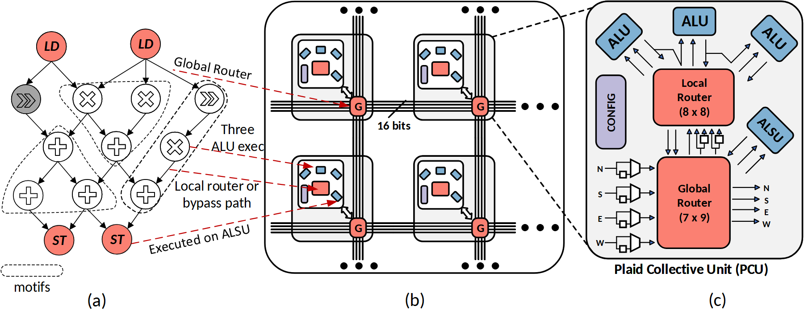

# VA-075 · 计算模式到阵列及单元内部的映射

三个视图分别展示逻辑依赖图、重复计算单元阵列和单个单元内部。左图用轮廓圈出可共同执行的局部模式，中间交代部署规模，右侧解释本地路由与运算器怎样配合。虚线映射跨过阵列视图，不能与阵列内部的真实连线混读。



## 适用范围

- 算法子图映射到硬件资源的解释
- 同时需要整体阵列和局部单元放大的架构

不适合：只有软件模块、不涉及资源映射；没有重复单元的单一集中式服务。

## 阅读顺序

1. 先看左侧依赖图及被圈出的重复模式。
2. 中间识别重复单元和横纵互连。
3. 右侧放大单元，区分本地和全局路由。
4. 返回映射虚线，核对图节点落到哪类资源。

## 图形表达

**布局**：逻辑图、阵列、放大图三栏紧排；中栏给整体，右栏给细节，不能省略中栏后仍保留放大关系。

**对象**：圆形算子构成逻辑图，嵌套方框代表阵列单元，右侧蓝色运算器围绕两个红色路由块。

**连线**：黑实线为数据路径，红虚线为逻辑到资源映射，黑虚线为放大引线；三者应加明确图例。

**配色**：蓝色表示计算，鲑红表示路由及部分读写节点，紫色表示配置；同色跨视图需结合形状解释。

**文字**：端口方位和位宽标签最细，应按输出宽度检查；三栏下的面板号保留以支持正文引用。

## 部件与复用

| 部件 | 含义 | 改造方法 |
|---|---|---|
| 依赖模式图 (`dependency-motifs`) | 算子依赖中存在可共同执行的局部组合。 | 按新算法重新圈模式，不保留不相关运算符。 |
| 重复单元阵列 (`tile-array`) | 多个同型单元通过共享线网互连。 | 改行列与总线，但省略号不代表已说明规模。 |
| 单元内部放大 (`unit-zoom`) | 计算、局部路由和全局端口的协作。 | 替换端口和连接度，删掉无依据的容量标注。 |
| 局部计算路由 (`local-router`) | 多个运算器围绕本地路由形成紧耦合组。 | 独立复用时补上输入输出界面；与单元放大组存在嵌套。 |

## 改造步骤

1. 先建立逻辑节点到计算资源的映射表，再画跨面板虚线。
2. 按真实硬件更新端口数、互连位宽和路由容量。
3. 若只需一个单元，可删阵列面板并把映射改成直接两栏。

## 新情景示例（假设）

假设展示图像处理算子到可重构阵列的映射。

左边为滤波与阈值依赖，中间为处理块网格，右边为块内算子和交换结构。

重建左图算子，映射线指向所需执行部件；没有全局路由器时改为边界交换接口。

## 编辑入口

**入口**：以 make_figure.py 为入口，example.json 提供编辑配置，labels.json 用于查文字键，asset.json 对应下列部件。

**配置可改**：labels 改指定文字与字号；components 可显隐、平移和改属性；elements 修改单个矢量对象。平移保留固定几何，不会自动重新布线。

**需改代码**：改变阵列规模、算子数量或映射关系需修改重复几何、路由线和引线。 必须在 customize() 中处理新增矢量对象及连接，不能只扩大文字框。

**字体**：当前字体映射使用 Carlito-Bold.ttf, Carlito-BoldItalic.ttf, Carlito-Regular.ttf；换标签后按最终插入宽度检查字宽、上下标和边界，不直接继承小字号。

准备独立工作副本：

```text
python "<SKILL>/scripts/prepare_architecture.py" --id VA-075 --out figures/architecture
```

在工作副本运行：

```text
python make_figure.py --config example.json --out . --parts
python render_architecture.py fig.svg
```

## 本图检查

- 跨面板虚线是否误落中间阵列而丢失目标。
- 局部与全局端口方向是否对应真实传输。
- 修改嵌套 local-router 与 unit-zoom 时是否重复移动同一元素。

部件图用于复用局部对象；跨边界的连接和共享容器仍需按新关系处理。示例名称、数值和曲线不是当前研究结果。

来源与许可见 [ATTRIBUTION.md](ATTRIBUTION.md)。
