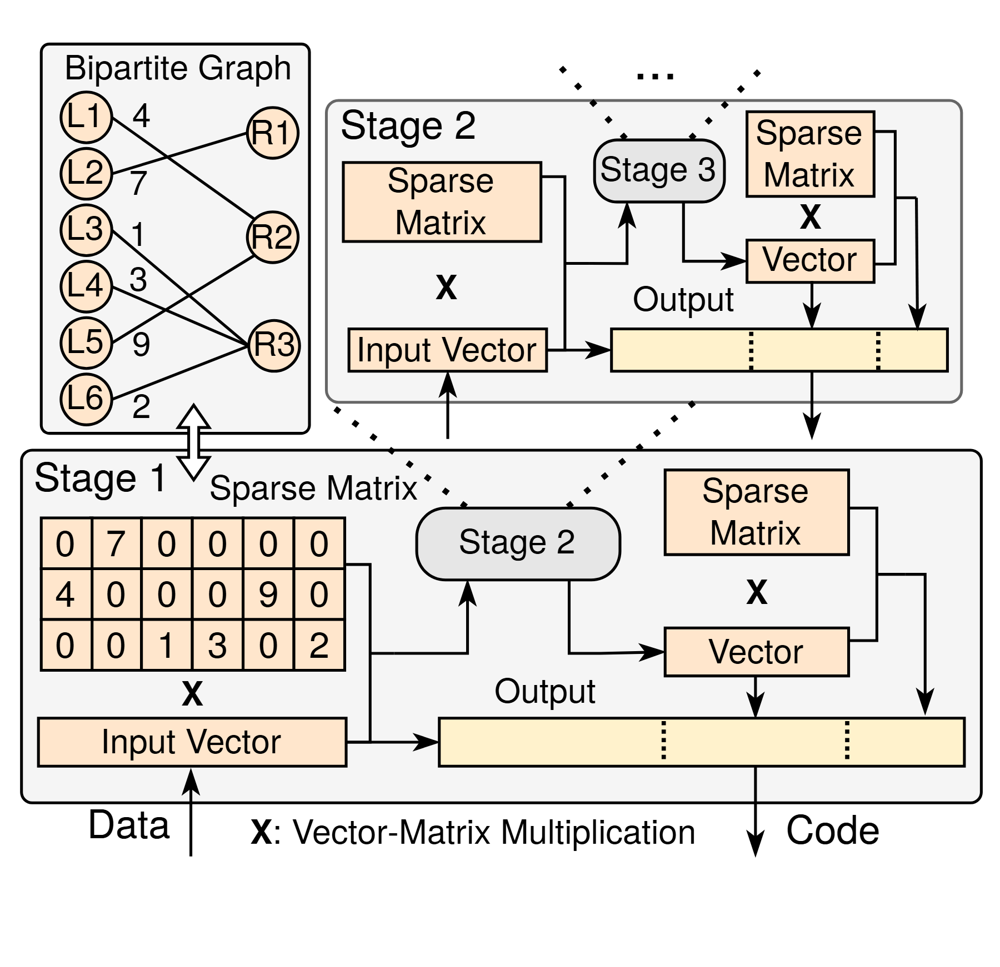

# VA-035 · 递归运算中的图矩阵对应与回传

下方给出一个完整运算阶段，上方缩小展开下一递归层，左上再用二部图解释稀疏矩阵的来源。它同时回答对象如何表示、子问题如何调用、返回量如何拼接三件事。递归层并非普通顺序模块，进入与返回路径必须一起保留。



## 适用范围

- 有明确子问题调用与回传的递归编码或算法
- 需要解释图结构到稀疏线性运算的对应

不适合：仅有串行处理步骤的流水线；不包含矩阵或递归关系的一般平台介绍。

## 阅读顺序

1. 先看左上二部图的两组节点与权重。
2. 对照下方矩阵和输入向量，理解一次运算。
3. 沿子阶段箭头进入上方缩略展开，再沿返回边回到输出拼接。

## 图形表达

**布局**：下大上小的嵌套展开，不按简单上下时间轴阅读；图与矩阵紧邻以便对照。

**对象**：圆节点和带权边表示图，方格矩阵表示数值关系，横向向量条表示有序输出。

**连线**：实线箭头传递操作数与结果，点状引线解释下一层展开；双向提示线表示表示法对应。

**配色**：浅橙矩阵与浅黄向量区分操作数类型；灰底框表示阶段范围，颜色不表示数值大小。

**文字**：运算符 X 需要脚注式定义；矩阵数字必须可读，并与图边权一致。

## 部件与复用

| 部件 | 含义 | 改造方法 |
|---|---|---|
| 二部关系图 (`bipartite-map`) | 两类对象的稀疏带权联系。 | 改节点与边时同步改矩阵非零项。 |
| 递归层展开 (`recursive-stage`) | 次级阶段继续调用更小阶段。 | 用子问题编号而非时间编号，按真实终止条件截断。 |
| 主运算阶段 (`base-stage`) | 一次乘法、子调用、回传和输出构成完整局部算法。 | 替换算子时重新检查所有输入的维数。 |
| 分段输出条 (`vector-output`) | 把不同来源结果放到同一有序向量。 | 解释每段来自输入、递归还是后处理，并改段长。 |

## 改造步骤

1. 先写清输入维数、矩阵形状和返回维数，再调整图中的块大小。
2. 没有具体数值证据时将矩阵改成符号示例，不能保留无关边权。
3. 保留一层详细展开和一层缩略递归，深层用带说明的省略符号。

## 新情景示例（假设）

假设展示递归式网络编码教学方案。

二部节点代表输入符号与校验符号，矩阵记录参与关系，子阶段继续处理缩小后的向量。

按自定义编码规则重建矩阵与向量分段；若改为非线性算子需替换乘法符号与图例。

## 编辑入口

**入口**：以 make_figure.py 为入口，example.json 提供编辑配置，labels.json 用于查文字键，asset.json 对应下列部件。

**配置可改**：labels 改指定文字与字号；components 可显隐、平移和改属性；elements 修改单个矢量对象。平移保留固定几何，不会自动重新布线。

**需改代码**：改变递归层数、矩阵规模或输出分段必须重建网格与连接，而不是仅替换数字。 必须在 customize() 中处理新增矢量对象及连接，不能只扩大文字框。

**字体**：当前字体映射使用 texgyreheros-bold.otf, texgyreheros-regular.otf；换标签后按最终插入宽度检查字宽、上下标和边界，不直接继承小字号。

准备独立工作副本：

```text
python "<SKILL>/scripts/prepare_architecture.py" --id VA-035 --out figures/architecture
```

在工作副本运行：

```text
python make_figure.py --config example.json --out . --parts
python render_architecture.py fig.svg
```

## 本图检查

- 二部图的每条边是否都有对应非零矩阵项。
- 递归返回箭头是否回到主阶段正确拼接位置。
- 输出段长是否与各来源维数相符。

部件图用于复用局部对象；跨边界的连接和共享容器仍需按新关系处理。示例名称、数值和曲线不是当前研究结果。

来源与许可见 [ATTRIBUTION.md](ATTRIBUTION.md)。
