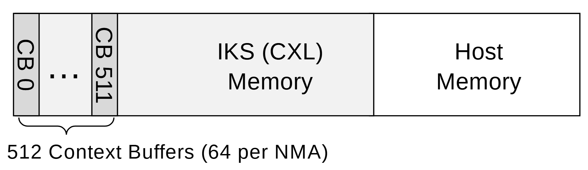

# VA-105 · 主机地址空间与上下文缓冲分区条带

用一个连续横条并置上下文缓冲、设备内存与主机内存，左端首尾编号和省略号表示大量重复缓冲区。此资产实际只包含地址映射子图，可作为较大系统图中的局部资源布局。



## 适用范围

- 描述同一逻辑地址域中的不同资源区间
- 在系统总图旁补充控制区与数据区的映射

不适合：需要 CPU、设备、处理引擎四层连接的完整硬件架构；需要用宽度精确比较真实容量的定量图。

## 阅读顺序

1. 从最左侧竖排 CB 0 与 CB 511 识别重复上下文区。
2. 读中间 IKS (CXL) Memory 与右侧 Host Memory 两个地址区。
3. 最后读下方括线和 512 Context Buffers (64 per NMA)，核对其作用范围。

## 图形表达

**布局**：单行长矩形按竖线划分资源区，缓冲区放在左端；下方另留数量注释。

**对象**：矩形分区、首尾两个窄格、省略号和下括线共同表达区间与重复。

**连线**：没有数据流箭头；边界线表达地址分隔，括线只指向缓冲区。

**配色**：灰色用于缓冲和设备区，右侧主机区接近白色，色差很轻。

**文字**：主体是紧凑无衬线字，CB 编号竖排，两个大区名称分为两行。

## 部件与复用

| 部件 | 含义 | 改造方法 |
|---|---|---|
| 完整地址空间条带 (`address-map`) | 连续外框、上下文格与两大内存区组成完整地址分区。 | 作为完整横条嵌入系统图；外框跨区共享，不可把两大区当作各自独立边框。 |
| 上下文缓冲条带 (`context-strip`) | 首尾缓冲格代表同一组重复控制区。 | 增加缓冲数量只改首尾编号及注释；需要展示更多格时重分窄格。 |
| 缓冲数量注释 (`buffer-caption`) | 补充重复数量与每设备分配数量。 | 同步更新总数和每实例数量，括线边界随缓冲区宽度调整。 |

## 改造步骤

1. 先确定横条是地址分区而不是工作流，避免新增无依据的流向箭头。
2. 同步改首尾 CB 编号、总数与每实例数，不能只改主标签。
3. 若改变分区宽度，在 customize 中同时调整相邻边界与括线；配置不自动伸缩。

## 新情景示例（假设）

假设示例：边缘网关的统一地址映射

左端映射控制邮箱，中部映射共享数据缓冲，右端映射主机工作区。

替换内存名称与邮箱计数；增加新地址区时重新分割横条并移动边界。

## 编辑入口

**入口**：make_figure.py 调用本包共享运行库；example.json 配置本图实例，labels.json 定位可编辑文字，asset.json 登记语义部件。运行 python make_figure.py --config example.json --out . --parts 生成整图及部件。

**配置可改**：labels、components 支持既有文字、配色、显隐和位移；修改配置不会自动重排布局或重接跨部件箭头。

**需改代码**：改变对象数量或拓扑时在 customize(root, context) 中编辑矢量；新元素设置 data-asset-key 并登记到部件 element_keys。重叠语义区域不可同时移动同一元素。

**字体**：图面为 Arial/Calibri 风格无衬线，竖排编号需保留旋转方向。最终字体文件以构建映射为准；局部 font_size 使用源坐标，不能直接视为纸面 pt。本批构建已确认并嵌入完整字体：Arimo-Bold.ttf, Arimo-Regular.ttf, Carlito-Regular.ttf, STIXTwoMath-Regular.ttf。映射可能改变原字形和字宽，需按实际论文尺寸复核。

准备独立工作副本：

```text
python "<SKILL>/scripts/prepare_architecture.py" --id VA-105 --out figures/architecture
```

在工作副本运行：

```text
python make_figure.py --config example.json --out . --parts
python render_architecture.py fig.svg
```

## 本图检查

- CB 首尾编号与数量说明是否一致。
- 竖排标签是否仍位于窄格内部。
- 分区之间是否出现双线、缝隙或重叠。
- 下方括线是否只覆盖上下文区。

部件图用于复用局部对象；跨边界的连接和共享容器仍需按新关系处理。示例名称、数值和曲线不是当前研究结果。

来源与许可见 [ATTRIBUTION.md](ATTRIBUTION.md)。
