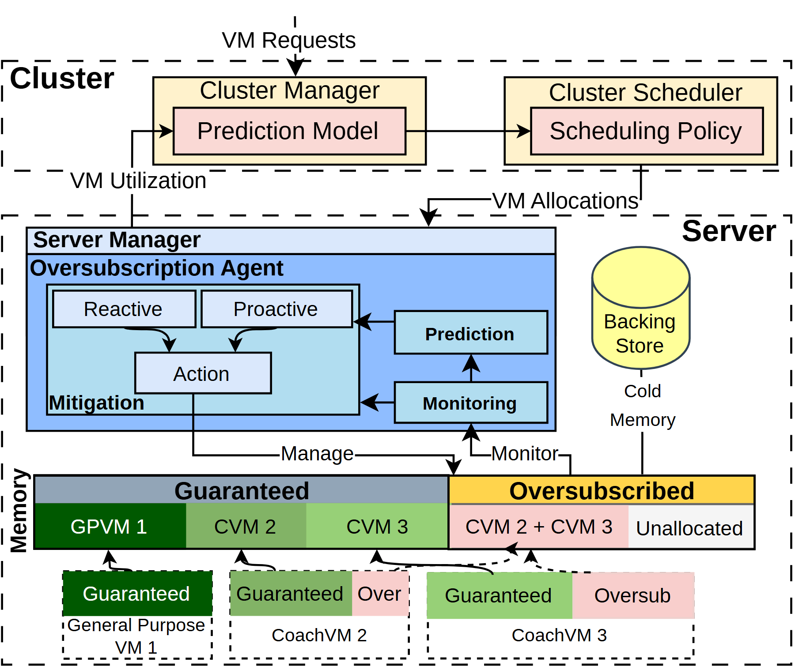

# VA-005 · 全局预测与局部响应的分层资源分配

这张图把资源决策拆成两个时间尺度：上层依据需求与使用情况决定分配，下层监测冲突并执行预防或事后响应。底部连续资源条与三个实例卡片对应，使控制过程能落到具体份额。适合解释“谁决定、谁执行、资源如何分摊”，不用于直接展示性能优劣。



## 适用范围

- 有全局调度及节点自治的资源管理
- 需要区分保底份额与共享弹性份额

不适合：只有单层规则的流程；不能用可分割份额表达的对象。

## 阅读顺序

1. 从顶部请求进入预测与调度两个框。
2. 沿向下的分配箭头进入局部代理，再辨认使用率向上的反馈。
3. 在局部区读取监测、预测和两种响应如何汇入动作。
4. 沿管理箭头查看资源条，最后对照底部各实例的占用。

## 图形表达

**布局**：上窄下宽的上下层虚线容器，局部代理左置、后备池右置；底部横带横跨下层。

**对象**：矩形表示职责，嵌套框表示归属，圆柱表示后备存储，分段横带表示份额。

**连线**：黑色有向线区分请求、分配、监测和管理；利用率回路从局部返回全局。

**配色**：蓝色集中在局部控制区，绿色表示保底占用，粉色表示弹性部分，黄色区分后备资源与份额标题。

**文字**：无衬线短标题，粗体用于层级；底部实例文字比模块标题紧凑，长名称应换行而非继续缩小。

## 部件与复用

| 部件 | 含义 | 改造方法 |
|---|---|---|
| 全局规划 (`cluster-planning`) | 需求估计与放置决策串接。 | 把预测量和分配对象写清，保留两个不同职责。 |
| 局部响应 (`local-agent`) | 监测和预测驱动主动、被动两路动作。 | 没有预测时删去对应分支及入线。 |
| 后备资源 (`backing-store`) | 与主资源带相连的备用空间。 | 注明容量或启用条件，不暗示无限供应。 |
| 份额横带 (`resource-band`) | 保底、弹性和未分配区并列。 | 份额数量改变时重新划分宽度。 当前独立导出仅含文字与箭头，缺少整图中的横带色块；复用前补齐色块的 element_keys，不能直接当完整横带使用。 |
| 实例映射 (`instance-allocation`) | 每个实例以同色段对应上方资源。 | 同步改对象数、分段和对应箭头。 当前独立导出顶部含截断的跨界箭头；复用前重新划分连接归属并清理残片。 |

## 改造步骤

1. 先确定两层控制边界及反馈变量。
2. 按新对象重建份额类别和配色映射。
3. 份额宽度若不按数据绘制，应标为示意。

## 新情景示例（假设）

可用于园区充电容量协调。

全局层映射到需求预测和站点分配，局部层映射到充电站限流，绿色与粉色分别表示保底和可借用容量。

需把后备存储改为确实存在的备用电源，并按站点数重画底部卡片。

## 编辑入口

**入口**：运行 make_figure.py；example.json 为配置，labels.json 查文字键，asset.json 查部件。使用 --parts 导出独立矢量部件。

**配置可改**：labels 可改文字及字体；components 可设置 visible、dx/dy、attributes；elements 可按键改图元属性。移动量使用整图 viewBox 单位，重叠部件只选一个层级移动。

**需改代码**：增删节点、调整连接和重排结构须在 customize() 中处理；新增图元使用唯一 data-asset-key，并登记至相应部件 element_keys。配置不会自动排版。

**字体**：本图使用 Arimo-Bold.ttf、Arimo-Regular.ttf。font_size 是图元局部坐标单位，受既有缩放影响，不等于纸面 pt；改字后检查实际字宽与最终阅读尺寸。

准备独立工作副本：

```text
python "<SKILL>/scripts/prepare_architecture.py" --id VA-005 --out figures/architecture
```

在工作副本运行：

```text
python make_figure.py --config example.json --out . --parts
python render_architecture.py fig.svg
```

## 本图检查

- 上下两层反馈方向是否与变量定义一致。
- 底部实例颜色是否与份额条一一对应。
- 资源分段及长标签是否越过容器边界。
- 独立导出的份额横带是否补齐色块，实例映射顶部是否清理截断箭头；这是当前部件划分的已知限制。

部件图用于复用局部对象；跨边界的连接和共享容器仍需按新关系处理。示例名称、数值和曲线不是当前研究结果。

来源与许可见 [ATTRIBUTION.md](ATTRIBUTION.md)。
