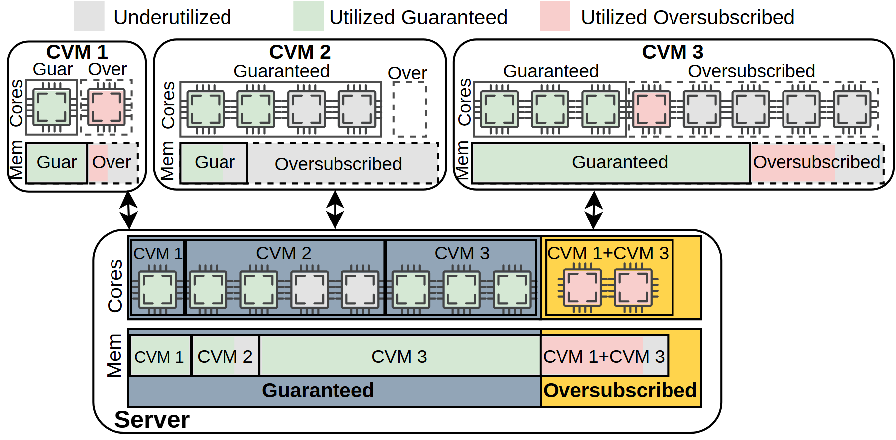

# VA-076 · 租户配额到实体资源池映射

上方三个不同规模租户分别展示计算和内存资源，下方聚合到统一实体池。保障份额与超额共享区通过区域边界区分，使用状态通过灰绿粉三色区分，适合解释逻辑配额和实际资源占用之间的关系。



## 适用范围

- 多租户保障配额与共享超额资源说明
- 计算和内存两种资源需要并行展示的方案

不适合：颜色即可证明超额配置安全性的结论图；需要精确容量比较却没有数值支撑的统计图。

## 阅读顺序

1. 先读顶端三色图例，区分闲置、保障使用和超额使用。
2. 横向比较三个租户的计算行与内存行。
3. 沿双向映射箭头下看实体资源池。
4. 最后对照池内保障区和黄色超额共享区的边界。

## 图形表达

**布局**：上部三卡片宽度随展示内容变化，下部一张总池；每卡都按计算、内存两行对齐。

**对象**：芯片图标代表计算槽，横条代表内存分区，虚线内部框标逻辑份额或可用位置。

**连线**：双向箭头表示逻辑与实体映射，不是实时数据传输；下方邻接关系不是操作顺序。

**配色**：灰表示未充分使用，绿表示已用保障份额，粉表示已用超额份额；黄色底层区域专指超额池。

**文字**：租户名加粗；计算、内存行标签竖排，短配额标签避免挤占芯片内部。

## 部件与复用

| 部件 | 含义 | 改造方法 |
|---|---|---|
| 状态图例 (`allocation-key`) | 定义三种资源使用状态。 | 改状态名必须同时改全部芯片和内存块，别把容量区域颜色混入图例。 |
| 小规模租户 (`tenant-one`) | 展示少量保障与超额位置。 | 可改低配额服务，注意计算与内存比例不应由框宽自动推断。 |
| 中规模租户 (`tenant-two`) | 具有更多保障计算位置的配置。 | 按真实配额调整芯片数和内存分段。 |
| 大规模租户 (`tenant-three`) | 同时拥有较多保障与超额资源的租户。 | 重画两类边界，维护标签在跨行相同位置的对应。 |
| 统一实体池 (`physical-server`) | 所有租户映射到保障区和共享超额区。 | 资源归属名称须与上方一致，共享块可列多个租户而不重复计数。 |

## 改造步骤

1. 先定义保障、超额、已用、闲置四个概念，避免混为一维。
2. 整理租户到实体资源映射，再画池内分区。
3. 若无真实数量，注明示意并避免从图形面积推导容量。
4. 新租户加入须同时修改上方卡片和底部共享块。

## 新情景示例（假设）

假设绘制三实验组的计算集群配额。

三个租户改为实验组，保障池对应最低保留资源，超额池对应空闲时可借用资源。

把共用份额改成可回收借用，并明确回收规则；不从粉色占用推断性能提升。

## 编辑入口

**入口**：运行 make_figure.py，以 example.json 为改造配置；labels.json 查文字键，--parts 同步导出部件。

**配置可改**：labels 改文字，components 改显示、位移及样式，elements 改单个矢量属性；只选一个部件层级移动，避免重叠归属使对象移动两次。

**需改代码**：这是可编辑矢量结构，未实现自动布局。增删模块、改变连接或重新排版，须在 customize() 中改真实对象并更新部件成员。

**字体**：使用随包完整映射字体；改字后核查换行、符号和最终纸面字号。font_size 是对象局部单位，不能直接当作 PDF 的磅值。

准备独立工作副本：

```text
python "<SKILL>/scripts/prepare_architecture.py" --id VA-076 --out figures/architecture
```

在工作副本运行：

```text
python make_figure.py --config example.json --out . --parts
python render_architecture.py fig.svg
```

## 本图检查

- 同一实体核是否被多个租户重复画成独占。
- 图例的使用状态和黄色池范围是否混淆。
- 计算和内存的保障边界是否各自一致。

部件图用于复用局部对象；跨边界的连接和共享容器仍需按新关系处理。示例名称、数值和曲线不是当前研究结果。

来源与许可见 [ATTRIBUTION.md](ATTRIBUTION.md)。
