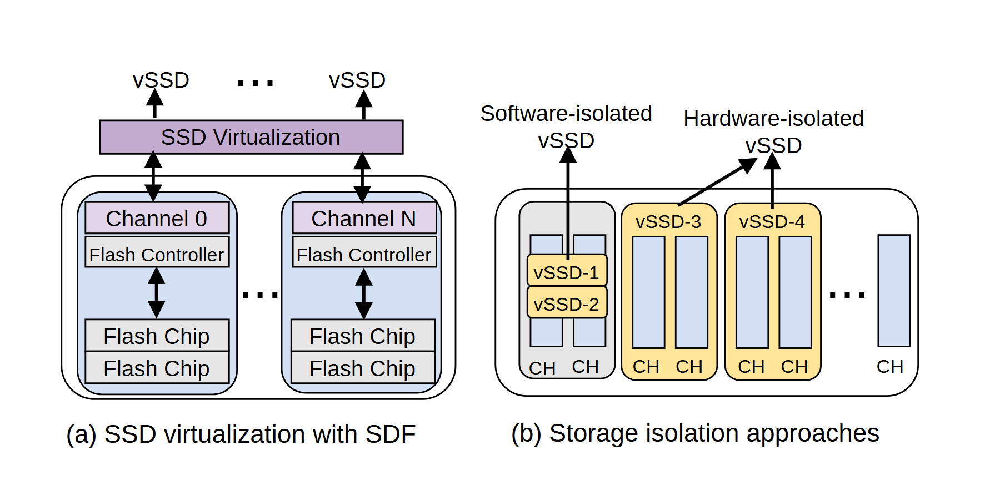

# VA-036 · 虚拟资源栈与共享独占对照

左面板先解释虚拟实例如何经统一映射层访问多个实体通道，右面板再比较共享与独占两类隔离边界。它把通用背景和关键方案差异放在同一张图中，读者可以直接比较资源归属，而不是只读策略名称。



## 适用范围

- 虚拟资源与实体资源关系的背景说明
- 共享隔离和独占隔离的结构对照

不适合：需要证明性能优劣的实验图；多于两种且边界复杂的策略大全。

## 阅读顺序

1. 看左图顶部虚拟实例和横向映射层。
2. 向下查看重复通道内的控制器及资源。
3. 转到右图，先看共享区域中两个实例。
4. 最后对照黄色独占区及各自连接，核查物理归属。

## 图形表达

**布局**：左右双面板，左为纵向层级，右为横向资源分区；底部面板说明对齐。

**对象**：长条表示统一抽象层，圆角大框包实体设备，窄条表示通道，内层小块表示资源。

**连线**：左侧双向箭头表示访问映射，右侧箭头连接实例与对应通道；并列本身不表示顺序。

**配色**：淡紫用于抽象层与控制，淡蓝标实体层，黄色强调独占范围；共享区保持中性。

**文字**：面板标题与对象标签分层；实例编号不能被长策略名挤掉。

## 部件与复用

| 部件 | 含义 | 改造方法 |
|---|---|---|
| 虚拟化映射栈 (`virtualized-stack`) | 从上层实例经过映射层到多个底层通道。 | 替换抽象对象与物理设备，保留一对多映射的真实含义。 |
| 通道内控制单元 (`channel-unit`) | 一个控制者管理若干底层资源的层次单元。 | 复用为车间控制器加设备，移动时别再次移动包含它的整栈。 |
| 共享与独占分区 (`isolation-partitions`) | 用资源条是否跨实例边界展示两种隔离。 | 按真实归属重画边界；颜色不能替代共享关系的可见结构。 |

## 改造步骤

1. 先确认比较维度是资源归属，而非性能或公平程度。
2. 在两个面板使用相同的实例、通道和设备词汇。
3. 共享策略需要画出多个实例共同占用，独占策略需要互不重叠的范围。
4. 如果新增混合策略，应扩展第三面板，不压缩现有两个。

## 新情景示例（假设）

假设说明共享实验仪器与专用实验仪器两类配置。

虚拟实例改为研究任务，通道改为仪器时段，控制器改为预约管理。

共享区画多任务共用时段，专用区画独占仪器；改掉存储专用图标和访问箭头含义。

## 编辑入口

**入口**：运行 make_figure.py，以 example.json 为改造配置；labels.json 查文字键，--parts 同步导出部件。

**配置可改**：labels 改文字，components 改显示、位移及样式，elements 改单个矢量属性；只选一个部件层级移动，避免重叠归属使对象移动两次。

**需改代码**：这是可编辑矢量结构，未实现自动布局。增删模块、改变连接或重新排版，须在 customize() 中改真实对象并更新部件成员。

**字体**：使用随包完整映射字体；改字后核查换行、符号和最终纸面字号。font_size 是对象局部单位，不能直接当作 PDF 的磅值。

准备独立工作副本：

```text
python "<SKILL>/scripts/prepare_architecture.py" --id VA-036 --out figures/architecture
```

在工作副本运行：

```text
python make_figure.py --config example.json --out . --parts
python render_architecture.py fig.svg
```

## 本图检查

- 右图共享实例是否确实跨用同一资源条。
- 黄色边界是否只包各自独占资源。
- 通道部件与整栈一起位移时是否发生重复偏移。

部件图用于复用局部对象；跨边界的连接和共享容器仍需按新关系处理。示例名称、数值和曲线不是当前研究结果。

来源与许可见 [ATTRIBUTION.md](ATTRIBUTION.md)。
