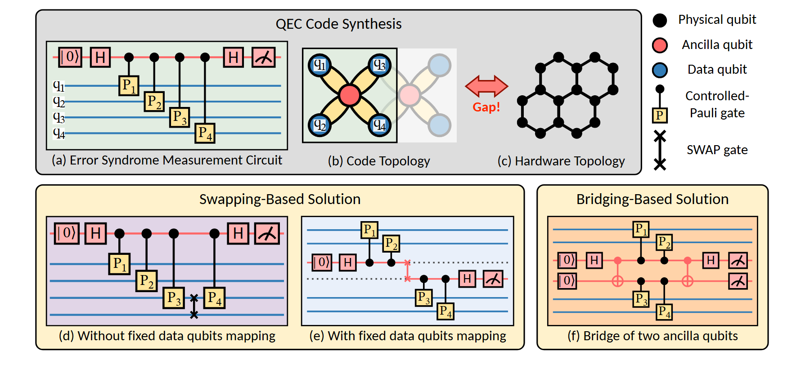

# VA-106 · 拓扑约束与两类映射方案对照矩阵

上排把逻辑测量线路、逻辑连接与硬件连接放在一个灰底问题区，下排并列交换式与桥接式方案。既能说明约束来自哪里，又能比较为适配约束而付出的结构改变。



## 适用范围

- 先展示目标拓扑与可用拓扑的差距，再比较两类改造方案
- 需要统一节点颜色和线路符号的多面板方法比较

不适合：仅表达一个算法的线性执行顺序；没有共享符号语义的多张独立结果图。

## 阅读顺序

1. 先读上排左侧线路，理解输入操作与连接要求。
2. 读中央逻辑星形与右侧蜂窝硬件拓扑，红色 Gap 箭头强调不匹配。
3. 比较下排左侧无固定映射和固定映射两种交换方式。
4. 最后读右下桥接方案，并用右上共享图例核对符号。

## 图形表达

**布局**：上大下分的两层布局；下层左宽右窄，六个字母面板按问题与解法组织。

**对象**：小圆点表示节点，水平线表示线路，黄色门框与交叉交换符号承载不同操作。

**连线**：竖线及受控点表示线路耦合；红色双向 Gap 箭头属于说明而非执行数据流。

**配色**：蓝色数据节点与线路、红色辅助节点、黑色硬件点、浅黄色操作门；灰底问题区与奶黄方案区区分层级。

**文字**：面板名使用紧凑无衬线字；线路 q 下标和 P 下标需保持数学标签辨识度。

## 部件与复用

| 部件 | 含义 | 改造方法 |
|---|---|---|
| 目标测量线路 (`problem-circuit`) | 上排左侧线路给出目标操作序列。 | 替换操作门与线路数时保持上下方案具有同一输入要求。 |
| 逻辑与硬件拓扑差距 (`topology-gap`) | 逻辑星形、稀疏硬件网格和 Gap 共同构成问题陈述。 | 换成业务依赖图与部署网络；重画节点连接，保留差距提示。 |
| 两种交换映射方案 (`swapping-solutions`) | 共享大框中的两个线路面板分别体现映射约束。 | 改造两个方案时保持线路语义一致，勿仅替换标题。 |
| 桥接映射方案 (`bridge-solution`) | 右下独立面板用两条辅助线路实施桥接。 | 可改为中继节点或辅助流程；增减辅助线需重接门和受控点。 |
| 节点与门符号图例 (`symbol-legend`) | 统一解释多面板使用的节点和操作符号。 | 新增符号同步补图例，颜色不能在下排换含义。 |

## 改造步骤

1. 先写清两种拓扑的节点和边分别代表什么，再选用此矩阵。
2. 用同一组输入要求改写所有比较面板，保证差异来自方案而非任务。
3. 在 customize 中更改线路、门或节点数量；跨面板位置调整须保持上下对齐。
4. 保留一份共享图例并同步所有符号颜色。

## 新情景示例（假设）

假设示例：传感器逻辑通信与实际无线网络的映射比较

上排换成采样任务依赖与可用无线拓扑；下排对比移动转发节点和固定中继方案。

重建逻辑边与可用边，用发送/接收符号替代量子门；不把原门操作解释为网络协议。

## 编辑入口

**入口**：make_figure.py 调用本包共享运行库；example.json 配置本图实例，labels.json 定位可编辑文字，asset.json 登记语义部件。运行 python make_figure.py --config example.json --out . --parts 生成整图及部件。

**配置可改**：labels、components 支持既有文字、配色、显隐和位移；修改配置不会自动重排布局或重接跨部件箭头。

**需改代码**：改变对象数量或拓扑时在 customize(root, context) 中编辑矢量；新元素设置 data-asset-key 并登记到部件 element_keys。重叠语义区域不可同时移动同一元素。

**字体**：普通面板文字为无衬线，线路变量和下标带数学排版特征。最终字体文件以构建映射为准；局部 font_size 使用源坐标，不能直接视为纸面 pt。本批构建已确认并嵌入完整字体：Carlito-Bold.ttf, Carlito-Regular.ttf, DejaVuSans.ttf, STIXTwoMath-Regular.ttf。映射可能改变原字形和字宽，需按实际论文尺寸复核。

准备独立工作副本：

```text
python "<SKILL>/scripts/prepare_architecture.py" --id VA-106 --out figures/architecture
```

在工作副本运行：

```text
python make_figure.py --config example.json --out . --parts
python render_architecture.py fig.svg
```

## 本图检查

- 六个面板是否仍能按问题到方案阅读。
- 同色节点在各面板是否含义一致。
- Gap 是否清楚连接两种拓扑而不是指向线路门。
- 新增边是否与线路交点的实心控制点混淆。

部件图用于复用局部对象；跨边界的连接和共享容器仍需按新关系处理。示例名称、数值和曲线不是当前研究结果。

来源与许可见 [ATTRIBUTION.md](ATTRIBUTION.md)。
