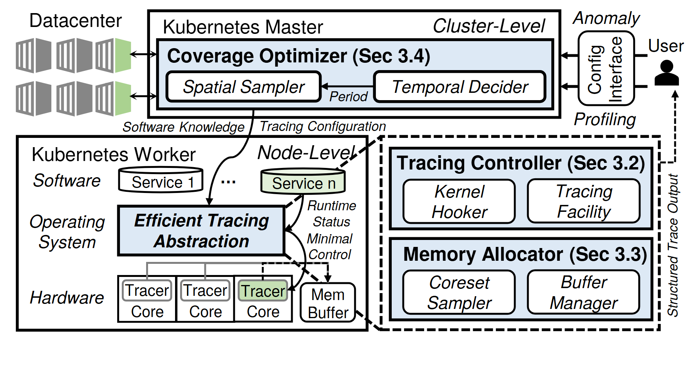

# VA-077 · 全局观测规划与节点内采集控制

上部全局规划器决定观察哪些对象及何时观察，下部节点栈显示服务、系统抽象与硬件采集。右侧放大两个局部管理模块，分别控制采集操作与缓存资源，最右人员接口连接配置及输出。图的核心是跨层协调，而非单条数据处理链。



## 适用范围

- 观测系统同时涉及全局策略和节点实现
- 采集控制与缓存分配需要分别解释

不适合：没有分层实现的监控面板；只展示检测模型输入输出。

## 阅读顺序

1. 由右上配置入口进入全局空间选择及时间决策。
2. 沿配置线进入左下节点的服务、系统、硬件三层。
3. 读取右侧采集控制器与资源管理器的内部职责。
4. 区分运行状态返回与最右侧结构化结果输出。

## 图形表达

**布局**：全局长条在上，节点层叠区在左下，两个局部模块纵置右下；人员与输出占右边窄栏。

**对象**：服务用圆柱，节点内部为分层矩形，硬件用重复小单元，右侧虚线大框将两类管理模块归组。

**连线**：实线负责配置和控制，点线输出观测结果；多条跨层曲线应在标签处明确所传对象。

**配色**：浅蓝凸显关键管理模块，浅绿标记部分活动服务或采集单元；背景保持白色以容纳密集连接。

**文字**：大模块标题加粗，内部职责与层名有斜体区分；迁移时删除旧章节号并重排多行标题。

## 部件与复用

| 部件 | 含义 | 改造方法 |
|---|---|---|
| 全局规划 (`global-control`) | 决定空间覆盖与时间采样。 | 替换两个决策量并保留不同职责。 |
| 操作入口 (`operator`) | 人员给出配置并接收结果。 | 仅保留确实存在的人机操作。 |
| 节点实现栈 (`node-stack`) | 服务、系统接口、硬件采集逐层对应。 | 按实际部署层级改写，别把逻辑层当物理设备。 |
| 采集控制 (`trace-controller`) | 控制钩子与采集设施协作。 | 替换为新系统的具体执行接口。 |
| 缓存管理 (`memory-control`) | 采样摘要与缓冲维护分工。 | 注明容量或更新规则，不暗示无成本缓存。 |

## 改造步骤

1. 先决定全局和节点各自能改变什么。
2. 分别标识配置、状态与结果三类信息。
3. 移除不适用平台名和章节号，保留必要层级。

## 新情景示例（假设）

可用于多厂区设备状态采集。

全局层映射为设备覆盖及采样频率，节点栈映射为产线服务、采集网关、传感单元，右侧管理采样器和缓冲。

将系统钩子替换为网关接口，按真实状态反馈重接跨层线。

## 编辑入口

**入口**：运行 make_figure.py；example.json 为配置，labels.json 查文字键，asset.json 查部件。使用 --parts 导出独立矢量部件。

**配置可改**：labels 可改文字及字体；components 可设置 visible、dx/dy、attributes；elements 可按键改图元属性。移动量使用整图 viewBox 单位，重叠部件只选一个层级移动。

**需改代码**：增删节点、调整连接和重排结构须在 customize() 中处理；新增图元使用唯一 data-asset-key，并登记至相应部件 element_keys。配置不会自动排版。

**字体**：本图使用 Arimo-Bold.ttf、texgyreheros-bold.otf、texgyreheros-bolditalic.otf、texgyreheros-italic.otf、texgyreheros-regular.otf。font_size 是图元局部坐标单位，受既有缩放影响，不等于纸面 pt；改字后检查实际字宽与最终阅读尺寸。

准备独立工作副本：

```text
python "<SKILL>/scripts/prepare_architecture.py" --id VA-077 --out figures/architecture
```

在工作副本运行：

```text
python make_figure.py --config example.json --out . --parts
python render_architecture.py fig.svg
```

## 本图检查

- 空间选择与时间决策是否各有明确输出。
- 右侧两模块控制线是否落到正确的采集或缓冲对象。
- 点线结果输出是否与控制反馈混淆。

部件图用于复用局部对象；跨边界的连接和共享容器仍需按新关系处理。示例名称、数值和曲线不是当前研究结果。

来源与许可见 [ATTRIBUTION.md](ATTRIBUTION.md)。
