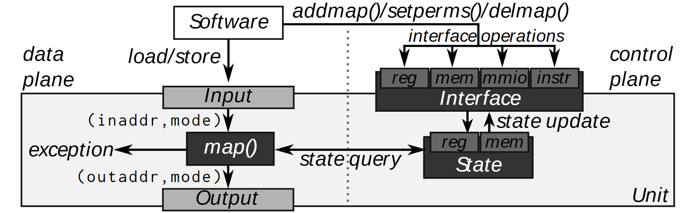

# VA-006 · 配置控制与有状态执行分离

一张扁宽图同时回答操作怎样执行、执行依据怎样改变。左侧以输入、处理、输出建立垂直主线，右侧把配置接口和共享状态上下叠放；横向查询跨过分界线，使读者看到执行依赖状态，而配置修改状态。异常从处理节点侧向退出，区别于正常输出。



## 适用范围

- 访问控制与规则执行
- 需要区分配置更新和业务请求的处理单元

不适合：无共享状态的纯数据管道；大量并行节点及其调度关系。

## 阅读顺序

1. 从顶部调用者跟随向下箭头进入输入
2. 沿处理块检查正常输出和侧向异常
3. 向右读查询通道连接的状态容器
4. 回到右上接口，追踪配置更新怎样到达状态

## 图形表达

**布局**：左右两区共用一个外部容器，左窄右宽；竖虚线分隔职责，不表示时间先后。

**对象**：深灰块是处理、接口、状态三个核心对象；浅灰输入输出条和顶部接口小格承担端口角色。

**连线**：细黑箭头区别请求、查询和更新；双向查询线表示往返访问，异常箭头必须保留明确出口。

**配色**：以灰阶区分核心与端口，没有红色告警或蓝色数据之类额外编码，黑白打印仍可读。

**文字**：说明性文字用斜体，参数使用等宽体；函数名和括号长度会影响输入通道宽度。

## 部件与复用

| 部件 | 含义 | 改造方法 |
|---|---|---|
| 请求发起者 (`software`) | 同时提供业务输入与配置调用，位置在处理单元外。 | 更换为真正能发起两类操作的角色；若职责分离，须拆成两个调用者。 |
| 有状态处理链 (`execution-path`) | 输入经过核心规则得到结果，也可能转向异常出口。 | 改写输入输出字段，并核实异常属于拒绝、失败还是旁路。 |
| 配置端口组 (`control-interface`) | 多个配置动作汇入同一个接口，再改变底部状态。 | 端口应按实际操作保留，新增端口需扩展接口宽度及箭头落点。 |
| 共享规则状态 (`state-store`) | 供处理链读取、由配置接口更新的持久上下文。 | 可换成规则表或参数集；不能把查询线和更新线互换。 |

## 改造步骤

1. 先确认业务读状态和控制写状态确实是两个职责
2. 替换所有参数和接口动作，保持一次请求对应一组输入输出
3. 增加错误类别时在侧面扩展分支，不挤入正常输出
4. 移除共享状态时应改用普通流水图，不能仅隐藏右半图

## 新情景示例（假设）

可用于设计一个规则驱动的订单审核器。

调用者映射为业务平台，处理链为订单审核，状态为额度与风控规则，接口为规则维护动作。

将地址参数换为订单字段；若规则维护由管理员发起，增加独立管理员入口，并为拒绝订单写明异常出口。

## 编辑入口

**入口**：make_figure.py 读取 example.json；labels.json 查文字键，asset.json 查部件键；输出 SVG，可用配套渲染脚本导出 PDF。

**配置可改**：labels 修改文字及字体属性；components 可设 visible、dx/dy、attributes；elements 修改单个对象属性。平移使用图的坐标单位，重叠部件不要同时平移。

**需改代码**：改变模块数量、连接关系或分栏布局须编辑 customize()，不会自动布线。新对象需唯一 data-asset-key，并加入对应部件 element_keys，才会随部件导出。

**字体**：本图映射字体：Arimo-Italic.ttf, Inconsolata-Regular.ttf。沿用完整字体覆盖新字符；font_size 是元素局部单位，不是纸面 pt。改长标签后检查字宽、裁切及最终 PDF。

准备独立工作副本：

```text
python "<SKILL>/scripts/prepare_architecture.py" --id VA-006 --out figures/architecture
```

在工作副本运行：

```text
python make_figure.py --config example.json --out . --parts
python render_architecture.py fig.svg
```

## 本图检查

- 查询箭头是否接到状态而非配置端口
- 正常输出与异常是否清楚分离
- 虚线两侧文字及横向查询标注是否重叠

部件图用于复用局部对象；跨边界的连接和共享容器仍需按新关系处理。示例名称、数值和曲线不是当前研究结果。

来源与许可见 [ATTRIBUTION.md](ATTRIBUTION.md)。
