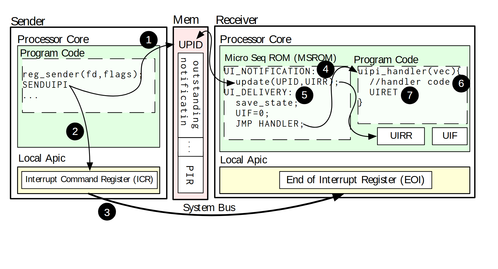

# VA-037 · 双端事件通知与共享状态交互

左侧发送端、中央共享状态、右侧接收端构成三个竖区。编号沿弧形和折线箭头穿过代码、通知状态、底部总线及接收处理，展示事件从发起到处理后恢复的过程。与普通流水线相比，它强调两端程序和底层通知机制交织。



## 适用范围

- 事件通知涉及共享状态和接收处理
- 需要把短代码片段放入端点内部解释

不适合：多对多网络拓扑；没有确认或状态恢复的单向数据搬运。

## 阅读顺序

1. 先辨认发送、共享状态及接收三栏。
2. 按前几个编号跟随发送端更新共享标志并发出通知。
3. 沿底部弧线到接收端，再读内部处理序列。
4. 最后查看处理程序与状态标志的恢复关系。

## 图形表达

**布局**：接收端比发送端更宽，中间狭长状态栏独立；底部大弧线绕开内部代码。

**对象**：外矩形为端点，浅色嵌套框为处理区，虚线框为代码片段，窄格表示共享标志。

**连线**：黑色有向弧线联系远距离状态，圆形编号给出阅读次序；箭头跨过框时不表示归属。

**配色**：浅绿色承载处理代码，浅黄色承载底层控制寄存器，粉色窄栏突出共享状态，黑白号码保持高对比。

**文字**：代码用等宽字体，模块用无衬线；保留缩进与换行，不能将长代码强塞进现有框。

## 部件与复用

| 部件 | 含义 | 改造方法 |
|---|---|---|
| 发送端 (`sender`) | 程序发起操作并关联本地通知寄存器。 | 把调用与发送状态作为一组修改。 |
| 共享状态 (`shared-state`) | 端点间可见的待处理位和通知标志。 | 按协议改字段，并解释谁写谁读。 |
| 接收端 (`receiver`) | 接收机制、处理代码和完成标志并列。 | 替换内部状态机时重编步骤。 |
| 底部通道 (`system-bus`) | 跨端点传递通知的外绕路径。 | 与共享状态访问区分，不误作同一数据通道。 |

## 改造步骤

1. 先列出端点动作及共享字段的读写顺序。
2. 保留两类通道的视觉区别：状态访问和通知传递。
3. 步骤数变化时重排圆形号码与路径，必要时放大接收区。

## 新情景示例（假设）

可用于任务生产者向工作线程发事件。

发送代码映射为提交任务，共享栏映射为待处理队列标志，接收代码映射为任务处理与确认。

需替换硬件专用寄存器及返回指令，并补画队列实际所在位置。

## 编辑入口

**入口**：运行 make_figure.py；example.json 为配置，labels.json 查文字键，asset.json 查部件。使用 --parts 导出独立矢量部件。

**配置可改**：labels 可改文字及字体；components 可设置 visible、dx/dy、attributes；elements 可按键改图元属性。移动量使用整图 viewBox 单位，重叠部件只选一个层级移动。

**需改代码**：增删节点、调整连接和重排结构须在 customize() 中处理；新增图元使用唯一 data-asset-key，并登记至相应部件 element_keys。配置不会自动排版。

**字体**：本图使用 Arimo-Regular.ttf、Inconsolata-Regular.ttf。font_size 是图元局部坐标单位，受既有缩放影响，不等于纸面 pt；改字后检查实际字宽与最终阅读尺寸。

准备独立工作副本：

```text
python "<SKILL>/scripts/prepare_architecture.py" --id VA-037 --out figures/architecture
```

在工作副本运行：

```text
python make_figure.py --config example.json --out . --parts
python render_architecture.py fig.svg
```

## 本图检查

- 每个编号是否紧贴唯一的动作或箭头。
- 共享标志是否有明确读者、写者和清除时机。
- 接收端代码是否与恢复箭头互相遮挡。

部件图用于复用局部对象；跨边界的连接和共享容器仍需按新关系处理。示例名称、数值和曲线不是当前研究结果。

来源与许可见 [ATTRIBUTION.md](ATTRIBUTION.md)。
