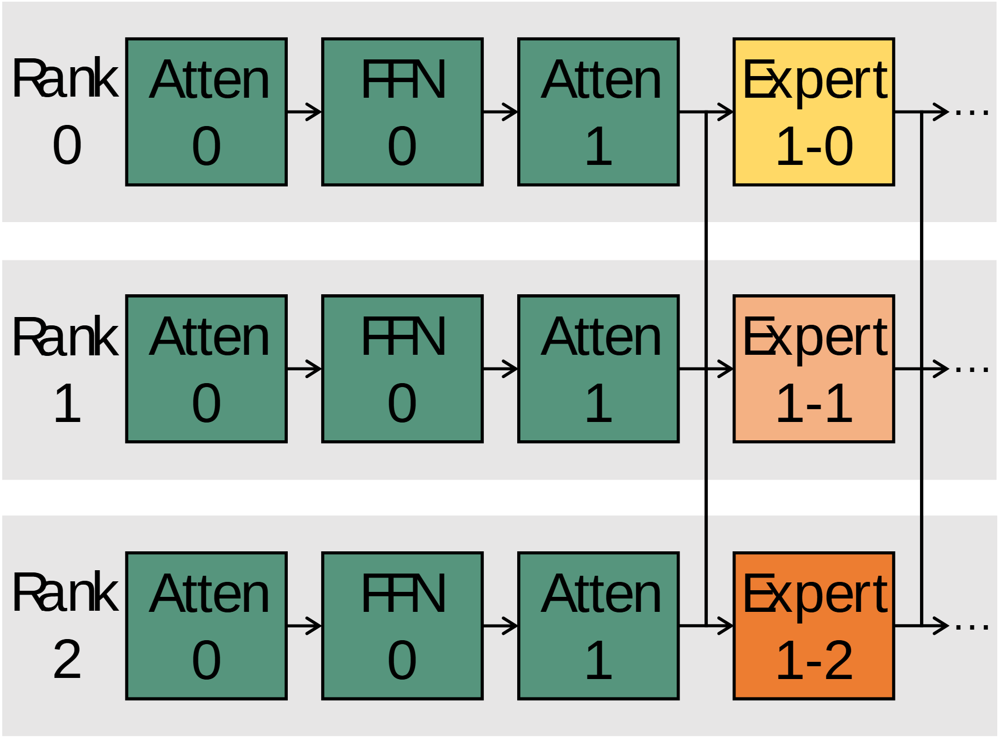

# VA-107 · 三条计算通道与专家分支互连

三条灰底 Rank 泳道重复同样的注意力与前馈前缀，末端用黄橙色区分专家分支，并通过跨泳道竖线表示连接。适合突出相同骨干与不同分支的并行部署。



## 适用范围

- 并行节点上共享计算前缀而末端承担不同专门功能
- 展示复制模块与分片模块之间的区别

不适合：完整训练优化器状态分布；表达每条通道完全独立且没有跨通道通信的流水线。

## 阅读顺序

1. 沿 Rank 0 从 Atten 0、FFN 0 读到 Atten 1。
2. 向下对比 Rank 1 和 Rank 2 的相同绿色前缀。
3. 观察三种黄橙专家模块的不同编号。
4. 核对专家前后两条纵向连接与各泳道箭头。

## 图形表达

**布局**：三行同宽灰底泳道，前三个绿色方块按列对齐，专家列单独着色。

**对象**：规则方块和短水平箭头形成重复节拍，末端省略号表示未展开后续。

**连线**：专家前后存在贯穿泳道的竖线；不是三条互不相干的单链。

**配色**：共享层统一深绿；三个专家依次黄色、浅橙、亮橙，背景浅灰。

**文字**：模块名大号无衬线并分两行，Rank 与编号也分行放在左侧。

## 部件与复用

| 部件 | 含义 | 改造方法 |
|---|---|---|
| 第一条计算泳道 (`rank-zero`) | 展示 Rank 0 的完整重复前缀和专家 1-0。 | 可作为其他泳道的对齐基准；复制后必须独立修改标识与分支。 |
| 第二条计算泳道 (`rank-one`) | 第二条通道具有相同前缀但不同专家。 | 保持共享模块名一致，只在角色变化时改分支。 |
| 第三条计算泳道 (`rank-two`) | 第三条通道延续同一结构，完成跨节点对照。 | 增加第四通道需扩展画布及两侧竖线。 |

## 改造步骤

1. 确认绿色模块是否确实复制；若只是同类而非共享参数，在说明中区分。
2. 同步更新三个 Rank 编号和专家编号，保留各列对齐。
3. 跨泳道竖线作为整图关系处理，移动单条泳道后手动重接其交点。
4. 增加通道需在 customize 中复制完整行、调整画布和纵向连接长度。

## 新情景示例（假设）

假设示例：三个区域预测节点共享特征处理但各用专门预测器

绿色前缀映射数据清洗、特征提取与编码，黄橙分支映射三个区域专用模型。

改模块标签并按实际通讯方式重接跨行边；没有跨区交换时移除原有竖线而不是保留装饰。

## 编辑入口

**入口**：make_figure.py 调用本包共享运行库；example.json 配置本图实例，labels.json 定位可编辑文字，asset.json 登记语义部件。运行 python make_figure.py --config example.json --out . --parts 生成整图及部件。

**配置可改**：labels、components 支持既有文字、配色、显隐和位移；修改配置不会自动重排布局或重接跨部件箭头。

**需改代码**：改变对象数量或拓扑时在 customize(root, context) 中编辑矢量；新元素设置 data-asset-key 并登记到部件 element_keys。重叠语义区域不可同时移动同一元素。

**字体**：源图大号无衬线标签较宽；两行标签必须检查字符溢出。最终字体文件以构建映射为准；局部 font_size 使用源坐标，不能直接视为纸面 pt。本批构建已确认并嵌入完整字体：Arimo-Regular.ttf。映射可能改变原字形和字宽，需按实际论文尺寸复核。

准备独立工作副本：

```text
python "<SKILL>/scripts/prepare_architecture.py" --id VA-107 --out figures/architecture
```

在工作副本运行：

```text
python make_figure.py --config example.json --out . --parts
python render_architecture.py fig.svg
```

## 本图检查

- 重复前缀的模块数量与顺序是否一致。
- 不同专家标识是否唯一。
- 跨通道连接是否仍与正确模块接口相接。
- 泳道移动后是否误带相邻通道的长竖线。

部件图用于复用局部对象；跨边界的连接和共享容器仍需按新关系处理。示例名称、数值和曲线不是当前研究结果。

来源与许可见 [ATTRIBUTION.md](ATTRIBUTION.md)。
