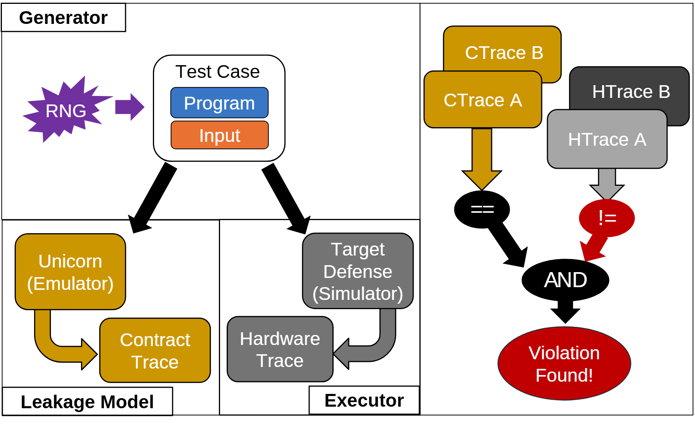

# VA-038 · 共同输入下的双执行轨迹检验

左上生成一个共同测试对象，向下分给参考执行与目标执行两条路径，右侧则把两组轨迹按条件组合成判定结果。布局强调公平比较的输入来源以及明确的逻辑准则；它不是简单的“两个结果是否相等”，两个局部比较关系和汇合逻辑共同决定最后结论。



## 适用范围

- 模型与实现的差分验证
- 相同输入下检查行为约束

不适合：没有可比输入的性能展示；只需展示单一路径的数据处理。

## 阅读顺序

1. 从随机源与测试对象看输入如何构成
2. 沿分叉箭头分别进入参考和目标执行
3. 读取右侧两组轨迹之间的比较符号
4. 跟随比较结果进入逻辑汇合及底部判定

## 图形表达

**布局**：左侧上部输入、下部并列执行，右侧独立竖向判定；直线分隔生成、执行和比较职责。

**对象**：测试对象含两个彩色字段，轨迹用错位叠卡表示成对记录，椭圆容纳比较与逻辑运算。

**连线**：粗黑箭头推动两路执行，金色和灰色弯箭头输出各自轨迹；红色箭头强调触发异常的比较。

**配色**：金色贯穿参考路径，灰色贯穿目标路径，紫色表示随机输入，红色只用于异常判定。

**文字**：无衬线文字较醒目，轨迹卡片上的短标签应保持对齐，比较符号需明显大于正文。

## 部件与复用

| 部件 | 含义 | 改造方法 |
|---|---|---|
| 共同测试输入 (`case-generator`) | 生成程序与输入组成的同一测试实例。 | 替换为可复现样本及参数，保留随机种子位置或说明。 |
| 参考执行分支 (`model-execution`) | 用规范或基准方法产生应允许的观察。 | 注明参考模型适用范围，不把预测自动当作真值。 |
| 目标执行分支 (`target-execution`) | 对待测实现执行相同案例并提取观察。 | 保证轨迹字段与参考路径可比，补充必要转换。 |
| 轨迹组合判定 (`trace-comparison`) | 两类成对轨迹先分别比较，再由逻辑运算得结论。 | 重新推导比较符号与AND等逻辑；不要只更换最终告警文字。 |

## 改造步骤

1. 先写出违规判定的布尔表达式，再设置比较圆和汇合节点
2. 两条分支必须共享输入身份，避免仅看起来共用
3. 比较对象超过两组时增加轨迹行并重排判定区
4. 可把随机源换成固定案例集，但相应删除随机含义

## 新情景示例（假设）

可用于验证路径规划程序的实现一致性。

共同输入为地图和起终点，参考分支为精确小规模求解器，目标分支为待测规划代码，轨迹改为可行性与成本记录。

将判据重写成“参考可行且目标不可行”等明确条件；若只检验成本差，不保留原有双对照逻辑。

## 编辑入口

**入口**：make_figure.py 读取 example.json；labels.json 查文字键，asset.json 查部件键；输出 SVG，可用配套渲染脚本导出 PDF。

**配置可改**：labels 修改文字及字体属性；components 可设 visible、dx/dy、attributes；elements 修改单个对象属性。平移使用图的坐标单位，重叠部件不要同时平移。

**需改代码**：改变模块数量、连接关系或分栏布局须编辑 customize()，不会自动布线。新对象需唯一 data-asset-key，并加入对应部件 element_keys，才会随部件导出。

**字体**：本图映射字体：Arimo-Bold.ttf, Arimo-Regular.ttf。沿用完整字体覆盖新字符；font_size 是元素局部单位，不是纸面 pt。改长标签后检查字宽、裁切及最终 PDF。

准备独立工作副本：

```text
python "<SKILL>/scripts/prepare_architecture.py" --id VA-038 --out figures/architecture
```

在工作副本运行：

```text
python make_figure.py --config example.json --out . --parts
python render_architecture.py fig.svg
```

## 本图检查

- 两路执行是否使用相同案例和参数
- 两个比较符号与最终逻辑是否符合检验定义
- 红色异常是否只代表已定义的失败条件

部件图用于复用局部对象；跨边界的连接和共享容器仍需按新关系处理。示例名称、数值和曲线不是当前研究结果。

来源与许可见 [ATTRIBUTION.md](ATTRIBUTION.md)。
