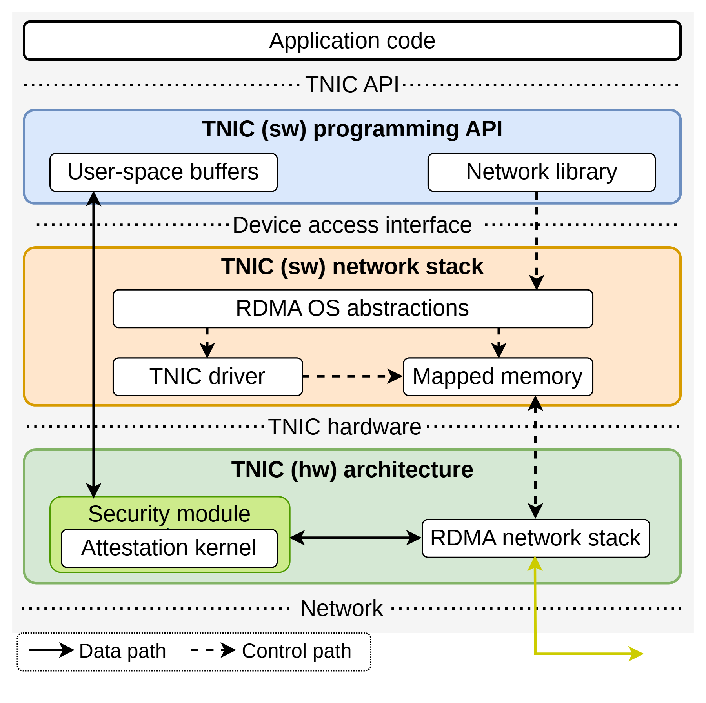

# VA-109 · 应用接口到可信硬件的三层通信栈

应用代码下方依次放置编程接口、软件网络栈、硬件架构三个色带，纵向路径穿越接口边界。安全模块与 RDMA 栈在底层并列，适合解释接口、实现与可信边界之间的关系。



## 适用范围

- 说明应用经软件接口访问硬件服务的完整路径
- 需要区分数据路径和控制路径的分层系统

不适合：没有软件硬件层次的线性加工过程；试图以此图证明未验证的安全保障。

## 阅读顺序

1. 从顶部 Application code 进入蓝色编程 API。
2. 向下读橙色网络栈中的操作系统抽象、驱动和映射内存。
3. 读绿色硬件层里的安全模块和 RDMA 网络栈。
4. 最后对照底部实线/虚线图例跟踪两类路径及网络出口。

## 图形表达

**布局**：上窄应用条加三条等宽彩色层；层间用点线和接口名称分界。

**对象**：圆角容器包围白色小模块，安全区域还用浅黄色小框嵌套。

**连线**：黑色实线标数据路径、黑色虚线标控制路径；绿色/黄色向外线位于底部网络出口。

**配色**：API 淡蓝、软件栈淡橙、硬件层淡绿；颜色表示层而不是性能。

**文字**：无衬线层标题较粗，小模块文字紧凑，接口名称置于分隔线中央。

## 部件与复用

| 部件 | 含义 | 改造方法 |
|---|---|---|
| 应用入口 (`application`) | 应用代码条是整个栈的调用起点。 | 替换业务入口名称，保持 API 分隔线在其下方。 |
| 编程接口层 (`programming-api`) | 用户缓冲区和网络库是应用可见接口。 | 按真实 API 组成替换模块；保持数据与控制接口差异。 |
| 软件网络栈 (`software-network`) | 操作系统抽象、驱动和映射内存共同承接设备访问。 | 可改为运行时、驱动与共享缓冲；修改模块后重接垂直路径。 |
| 可信硬件层 (`trusted-hardware`) | 安全模块内含证明内核，与网络栈连接。 | 安全声明必须按实际能力改名，不能仅借用可信字样。 |
| 路径类型图例 (`path-legend`) | 用实线与虚线区分数据和控制路径。 | 增删路径类型时同步改图例。 |

## 改造步骤

1. 先列出项目的应用接口、运行时、驱动与硬件模块，按真实边界替换三层。
2. 保留层色但让实虚线只表达数据/控制，避免又用作可信程度。
3. 移动层间对象时重接贯穿边；底部网络出口保留在整图中。
4. 若没有远程证明等功能，重写安全模块名称并删除不成立连接。

## 新情景示例（假设）

假设示例：边缘采集应用的软件驱动与设备验证栈

蓝层对应采集 SDK，橙层对应通信驱动和共享缓冲，绿层对应采集芯片与验证模块。

按实际架构增删验证模块与映射内存，重画采集数据和设备控制两种路径。

## 编辑入口

**入口**：make_figure.py 调用本包共享运行库；example.json 配置本图实例，labels.json 定位可编辑文字，asset.json 登记语义部件。运行 python make_figure.py --config example.json --out . --parts 生成整图及部件。

**配置可改**：labels、components 支持既有文字、配色、显隐和位移；修改配置不会自动重排布局或重接跨部件箭头。

**需改代码**：改变对象数量或拓扑时在 customize(root, context) 中编辑矢量；新元素设置 data-asset-key 并登记到部件 element_keys。重叠语义区域不可同时移动同一元素。

**字体**：源图使用小号无衬线，层名加粗；最终缩印前必须检查最小模块字高。最终字体文件以构建映射为准；局部 font_size 使用源坐标，不能直接视为纸面 pt。本批构建已确认并嵌入完整字体：Arimo-Bold.ttf, Arimo-Regular.ttf。映射可能改变原字形和字宽，需按实际论文尺寸复核。

准备独立工作副本：

```text
python "<SKILL>/scripts/prepare_architecture.py" --id VA-109 --out figures/architecture
```

在工作副本运行：

```text
python make_figure.py --config example.json --out . --parts
python render_architecture.py fig.svg
```

## 本图检查

- 实线与虚线是否全图统一。
- 接口分隔线文字是否被贯穿箭头覆盖。
- 安全模块是否与真实实现相符。
- 底部出口是否离开硬件层并指向网络。

部件图用于复用局部对象；跨边界的连接和共享容器仍需按新关系处理。示例名称、数值和曲线不是当前研究结果。

来源与许可见 [ATTRIBUTION.md](ATTRIBUTION.md)。
