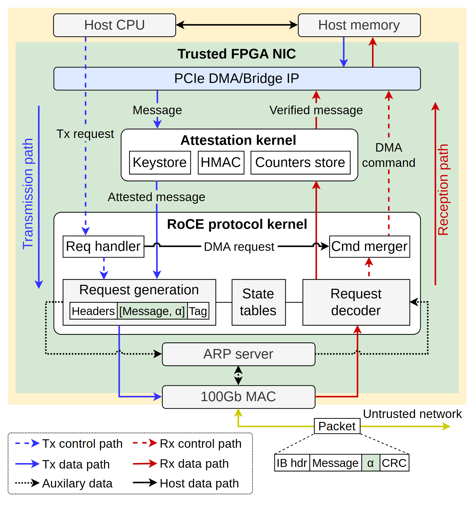

# VA-007 · 双向处理通路中的校验核心

以一个共享校验核串起发送与接收两条通路，说明数据进入处理边界后，经过哪些状态维护、封装和解码步骤。紧凑的纵向嵌套把主机、受控设备、协议子系统区分开；底部字段条进一步解释接口携带的内容。



## 适用范围

- 必须在输入与输出两方向执行校验的通信或质控系统
- 需要同时说明执行边界、状态存储和信息字段的子系统

不适合：没有双向处理或校验关口的普通流程；需要展示大量并列服务的整体平台。

## 阅读顺序

1. 先认上方处理器与内存，以及绿色受控设备边界。
2. 沿蓝色发送线向下，经过校验核、请求构造和底部出口。
3. 沿红色接收线向上，查看解码、校验及写回。
4. 最后核对底部消息字段和左下线型图例。

## 图形表达

**布局**：纵向主体内再嵌套两个子系统，左右留窄轨道容纳方向相反的主线。

**对象**：普通矩形表示处理器和状态库；校验核内三小格并列；底部细分条表示消息结构。

**连线**：蓝与红分别承担发送和接收；实线传数据，虚线传控制，黑色辅助线另有含义，须由图例确认。

**配色**：浅绿区分受控设备范围，淡黄色外底不代表性能；白灰模块保持中性，让路径颜色成为重点。

**文字**：使用紧凑无衬线字，子系统标题加粗；侧轨方向文字旋转，字段名比模块名更小。

## 部件与复用

| 部件 | 含义 | 改造方法 |
|---|---|---|
| 主机接口 (`host-interface`) | 主机处理器、内存与桥接入口构成设备的上游环境。 | 改成真实请求源和缓存，接口类型应随实现替换。 |
| 校验与状态单元 (`attestation-core`) | 三格共同表示校验所需的持久材料、算法和状态。 | 可换为规则库、验证器和版本记录，不能仅改标题便保留安全保证。 |
| 双向处理核心 (`protocol-core`) | 左侧构造输出，右侧解析输入，中部状态表为两路服务。 | 重写每条请求的方向与共享状态；单向任务应改结构。 |
| 出口及字段条 (`wire-format`) | 出口连接外部环境，细分字段解释一个传递对象的组成。 | 按新消息格式重画字段数与宽度，勿暗示未定义的认证字段。 |
| 路径图例 (`path-legend`) | 六种线的颜色和虚实共同区分方向及信息种类。 | 删去未用类别，保留黑白打印也可识别的线型差异。 |

## 改造步骤

1. 先列清两个方向经过的模块，检查校验核是否确实位于必经路径。
2. 把硬件名称与带宽换成当前对象，保留边界的明确含义。
3. 缩短字段名，字段含义放正文；不要把细字放大到挤压双向通路。
4. 改造完成后单独检查消息条与图例，不让旧信息成为新方案的隐含承诺。

## 新情景示例（假设）

可用于说明实验数据发布与回收的双向质控网关。

上方是数据仓库；三格是规则版本、格式验证、批次记录；下方处理核负责发布封装和回收解析。

删除协议特有旁路，新增异常隔离出口，并重新连接拒收反馈。这只是迁移设想，未代表已实现的系统。

## 编辑入口

**入口**：以 make_figure.py 为入口，example.json 存修改参数；labels.json 定位文字键，asset.json 定位部件。运行后查看整图和独立部件。

**配置可改**：labels 改文字及字体；components 改显示、dx/dy 和属性；elements 改对象属性。位移采用整图 viewBox 单位，父子部件重叠时只选一个层级移动。

**需改代码**：增删协议步骤、改变消息字段数量或增加异常出口须改 customize()，并补齐连接与部件元素键。现有参数不自动重布线。

**字体**：正文为 Arimo Regular，模块标题为 Arimo Bold；长字段优先改简称，不靠压缩字宽塞入。 font_size 是元素局部单位，受变换影响，不等于纸面字号。

准备独立工作副本：

```text
python "<SKILL>/scripts/prepare_architecture.py" --id VA-007 --out figures/architecture
```

在工作副本运行：

```text
python make_figure.py --config example.json --out . --parts
python render_architecture.py fig.svg
```

## 本图检查

- 蓝红路径是否都穿过应执行的校验步骤。
- 字段条中的每一格是否能在消息定义中找到。
- 缩到论文宽度后六类图例及侧轨文字是否仍可分辨。

部件图用于复用局部对象；跨边界的连接和共享容器仍需按新关系处理。示例名称、数值和曲线不是当前研究结果。

来源与许可见 [ATTRIBUTION.md](ATTRIBUTION.md)。
