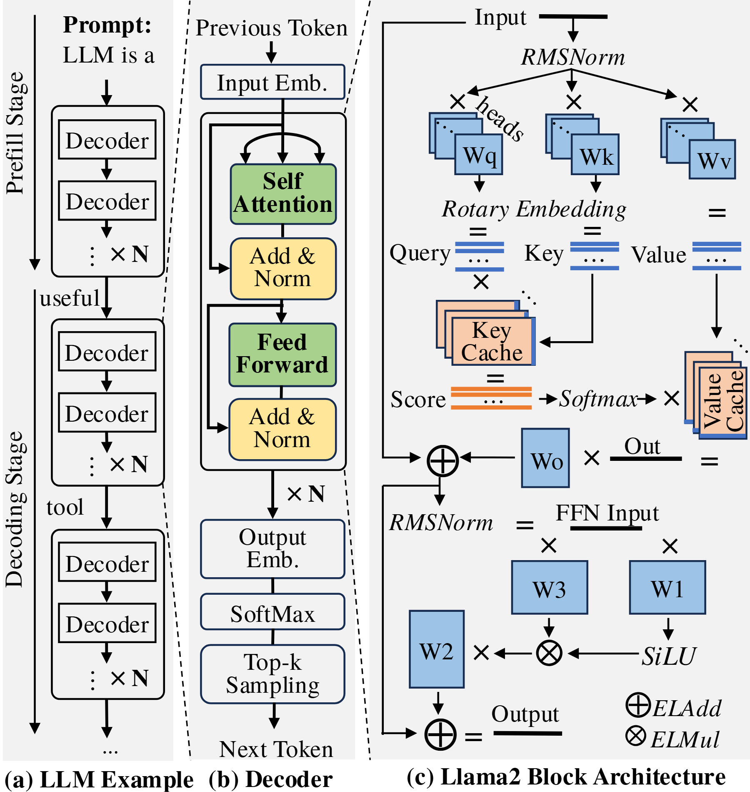

# VA-078 · 从迭代过程到内部算子的三级展开

三栏从宏观迭代逐步放大到模块链和算子图。左栏展示初始化与重复生成，中栏解释单个处理块及读出，右栏展开两个关键计算子结构。它适合说明嵌套算法层次，但右栏具有明确运算语义，不能在迁移时只替换名称而保留不对应的矩阵乘和残差连接。



## 适用范围

- 神经网络推理流程与内部计算
- 确有三级粒度的算法结构说明

不适合：普通业务功能架构；不了解内部算子仍希望仅换名的场景。

## 阅读顺序

1. 先从左栏识别一次初始化和重复迭代
2. 用中栏理解单个重复块的处理链
3. 在右上跟随投影、缓存与注意力计算
4. 在右下读取门控前馈及输出汇合

## 图形表达

**布局**：三栏纵向对齐，左为时间过程，中为模块流程，右为数学细节；细分区边界分隔观察尺度。

**对象**：叠片矩形表示重复权重或缓存，圆中加号和乘号表示不同运算，×N括号表示重复层。

**连线**：黑色细箭头是张量流，绕行线是残差或缓存访问；交叉线不能自动解释成相连。

**配色**：绿色强调主要计算模块，黄色强调归一化或合并，蓝色用于权重，桃色用于缓存；最终以标签核对。

**文字**：衬线正文配数学斜体及下标，多种运算符必须保留可用字形；右栏最密，需单独检查缩版清晰度。

## 部件与复用

| 部件 | 含义 | 改造方法 |
|---|---|---|
| 初始化与迭代 (`macro-stages`) | 粗粒度展示建立上下文后反复产生新输出。 | 改为真实初始化与循环条件；没有此区别时合并阶段。 |
| 重复处理块 (`decoder-block`) | 嵌入、核心变换、残差归一化及输出读出组成的链。 | 层顺序必须遵循实际模型，重复次数不能沿用示例。 |
| 注意力计算细节 (`attention-detail`) | 投影生成查询键值，经位置处理和缓存形成加权输出。 | 仅用于支持这些算子的模型；更换结构需重画运算图和缓存路径。 |
| 门控前馈细节 (`feedforward-detail`) | 两路投影经过激活及逐元素组合，再输出投影。 | 按模型公式决定乘法、加法和激活的位置，不作通用三块流水线。 |

## 改造步骤

1. 先写清每栏的粒度以及放大对象，再保留需要的重复括号
2. 逐条对照数学公式检查右栏运算顺序与张量维度
3. 删除模型不存在的缓存、位置编码或采样模块
4. 若用作其他算法，须重构右栏算子图而非仅换标题

## 新情景示例（假设）

可用于说明一个自回归时间序列预测模型的推理结构。

左栏映射历史窗口编码与滚动预测，中栏展示实际预测块，右栏展开确实采用的注意力和前馈算子。

替换分词读出为数值预测头，删除不适用的词表采样；缓存和位置编码是否保留由实现决定。

## 编辑入口

**入口**：make_figure.py 读取 example.json；labels.json 查文字键，asset.json 查部件键；输出 SVG，可用配套渲染脚本导出 PDF。

**配置可改**：labels 修改文字及字体属性；components 可设 visible、dx/dy、attributes；elements 修改单个对象属性。平移使用图的坐标单位，重叠部件不要同时平移。

**需改代码**：改变模块数量、连接关系或分栏布局须编辑 customize()，不会自动布线。新对象需唯一 data-asset-key，并加入对应部件 element_keys，才会随部件导出。

**字体**：本图映射字体：DejaVuSans.ttf, Tinos-Regular.ttf, texgyretermes-bold.otf, texgyretermes-italic.otf, texgyretermes-regular.otf。沿用完整字体覆盖新字符；font_size 是元素局部单位，不是纸面 pt。改长标签后检查字宽、裁切及最终 PDF。

准备独立工作副本：

```text
python "<SKILL>/scripts/prepare_architecture.py" --id VA-078 --out figures/architecture
```

在工作副本运行：

```text
python make_figure.py --config example.json --out . --parts
python render_architecture.py fig.svg
```

## 本图检查

- 宏观流程与单块内部顺序是否一致
- 乘号加号及残差路径是否对应公式
- 缓存和重复次数是否属于当前模型

部件图用于复用局部对象；跨边界的连接和共享容器仍需按新关系处理。示例名称、数值和曲线不是当前研究结果。

来源与许可见 [ATTRIBUTION.md](ATTRIBUTION.md)。
