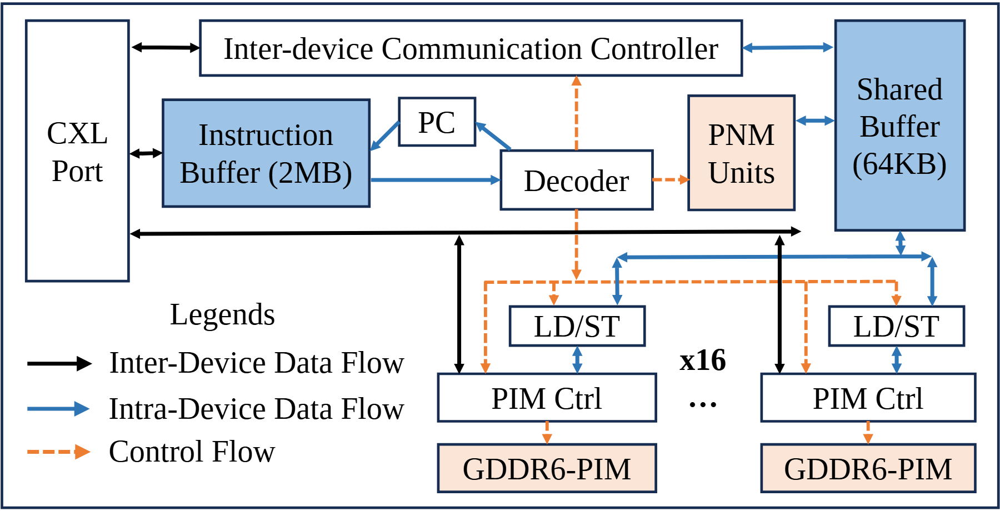

# VA-008 · 共享状态支撑的并行执行架构

这张图把入口、任务解释、共享状态与并行执行器放在同一设备边界内。它的重点是三种通信职责共存：外部数据经过公共通路，内部数据在缓冲与执行器之间交换，控制信号负责触发动作。下方只画首尾通道，用省略号表示规模，不应据此推断实际有多少执行器。



## 适用范围

- 任务拆分后由多通道执行且共享中间状态
- 需要同时解释数据路径和控制路径的设备或服务

不适合：各分支完全独立且没有共享存储；只需介绍串行算法步骤。

## 阅读顺序

1. 从左侧竖向端口识别系统入口及边界
2. 沿蓝色路径看输入缓冲、解码与专用计算单元
3. 下移查看代表通道及其控制器、执行资源
4. 最后跟随顶部通信模块和右侧共享缓冲，结合左下图例辨认三类连接

## 图形表达

**布局**：横向主框内采用左入口、上通信、中间分派、下并行的分区；图例占左下空白，避免挤入通道内部。

**对象**：窄长端口强调边界接口，宽矩形表示缓冲，成对上下矩形表示通道控制与执行两级。

**连线**：黑色实线表示跨设备数据，蓝色实线表示设备内数据，橙色虚线表示控制；箭头方向和是否双向必须逐条核实。

**配色**：蓝色填充归给状态或缓冲，浅橙填充归给计算资源；线色表达路径种类，不必与终点填充同色。

**文字**：正文采用衬线字形，通道数量单独加粗；容量与名称分行，避免把单位挤到框外。

## 部件与复用

| 部件 | 含义 | 改造方法 |
|---|---|---|
| 入口接口 (`input-port`) | 外部请求进入内部总线的接点。 | 替换接口名称，同时保留它与顶部和主通路的连接。 |
| 解释与分派链 (`dispatch-core`) | 输入缓冲、位置控制、解码和计算单元共同组织任务。 | 按真实流程删除无对应的程序计数器或专用计算支路。 |
| 共享状态区 (`shared-state`) | 右侧缓冲供通信与计算共同访问。 | 写明共享对象是队列、特征还是缓存，并更新容量单位。 |
| 并行执行通道 (`parallel-channels`) | 两个代表实例展示同构控制和执行层。 | 改变实例数量时重布底部横梁，数量文字应与省略表示一致。 |
| 连接图例 (`connection-types`) | 三种线型给交叉路径提供语义。 | 新场景只有两类连接时同时删去图例和多余路径。 |

## 改造步骤

1. 先列出输入、控制消息和共享数据，分别映射三类路径
2. 替换容量、通道数及硬件缩写，未确定数值直接省略
3. 保持共享缓冲的所有读写端点，不能只换名称却遗漏数据关系
4. 增加通道时用代码同步复制控制器、执行资源与上下连接

## 新情景示例（假设）

可用于假设的遥感图像并行预处理服务。

入口对应影像接入，解码器对应任务拆分，共享缓冲对应瓦片缓存，通道对应预处理工作器。

去掉程序计数器，将专用计算单元改为结果归约；若没有跨设备交换，删除顶部通信模块及黑色图例。

## 编辑入口

**入口**：make_figure.py 读取 example.json 生成 fig.svg；加 --parts 导出部件，render_architecture.py 渲染预览及 PDF。

**配置可改**：labels 按 labels.json 对象键改字；components 支持 visible、dx/dy、attributes；elements 改对象属性。位移用图内坐标，连线不自动重布。

**需改代码**：增删模块、改连接和布局须修改 customize()。新对象须有唯一 data-asset-key 并登记部件归属；嵌套部件选一个层级平移，避免重复移动。

**字体**：当前完整字体为 Tinos-Bold, Tinos-Regular。font_size 是元素局部坐标单位，受缩放变换影响，不是纸面字号；改长标签后按最终版面宽度复核换行与字距。

准备独立工作副本：

```text
python "<SKILL>/scripts/prepare_architecture.py" --id VA-008 --out figures/architecture
```

在工作副本运行：

```text
python make_figure.py --config example.json --out . --parts
python render_architecture.py fig.svg
```

## 本图检查

- 三类图例是否能在图中找到一致的线型实例
- 共享缓冲的控制线与数据线是否被误接
- 所有容量和通道数量是否已替换为当前场景依据

部件图用于复用局部对象；跨边界的连接和共享容器仍需按新关系处理。示例名称、数值和曲线不是当前研究结果。

来源与许可见 [ATTRIBUTION.md](ATTRIBUTION.md)。
