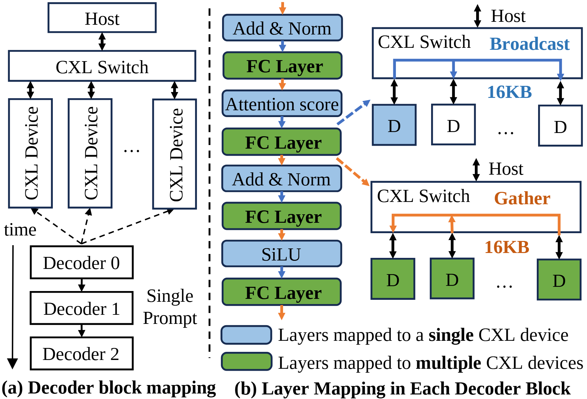

# VA-110 · 设备映射与广播汇集通信的并置解构

左侧把解码块映射到多设备系统，中间逐层标记单设备与多设备执行，右侧用两张小拓扑解释广播和汇集。颜色、虚线定位与局部通信图一起连接抽象分层和具体数据移动。



## 适用范围

- 解释哪些计算层本地执行、哪些层跨设备并行
- 给层级映射图补充两种关键通信操作

不适合：仅有一个设备且无跨节点通信；需要真实通信耗时或带宽结果的定量比较。

## 阅读顺序

1. 先看左侧 Host、CXL Switch 与多设备，再顺时间箭头看连续解码块。
2. 读中列从 Add & Norm 到 FC、Attention、SiLU 的层序。
3. 沿中列虚线定位右上 Broadcast 和右下 Gather。
4. 最后用蓝绿图例核对单设备和多设备映射。

## 图形表达

**布局**：左系统与时间映射、中间计算层栈、右两种通信拓扑并列，垂直虚线分隔左面板。

**对象**：设备用窄矩形，交换机横条，计算层圆角块；右侧省略号代表更多设备。

**连线**：层间橙箭头向下，系统边双向；右上广播一对多，右下汇集多对一；虚线连接为详图索引。

**配色**：蓝层映射单个设备，绿层映射多个设备；蓝色广播与橙色汇集路径另有通信含义，需结合图例读。

**文字**：衬线正文与加粗通信名称混排；16KB 是实例参数，不是资产固定约束。

## 部件与复用

| 部件 | 含义 | 改造方法 |
|---|---|---|
| 系统与解码块映射 (`device-and-block-map`) | 上方设备与下方串行解码块关联。 | 改变设备数量时同步映射线；时间箭头不代表设备间数据流。 |
| 解码块内部层栈 (`layer-stack`) | 纵向层序用蓝绿区分部署粒度。 | 替换为项目真实层序，新增层同时修改对应映射颜色。 |
| 广播通信小拓扑 (`broadcast`) | 共享交换机向多个设备分发数据。 | 按真实协议调整方向和数据量，设备数量可扩展。 |
| 汇集通信小拓扑 (`gather`) | 多个设备结果经共享交换机汇集。 | 与广播图保持节点名称和顺序一致。 |
| 部署粒度图例 (`mapping-legend`) | 蓝色单设备、绿色多设备两类执行位置。 | 改变颜色含义时同步中列与右侧设备填色。 |

## 改造步骤

1. 先确定每层的实际部署粒度，再给层块分配蓝绿颜色。
2. 替换左侧设备类型和块数，同时同步右侧广播/汇集节点。
3. 16KB 等数值必须换成项目证据或明确示意，不能继承为结果。
4. 跨区域虚线与通信边需要在 customize 中重接，不能只移动层块。

## 新情景示例（假设）

假设示例：分布式图计算中本地变换与跨节点聚合

蓝色层映射单节点归一化，绿色层映射分片计算，右侧对应参数分发与结果收集。

重建真实计算层顺序，把 CXL 标签改为网络设备并重写传输量。

## 编辑入口

**入口**：make_figure.py 调用本包共享运行库；example.json 配置本图实例，labels.json 定位可编辑文字，asset.json 登记语义部件。运行 python make_figure.py --config example.json --out . --parts 生成整图及部件。

**配置可改**：labels、components 支持既有文字、配色、显隐和位移；修改配置不会自动重排布局或重接跨部件箭头。

**需改代码**：改变对象数量或拓扑时在 customize(root, context) 中编辑矢量；新元素设置 data-asset-key 并登记到部件 element_keys。重叠语义区域不可同时移动同一元素。

**字体**：主体为衬线文字，计算层标签及通信强调需保留层次；旋转设备名称单独检查。最终字体文件以构建映射为准；局部 font_size 使用源坐标，不能直接视为纸面 pt。本批构建已确认并嵌入完整字体：Tinos-Bold.ttf, Tinos-Regular.ttf。映射可能改变原字形和字宽，需按实际论文尺寸复核。

准备独立工作副本：

```text
python "<SKILL>/scripts/prepare_architecture.py" --id VA-110 --out figures/architecture
```

在工作副本运行：

```text
python make_figure.py --config example.json --out . --parts
python render_architecture.py fig.svg
```

## 本图检查

- 单设备/多设备图例与实际填色是否一致。
- 广播与汇集方向是否相反且正确。
- 通信量是否来自本任务而非示例。
- 右侧详图的虚线是否指向正确计算层。

部件图用于复用局部对象；跨边界的连接和共享容器仍需按新关系处理。示例名称、数值和曲线不是当前研究结果。

来源与许可见 [ATTRIBUTION.md](ATTRIBUTION.md)。
