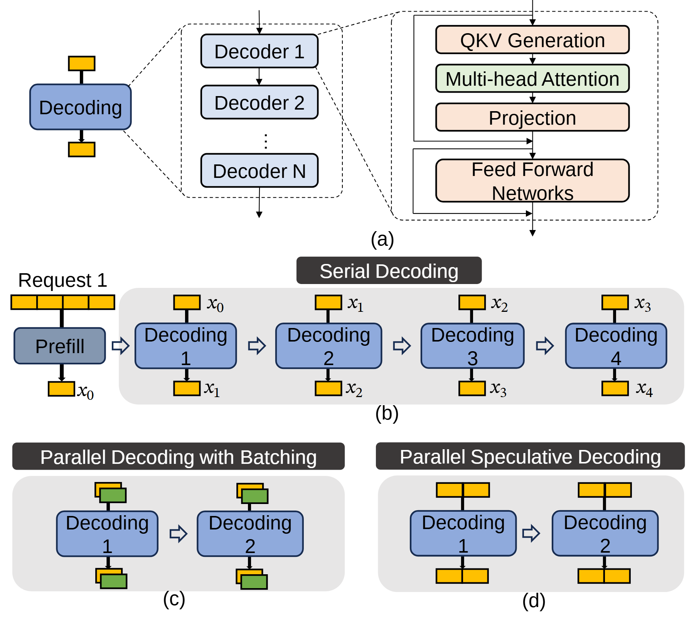

# VA-111 · 模块放大与三种解码并行策略对照

上部逐级放大单个解码模块，中部展示四步串行生成，下部比较请求批处理与单请求多令牌推测。复用价值在于通过小矩形令牌的排列方式区分两种并行维度。



## 适用范围

- 解释同一处理模块的内部组成并比较多种调度策略
- 区分跨请求并行与单请求内部并行

不适合：只用颜色就要精确表达延迟或吞吐结果；不同方案没有共同处理单元的无关流程比较。

## 阅读顺序

1. 上部从 Decoding 放大到 Decoder 栈，再放大到 QKV、Attention 和前馈网络。
2. 中部从 Request 1 的 Prefill 逐步读四次串行 Decoding。
3. 左下看叠放令牌表示多个请求批处理。
4. 右下看横向相邻令牌表示单请求多个候选位置。

## 图形表达

**布局**：上部三层放大，中部宽串行流程，下部两个等宽比较面板。

**对象**：蓝色圆角解码块、黄色小令牌块、灰底分组与黑底白字策略标题共同建立层次。

**连线**：放大虚线与执行箭头分开；中下部流程左至右，输入输出令牌位于模块上下。

**配色**：蓝色处理块一致，黄色主令牌与绿色叠放令牌区分请求，黑色标题条只做面板导航。

**文字**：模块无衬线，令牌 x 下标带数学特征；三种策略标题需要足够横向空间。

## 部件与复用

| 部件 | 含义 | 改造方法 |
|---|---|---|
| 解码模块逐级放大 (`decoder-zoom`) | 处理模块逐级展开为重复 Decoder 与内部子层。 | 若处理模块变化，重画内部层而不是保留语言模型专属词。 |
| 四步串行解码 (`serial-decoding`) | 一次预填充加四次依赖前一步的解码。 | 步骤数变化时同步更新 x 索引、箭头与灰底范围。 |
| 跨请求批处理 (`batched-decoding`) | 小令牌叠放表示不同请求一起执行。 | 用可区分颜色表示请求，不将堆叠误作时间序列。 |
| 单请求推测并行 (`speculative-decoding`) | 并排令牌表示一次推进多个位置的策略。 | 按真实方案增加验证/回退模块；此简图本身未展开这些过程。 |

## 改造步骤

1. 先确认要对比的并行维度，再统一各面板处理模块名称。
2. 批处理使用叠放对象，内部并行使用相邻对象，二者不能互换。
3. 串行索引逐步递增；复制步骤时同步输入输出标签。
4. 推测算法若需要说明接受与回退，在 customize 中补相应结构，不能靠标题暗示已画出。

## 新情景示例（假设）

假设示例：仿真任务的串行运行、批量运行与多步预测对照

解码块换成仿真推进器，黄色单元对应时间步，叠放色块对应不同场景。

修改内部计算层；如多步预测需要校验，新增校验与回退分支。

## 编辑入口

**入口**：make_figure.py 调用本包共享运行库；example.json 配置本图实例，labels.json 定位可编辑文字，asset.json 登记语义部件。运行 python make_figure.py --config example.json --out . --parts 生成整图及部件。

**配置可改**：labels、components 支持既有文字、配色、显隐和位移；修改配置不会自动重排布局或重接跨部件箭头。

**需改代码**：改变对象数量或拓扑时在 customize(root, context) 中编辑矢量；新元素设置 data-asset-key 并登记到部件 element_keys。重叠语义区域不可同时移动同一元素。

**字体**：无衬线标题与数学 x 下标混排；黑底策略标题的白字需要检查横向溢出。最终字体文件以构建映射为准；局部 font_size 使用源坐标，不能直接视为纸面 pt。本批构建已确认并嵌入完整字体：Arimo-Regular.ttf, STIXTwoMath-Regular.ttf。映射可能改变原字形和字宽，需按实际论文尺寸复核。

准备独立工作副本：

```text
python "<SKILL>/scripts/prepare_architecture.py" --id VA-111 --out figures/architecture
```

在工作副本运行：

```text
python make_figure.py --config example.json --out . --parts
python render_architecture.py fig.svg
```

## 本图检查

- 叠放与并排对象是否对应不同且清楚的并行维度。
- 串行 x 索引是否前后连续。
- 上部放大层是否属于下部共同处理模块。
- 是否把推测流程中未画的验证机制误写成已实现。

部件图用于复用局部对象；跨边界的连接和共享容器仍需按新关系处理。示例名称、数值和曲线不是当前研究结果。

来源与许可见 [ATTRIBUTION.md](ATTRIBUTION.md)。
