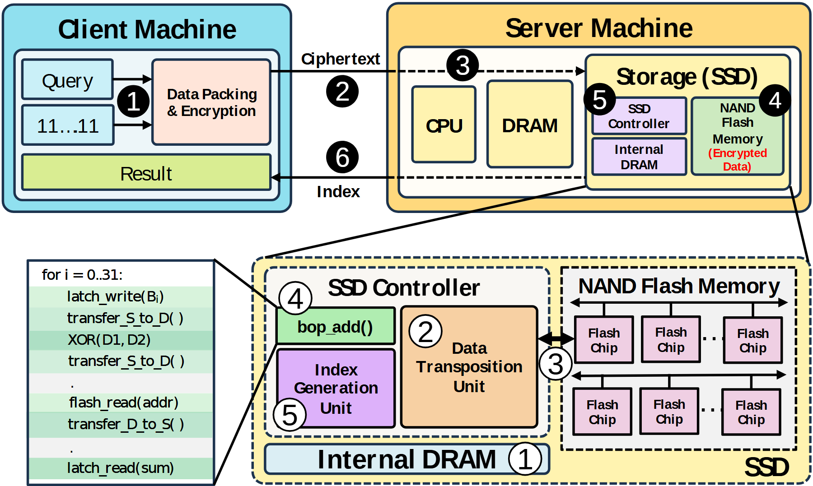

# VA-079 · 端到端请求与存储执行内部展开

上半部给出客户端到服务器存储的请求和返回路径，下半部展开控制器、存储阵列及操作步骤。黑圈与白圈是两个尺度的局部编号，不能按数字直接对应；放大线说明细节归属，适合强调数据处理下沉。



## 适用范围

- 客户端提交请求、设备内部执行并返回小结果的系统
- 需要同时展示系统边界和设备内关键算法

不适合：没有内部下沉执行机制的普通客户端服务器图；不清楚编号含义却希望仅增加图面复杂度。

## 阅读顺序

1. 上方从客户端查询进入打包处理，再跨机器边界送往存储。
2. 按黑色圈号追踪系统级请求与返回。
3. 沿展开线转到下方，按白色圈号阅读设备内部执行次序。
4. 对照左下操作列表，查看控制器如何驱动阵列并生成结果。

## 图形表达

**布局**：上方双机器边界并排，下方以存储展开为主、步骤旁注为辅；两尺度通过斜向放大线连接。

**对象**：圆角外框表示机器，虚线子框表示内部功能域；重复存储芯片小格表示并行阵列。

**连线**：上部请求与返回线的实虚段连续通向设备，内部双向箭头表示交换；展开线不是通信边，黑白圈号区分编号范围。

**配色**：青蓝区为客户端，金黄区为服务器与存储；内部紫色、橙色和绿色区别处理功能，红字突出数据状态。

**文字**：模块标题粗体，内部标签短；圈号大于正文以便跨区域寻找，步骤列表需保留清晰行距。

## 部件与复用

| 部件 | 含义 | 改造方法 |
|---|---|---|
| 客户端请求区 (`client`) | 构造查询、预处理输入并接收返回结果。 | 明确请求与结果的内容，不沿用未经采用的加密承诺。 |
| 服务器执行环境 (`server`) | 主机计算、内存及存储共同构成上层部署。 | 删除实际未参与的主机路径，保留设备所属关系。 |
| 关键操作旁注 (`algorithm-note`) | 用短步骤列表解释设备执行过程。 | 替换成可核验算法，示意伪代码不能充当已运行程序。 |
| 控制器内部展开 (`controller-inset`) | 数据转换、索引生成和缓存协作形成结果。 | 按新机制调整三个职责，重新连接数据依赖。 |
| 并行存储阵列 (`flash-array`) | 多行存储单元及通道说明数据所在和可执行范围。 | 芯片数量可示意，但计算发生在哪里必须准确。 |

## 改造步骤

1. 先确认上层哪一个框被放大，并把展开线固定到其边界。
2. 分别建立系统级和设备内编号表；可改为字母与数字，避免读者强行同号对应。
3. 所有数据状态说明与实际处理位置一起更新。
4. 旁注若超过可读长度应移入正文，图内保留关键调用。

## 新情景示例（假设）

可用于边缘视频检索中查询下发与设备内特征匹配。

客户端打包检索条件，设备控制器完成特征读取与匹配，阵列存特征块，返回候选编号。

把加密状态改为实际特征格式，增加视频帧到特征的来源，并重写下方操作列表；不继承任何密码学结论。

## 编辑入口

**入口**：以 make_figure.py 为入口，example.json 存修改参数；labels.json 定位文字键，asset.json 定位部件。运行后查看整图和独立部件。

**配置可改**：labels 改文字及字体；components 改显示、dx/dy 和属性；elements 改对象属性。位移采用整图 viewBox 单位，父子部件重叠时只选一个层级移动。

**需改代码**：更换设备机制需深改 customize() 中阵列、步骤列表和编号；新增图元登记元素键及部件归属，防止独立部件导出遗漏。

**字体**：使用 Arimo Regular/Bold 和 DejaVu Sans 符号；圈号与普通数字分别检查，红色状态小字不宜继续缩小。 font_size 是元素局部单位，受变换影响，不等于纸面字号。

准备独立工作副本：

```text
python "<SKILL>/scripts/prepare_architecture.py" --id VA-079 --out figures/architecture
```

在工作副本运行：

```text
python make_figure.py --config example.json --out . --parts
python render_architecture.py fig.svg
```

## 本图检查

- 黑圈与白圈是否明确属于不同尺度的编号序列。
- 返回箭头是否给出结果类型而非误回传全部原始数据。
- 展开斜线是否与真实数据通路混淆。

部件图用于复用局部对象；跨边界的连接和共享容器仍需按新关系处理。示例名称、数值和曲线不是当前研究结果。

来源与许可见 [ATTRIBUTION.md](ATTRIBUTION.md)。
