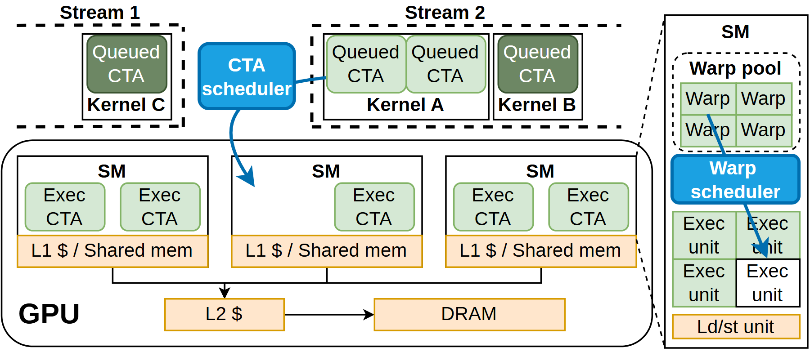

# VA-112 · 任务队列到执行单元的双层调度放大

顶部多流中的待执行任务由蓝色调度器分派到下方多个处理单元，右侧放大一个处理单元内部的第二级调度。底部共享缓存和内存形成独立的数据层级。



## 适用范围

- 需要区分任务级调度和单元内部细粒度调度的系统
- 队列、并行工作池和共享存储同时出现的架构

不适合：只有单级顺序处理的简单流水线；需要精确体现任务到资源的完整映射矩阵。

## 阅读顺序

1. 读顶部 Stream 1 和 Stream 2 的待执行队列及其 Kernel 容器。
2. 沿蓝色 CTA scheduler 箭头进入 GPU 中的三个 SM。
3. 下看各 SM 的本地存储和共同 L2、DRAM 路径。
4. 最后沿右侧放大边界读 Warp pool、Warp scheduler 与执行单元。

## 图形表达

**布局**：上方队列带、下方宽资源池、右侧窄放大栏；共享存储位于资源池底部。

**对象**：队列用重复圆角块，Kernel 和 SM 用矩形容器，GPU 用大圆角框；放大栏包含二维执行格。

**连线**：蓝色粗箭头表达两级调度分派，黑色细线表达存储连接，右侧虚线表示局部放大。

**配色**：待执行和执行任务为深浅绿，调度器亮蓝，存储浅橙；深浅绿不能直接当负载百分比。

**文字**：标题和调度器文字粗体较大，模块标签常分两行；大字比例适合宽图。

## 部件与复用

| 部件 | 含义 | 改造方法 |
|---|---|---|
| 单内核任务流 (`stream-one`) | 左上 Stream 1 内的 Kernel C 待执行任务。 | 可替换为低优先级或独立来源任务，流名必须与新场景一致。 |
| 双内核任务流 (`stream-two`) | 右上 Stream 2 包含两个 Kernel 队列。 | 增减 Kernel 时调整虚线流边界，保持任务与内核的包含关系。 |
| 任务级调度器 (`task-scheduler`) | 亮蓝调度器连接队列与 SM。 | 替换调度策略名称；跨域蓝色箭头保留整图重接。 |
| 并行处理单元阵列 (`sm-pool`) | 三个 SM 及其本地 L1/共享存储构成可分配执行池。 | 改变资源数要重画公共存储汇线，不能只复制方框。 |
| 共享缓存与外存 (`shared-memory-path`) | 底部 L2 与 DRAM 连接形成共享存储层级。 | 换成公共缓存和持久化存储时同步箭头方向。 |
| 执行单元内部调度放大 (`sm-detail`) | Warp 队列、二级调度器和执行格解释单个 SM 内部。 | 可复用为工作站内部线程池；修改格数须保留调度箭头落点。 |

## 改造步骤

1. 先明确两级调度单位，分别替换 CTA 与 Warp，不能两个层级都笼统写任务。
2. 保留来源流、Kernel 分组与资源池的包含层次，按真实分组重排顶部。
3. 增减 SM 或执行单元必须同步存储汇线和蓝色分派箭头。
4. 右侧放大虚线与父级 SM 对应；改变父级结构时同步详图。

## 新情景示例（假设）

假设示例：云计算作业调度与工作节点线程分派

Stream 映射任务来源，Kernel 映射作业，SM 映射工作节点，Warp 映射线程批次。

替换存储层为节点缓存、共享缓存和数据库；根据真实线程池数量重建右侧格阵。

## 编辑入口

**入口**：make_figure.py 调用本包共享运行库；example.json 配置本图实例，labels.json 定位可编辑文字，asset.json 登记语义部件。运行 python make_figure.py --config example.json --out . --parts 生成整图及部件。

**配置可改**：labels、components 支持既有文字、配色、显隐和位移；修改配置不会自动重排布局或重接跨部件箭头。

**需改代码**：改变对象数量或拓扑时在 customize(root, context) 中编辑矢量；新元素设置 data-asset-key 并登记到部件 element_keys。重叠语义区域不可同时移动同一元素。

**字体**：标题和调度器大号粗无衬线；白字调度器需检查对比度和换行。最终字体文件以构建映射为准；局部 font_size 使用源坐标，不能直接视为纸面 pt。本批构建已确认并嵌入完整字体：Arimo-Bold.ttf, Arimo-Regular.ttf。映射可能改变原字形和字宽，需按实际论文尺寸复核。

准备独立工作副本：

```text
python "<SKILL>/scripts/prepare_architecture.py" --id VA-112 --out figures/architecture
```

在工作副本运行：

```text
python make_figure.py --config example.json --out . --parts
python render_architecture.py fig.svg
```

## 本图检查

- 两级调度箭头是否各自指向正确粒度的执行对象。
- Kernel 是否仍处于其对应 Stream 中。
- SM 数量变化后共享存储汇线是否完整。
- 右侧放大对象与主图处理单元是否一致。

部件图用于复用局部对象；跨边界的连接和共享容器仍需按新关系处理。示例名称、数值和曲线不是当前研究结果。

来源与许可见 [ATTRIBUTION.md](ATTRIBUTION.md)。
