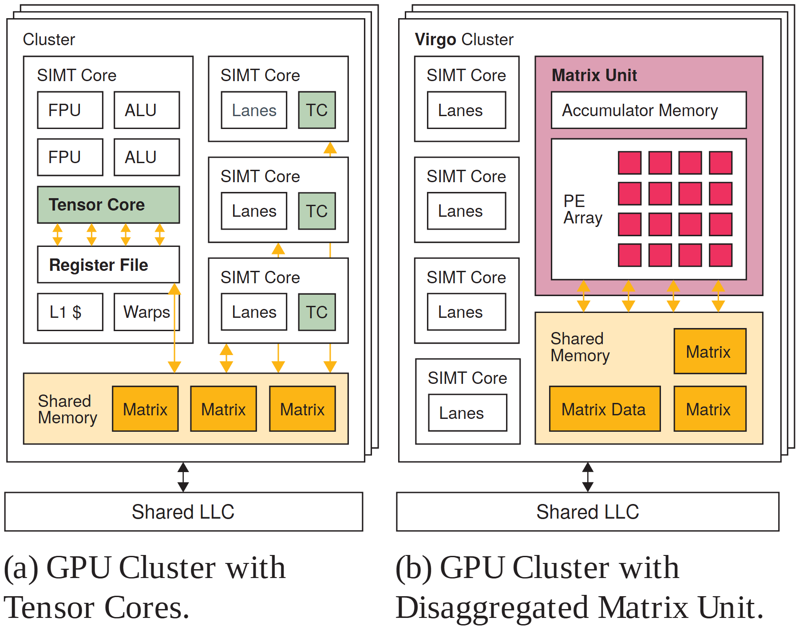

# VA-039 · 局部重复单元与共享专用阵列对照

并列对比两种资源组织：左图把专用功能嵌在每个通用单元内部，右图把该功能集中成独立阵列并直接连接共享存储。相同外框和下方缓存让读者把注意力放在耦合位置、共享方式和数据通路的改变。



## 适用范围

- 比较分散配置与集中共享的硬件或资源架构
- 需要解释专用单元从局部内部移到共享层的方案

不适合：两方案没有共同结构基础的任意拼图；需要通过面积大小精确表达成本而无比例数据。

## 阅读顺序

1. 先比较左右共同的集群外框与底部共享缓存。
2. 展开左侧局部核心，观察绿色专用功能与寄存器关系。
3. 转向右侧粉色独立区域，观察阵列和累加存储。
4. 沿橙色双向箭头比较两种方案怎样访问共享数据。

## 图形表达

**布局**：左右等高对照，后方错位外框暗示多个同类集群；两侧底部缓存保持对齐。

**对象**：嵌套矩形表示层级，右侧规则小方格表示执行阵列，底部黄色小块表示待用数据。

**连线**：橙色双向箭头表示数据交换，黑色底部连接表示集群与更低层缓存的关系。

**配色**：左侧绿色强调局部专用核，右侧粉色强调共享阵列；黄色跨两图表示共享数据，不能用作性能高低。

**文字**：内部采用紧凑无衬线字，面板说明采用衬线；子单元保持相近字级，勿只放大右侧方案。

## 部件与复用

| 部件 | 含义 | 改造方法 |
|---|---|---|
| 局部重复集群 (`baseline-cluster`) | 专用功能分散在多个通用核心内。 | 替换共同核心结构，保留重复关系以支持比较。 |
| 单个局部执行核心 (`local-core`) | 展示运算、寄存器与局部资源的包含关系。 | 先确定局部专用功能究竟通过哪个接口取数。 |
| 共享资源集群 (`disaggregated-cluster`) | 通用核心与集中专用区域并列。 | 改变集中位置时同步重画共享存储和访问关系。 |
| 专用阵列与共享数据 (`specialized-array`) | 二维执行阵列连接下方共享存储，展示集中后的内部组织。 | 方格数量可为示意，但若用来表达容量必须按真实规模绘制。 |

## 改造步骤

1. 固定两边相同的资源名称和外框尺度，先明确唯一要比较的组织差异。
2. 把橙色数据路径从头走一遍，确认集中后没有凭空消失的搬运步骤。
3. 阵列方格与外层叠框分别表示内部并行和集群复制，不应混用。
4. 若新领域没有缓存层，可改为公共物料区，但两侧必须同样处理。

## 新情景示例（假设）

可用于工厂中分散检测工位与集中检测中心的组织比较。

左图每条产线内有检测单元，右图多条产线共享检测阵列；黄色块对应待检批次。

将寄存器与缓存换成工位缓冲和公共仓储，并增加往返输送路径，不能直接继承硬件低延迟假设。

## 编辑入口

**入口**：以 make_figure.py 为入口，example.json 存修改参数；labels.json 定位文字键，asset.json 定位部件。运行后查看整图和独立部件。

**配置可改**：labels 改文字及字体；components 改显示、dx/dy 和属性；elements 改对象属性。位移采用整图 viewBox 单位，父子部件重叠时只选一个层级移动。

**需改代码**：改变重复核心数、阵列行列和内嵌层级需改 customize()；参数移动不会自动维持左右对称与公共基线。

**字体**：内部使用 TeX Gyre Heros Regular/Bold，面板说明使用 Tinos Regular；修改英文标签后检查两图说明占行是否一致。 font_size 是元素局部单位，受变换影响，不等于纸面字号。

准备独立工作副本：

```text
python "<SKILL>/scripts/prepare_architecture.py" --id VA-039 --out figures/architecture
```

在工作副本运行：

```text
python make_figure.py --config example.json --out . --parts
python render_architecture.py fig.svg
```

## 本图检查

- 两侧保留的公共设施是否确实相同。
- 阵列与数据块的数量是否被误当成测量值。
- 集中单元的双向箭头是否遗漏返回路径。

部件图用于复用局部对象；跨边界的连接和共享容器仍需按新关系处理。示例名称、数值和曲线不是当前研究结果。

来源与许可见 [ATTRIBUTION.md](ATTRIBUTION.md)。
