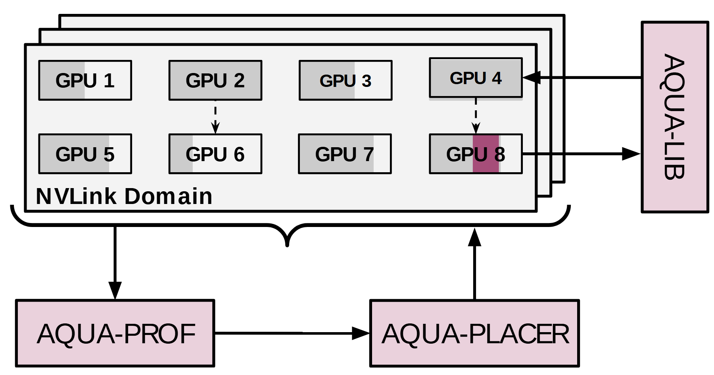

# VA-009 · 叠层资源池与外围决策回路

把一组同构资源画成规则网格，再用错位叠片表示多个同类资源域。状态采集和配置决策沿底部组成回路，独立访问层放在侧边，读者能区分“如何决定使用资源”与“实际从哪里访问资源”。该构图的核心是资源池与两类外围接口，不是八个节点或特定硬件名称。



## 适用范围

- 多站点资源配置、实例放置或容量管理
- 需要同时交代监测决策与访问入口的资源池

不适合：必须逐条解释稠密网状互联的拓扑；没有明确资源域边界的端到端业务流水线。

## 阅读顺序

1. 先识别顶端叠片与最前面的资源格，确认一片代表哪个组织层级。
2. 沿底部箭头读状态采集、配置计算和回写资源域的闭环。
3. 最后读右侧访问接口及其与代表节点的连接，将访问与配置两种关系分开。

## 图形表达

**布局**：资源池占上部主体，底部两个横向模块构成短回路；右侧窄竖条保持独立入口。

**对象**：重复矩形格表示实例，叠片表示重复域；大括号汇总整体资源，单格深色块可定位一个被操作的实例。

**连线**：外围实线箭头明确流向；网格内两条虚线只能保留为有说明的特定节点关系，不能默认解读成全互联。

**配色**：灰色保持资源背景，浅粉标识外围功能，深紫只强调一个具体对象；别将深色面积当成容量数值。

**文字**：资源编号使用紧凑粗体，外围模块用较大常规字；竖排入口应短，长名字宜旋转整行或改成两行横排。

## 部件与复用

| 部件 | 含义 | 改造方法 |
|---|---|---|
| 资源域叠片 (`resource-grid`) | 同一种组织结构的多个实例及其资源格 | 改变格数时同步改括号、编号和叠片边界；片数不等于精确规模。 |
| 状态采集模块 (`profiler`) | 从整个资源域汇总决策输入 | 明确是监测、估计还是离线剖析，并给返回决策的箭头补对象。 |
| 配置决策模块 (`placer`) | 把汇总状态转换成资源配置 | 改成实际优化器名称；结果可能面向多个格，不能只因现有箭头就限定目标。 |
| 访问接口 (`access-library`) | 与代表资源节点交换访问请求或结果 | 重新规定两个箭头方向；横向接口不足时扩展右侧空白。 |

## 改造步骤

1. 先定义一片、一个格和深色标记各代表什么，再写资源数目。
2. 按新任务分开状态、配置与实际访问三类连接，删除含义不明的域内虚线。
3. 重新组织外围模块标签，调整侧边条宽度并保持资源格对齐。
4. 在论文插图尺寸检查格内编号和外围回路，补充叠片为示意的图注。

## 新情景示例（假设）

假设设计多仓库存调拨系统。

资源格对应仓内库存区，叠片对应仓库；底部对应库存估计和调拨决策，侧边对应订单访问服务。

仓库之间不是硬件互联，应删除两条域内虚线；按实际调拨对象新增有方向的调拨边，并把深色格定义为本轮缺货区。

## 编辑入口

**入口**：在工作副本修改 example.json，运行 python make_figure.py --config example.json --out output --parts；再通过 Vivid 的矢量渲染入口检查 SVG 与 PDF。

**配置可改**：labels 按 labels.json 的元素键改字；components 按本页部件 id 设置 visible、dx、dy 或 attributes；elements 修改指定矢量元素属性。重叠部件可能共享元素，避免对父区域和内部区域重复位移。

**需改代码**：更改网格行列、叠片层数、大括号长度或接口拓扑时，在 make_figure.py 的 customize 中重建相关对象及连线。这些接口不会自动重排，也不会随部件移动自动修复跨部件连线。

**字体**：本资产已记录的完整字形资源：Arimo-Bold.ttf, Arimo-Regular.ttf。修改英文标签优先沿用对应字体族与字重；文字变长时调整框宽和换行，不靠整体缩小压入。其他语言须另选覆盖所需字符的字体并实查导出。

准备独立工作副本：

```text
python "<SKILL>/scripts/prepare_architecture.py" --id VA-009 --out figures/architecture
```

在工作副本运行：

```text
python make_figure.py --config example.json --out . --parts
python render_architecture.py fig.svg
```

## 本图检查

- 状态回路能否从资源池完整追踪到决策再返回，而不误读为货物路径？
- 侧边两条箭头是否落在实际被访问的资源上，且没有穿过编号？
- 叠片是否仅表示重复域，图注是否避免把绘制张数当成实际数量？

部件图用于复用局部对象；跨边界的连接和共享容器仍需按新关系处理。示例名称、数值和曲线不是当前研究结果。

来源与许可见 [ATTRIBUTION.md](ATTRIBUTION.md)。
