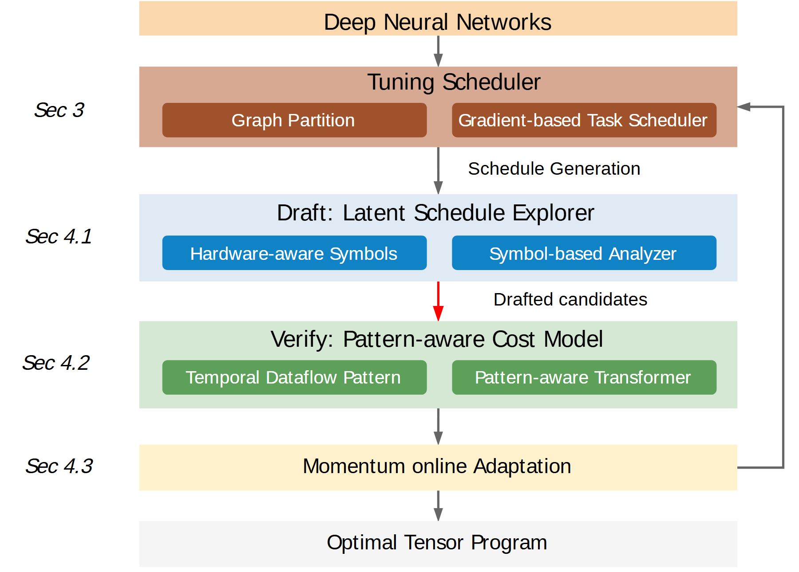

# VA-040 · 候选粗筛与精评迭代流水线

以竖直流程把问题输入、任务组织、快速探索、精细评估、在线调整和最终输出连续串起。中间两个阶段各含一对方法子模块，使图既能表达总流程又能点出内部方法。右侧长回线说明评估后还会更新调度，不能把这条回线当成无需证据的性能提升承诺。



## 适用范围

- 先低成本筛选再精细评估的优化流程
- 候选生成与代价预测之间存在迭代更新

不适合：只有一次计算而无候选集合；没有在线更新机制的静态方法比较。

## 阅读顺序

1. 从顶部输入进入调度组织层
2. 读取蓝色探索层及两个内部子模块
3. 顺着中间下行箭头进入绿色评估层
4. 查看底部调整与输出，并沿右侧回线回到调度器

## 图形表达

**布局**：纵向居中排布，各阶段采用等宽横带；左边留阶段说明位，右边留反馈回路走廊。

**对象**：外层色带表示阶段，内层深色小条表示具体方法，顶部和底部细条表示输入输出。

**连线**：主链沿中心下行，探索到评估的连接用红色突出候选交接，右侧回线表示更新而非另一个输出。

**配色**：棕色用于调度、蓝色用于快速探索、绿色用于精评、浅黄色用于调整；不要改成高低性能评分。

**文字**：阶段名常规字重，内部方法白字置于深色条上；长方法名宁可缩写并在正文解释，不缩成难读小字。

## 部件与复用

| 部件 | 含义 | 改造方法 |
|---|---|---|
| 输入与调度层 (`scheduler`) | 将输入问题划分并确定探索任务。 | 替换调度依据和子问题表示，不沿用特定模型名称。 |
| 快速探索层 (`draft-stage`) | 以简化表示和低成本分析生成少量候选。 | 写明快速模型近似了什么，不能直接命名为精确验证。 |
| 精细评估层 (`verify-stage`) | 用更详细的模式或成本模型比较候选。 | 区分预测得分与独立验证，必要时增加实际求解模块。 |
| 调整与输出层 (`online-adaptation`) | 使用新信息更新过程并给出选定结果。 | 没有在线样本时改为离线迭代或删除返回箭头。 |

## 改造步骤

1. 将每个阶段的输入输出先用一句话定义，再填写框内方法
2. 删除旧章节号或换成本论文实际章节，避免无效索引
3. 明确评估层是代理模型还是独立检验，不借绿色暗示通过验证
4. 需要终止条件时在回线旁加标签并留出横向空间

## 新情景示例（假设）

可用于假设的应急设施选址搜索。

输入为候选位置与需求，快速层用距离近似筛选，精评层用交通分配模型计算，调整层更新搜索优先级。

把两个精评子模块改成服务可达性和容量检查；若没有在线数据，用“迭代更新”替代“在线调整”。

## 编辑入口

**入口**：make_figure.py 读取 example.json 生成 fig.svg；加 --parts 导出部件，render_architecture.py 渲染预览及 PDF。

**配置可改**：labels 按 labels.json 对象键改字；components 支持 visible、dx/dy、attributes；elements 改对象属性。位移用图内坐标，连线不自动重布。

**需改代码**：增删模块、改连接和布局须修改 customize()。新对象须有唯一 data-asset-key 并登记部件归属；嵌套部件选一个层级平移，避免重复移动。

**字体**：当前完整字体为 Arimo-Regular。font_size 是元素局部坐标单位，受缩放变换影响，不是纸面字号；改长标签后按最终版面宽度复核换行与字距。

准备独立工作副本：

```text
python "<SKILL>/scripts/prepare_architecture.py" --id VA-040 --out figures/architecture
```

在工作副本运行：

```text
python make_figure.py --config example.json --out . --parts
python render_architecture.py fig.svg
```

## 本图检查

- 粗筛输出是否确实成为精评输入
- 回线是否回到会受新信息影响的阶段
- 输出名称是否夸大为未经证明的全局最优

部件图用于复用局部对象；跨边界的连接和共享容器仍需按新关系处理。示例名称、数值和曲线不是当前研究结果。

来源与许可见 [ATTRIBUTION.md](ATTRIBUTION.md)。
