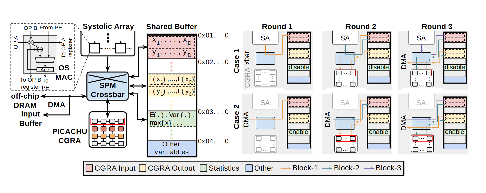

# VA-115 · 共享缓冲与双模式三轮执行矩阵

左侧把计算阵列、交叉开关与分区缓冲连成系统小图，右侧用两行三列对齐同一缓冲在不同轮次和模式下的流向；读者可以同时理解资源结构和状态变化。



## 适用范围

- 两种执行策略在相同轮次下的缓存状态比较
- 有限共享空间中输入、输出和统计量复用

不适合：没有重复状态的普通串行流程；只关心最终性能数字的方案比较。

## 阅读顺序

1. 先读左侧阵列—交叉开关—分区缓冲的连接
2. 从底部图例识别四类缓冲与三个数据块
3. 逐行观察右侧 Case 1 和 Case 2 的三轮变化
4. 对照 enable/disable 标签理解统计区是否启用

## 图形表达

**布局**：约左半宽用于系统结构，右半宽为两行三列状态小图；统一图例横置底部。

**对象**：小网格表现计算阵列，竖向分段长框表现共享缓冲，六个浅灰底小面板保持同构。

**连线**：左侧黑色箭头解释读写路径，右侧细彩色折线追踪数据块；局部箭头不等同时间轴。

**配色**：粉色是输入、浅黄是输出、浅绿是统计、浅蓝是其他变量；橙青紫细线区分块。

**文字**：系统名与轮次加粗，公式、地址和寄存器注释更小；密集小字适合横向宽幅。

## 部件与复用

| 部件 | 含义 | 改造方法 |
|---|---|---|
| 计算与交叉开关 (`compute-crossbar`) | 阵列和计算单元经交叉开关访问共享区 | 保留双向读写区别，替换计算对象时重接相关边 |
| 四类共享缓冲 (`shared-buffer`) | 同一存储空间分出输入输出统计和其他变量 | 增减缓冲类别须同步所有六个状态格和图例 |
| 第一模式三轮 (`case-one`) | 同一状态结构跨三轮变化且统计区禁用 | 按共同轮次替换块路径，保持列宽一致 |
| 第二模式三轮 (`case-two`) | 第二模式通过DMA并启用统计区 | 不要仅换行标题，应改真实状态和箭头 |
| 缓冲与数据块图例 (`legend`) | 统一解释色块类别和细线数据块身份 | 整图只保留一套图例，颜色更改必须全图联动 |

## 改造步骤

1. 先定义两种策略共同的轮次和缓冲类别，避免比较口径不同
2. 将左侧资源块映射为新系统，再分别重画六格的状态与流向
3. 为彩色块建立一致的命名和颜色映射，更新图例及 enable/disable 文本
4. 轮次数或缓冲分区数改变时，用代码重排矩阵和共享连线

## 新情景示例（假设）

假设的批处理系统缓存复用图

左侧映射为数据生产器、路由器和任务执行器；两行映射为流式与归约策略

如使用四轮，应新增一列，并按每轮实际统计写回改线，不能复制第三轮充数

## 编辑入口

**入口**：运行 make_figure.py --config example.json --out . --parts；example.json 是示例配置，labels.json 记录可定位文字，asset.json 记录部件及元素归属。

**配置可改**：labels 修改已有文字；components 可配色、显隐或位移。配置修改不自动重排容器、表格或连接线。

**需改代码**：在 customize(root, context) 中调整拓扑和几何；新增元素须设置 data-asset-key，并将键加入部件 element_keys。轮次数或缓冲分区数改变时，用代码重排矩阵和共享连线

**字体**：系统名与轮次加粗，公式、地址和寄存器注释更小；密集小字适合横向宽幅。 最终字体文件以构建映射为准；局部 font_size 是源坐标字号，不能直接当成论文纸面 pt。本批构建已确认并嵌入完整字体：Arimo-Bold.ttf, Arimo-Regular.ttf。映射可能改变原字形和字宽，需按实际论文尺寸复核。

准备独立工作副本：

```text
python "<SKILL>/scripts/prepare_architecture.py" --id VA-115 --out figures/architecture
```

在工作副本运行：

```text
python make_figure.py --config example.json --out . --parts
python render_architecture.py fig.svg
```

## 本图检查

- 六格的分区顺序和色义是否一致
- 统计区禁用时是否仍画入错误写入箭头
- 块颜色与图例及每一轮标签是否对应
- 论文页眉及作者行不属于图，应从发布资产中移除

部件图用于复用局部对象；跨边界的连接和共享容器仍需按新关系处理。示例名称、数值和曲线不是当前研究结果。

来源与许可见 [ATTRIBUTION.md](ATTRIBUTION.md)。
