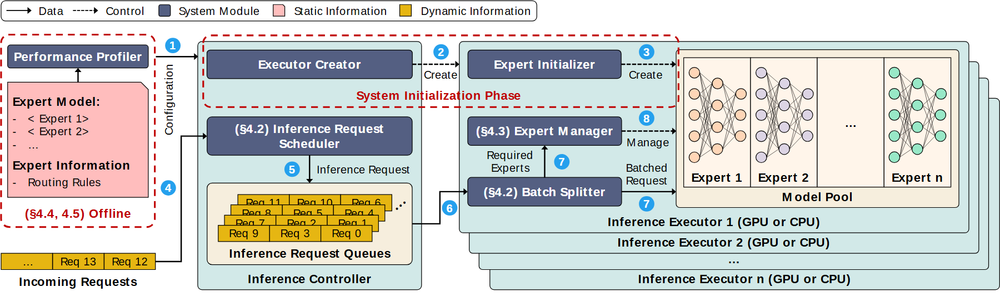

# VA-010 · 离线配置与在线多执行器服务

把一次性准备和持续请求处理画在同一张宽图中。左侧配置影响上方初始化与中部调度；队列进入执行器后分批选择模型，叠层面板表达多个同类执行器。核心是区分静态设置、动态任务和控制关系。



## 适用范围

- 需要预先测量配置的模型服务
- 多模型选择与批处理共存的调度系统

不适合：单一模型的一次调用；需要准确表达每项耗时的时间线。

## 阅读顺序

1. 先看图例，区分模块、静态信息和请求。
2. 从左侧配置卡追踪上方初始化链。
3. 从底部请求入口进入队列。
4. 沿分批与管理模块到右侧模型池。

## 图形表达

**布局**：左窄右宽；上部初始化带横跨在线模块，下部是队列到执行器。

**对象**：请求以金色阶梯卡片表示；模型用小型节点网络；执行器背后叠片表示同构副本。

**连线**：实线传数据、虚线传控制；编号用于阅读顺序，不表示耗时。

**配色**：深蓝灰模块、粉色静态信息、金色动态信息，浅青面板仅作分组。

**文字**：模块名加粗，控制注释较小；宽图缩为单栏会损失队列与连线标签。

## 部件与复用

| 部件 | 含义 | 改造方法 |
|---|---|---|
| 离线配置 (`offline-profile`) | 记录可复用的测量与路由信息。 | 替换为当前配置字段，不能把未测量性能写成事实。 |
| 初始化横带 (`initialization`) | 创建执行单元并装载模型。 | 与逐请求运行分开，删除不需要的初始化步骤。 |
| 调度和队列 (`request-control`) | 组织进入系统的动态任务。 | 队列卡改成真实任务单元及优先级。 |
| 分批与模型管理 (`batch-manager`) | 将任务需求和可用模型连接。 | 没有分批机制时删除相应节点与边。 |
| 模型池 (`expert-pool`) | 并列多个可选择计算模型。 | 内部节点网络应换成当前模型结构。 |
| 执行器叠层 (`executor-stack`) | 多个执行器共享内部组成。 | 实例数变化时同时调整叠片、标签及路由。 |

## 改造步骤

1. 先定义静态配置和运行期变化的边界。
2. 请求编号改成新情景的例子，清除无关章节号。
3. 改变模型数量时重新排列小网络和分批出口。

## 新情景示例（假设）

假设用于城市多传感器预警服务。

离线配置存放传感器可靠性与模型成本，请求队列装入时间窗，模型池包含洪水、交通和空气质量模型。

把专家网络换成三种预测模型图标，并按实际任务依赖重画选择关系。

## 编辑入口

**入口**：以 make_figure.py 为入口，先复制 example.json 作为当前情景配置；labels.json 定位标签，asset.json 定位部件。

**配置可改**：labels 可改文字和文字样式，components 可做显隐、平移和局部样式调整；elements 可定位矢量元素。配置只作用于已有几何，不会自动解决布局冲突。

**需改代码**：增减模型、改变执行器内部职责、增加跨执行器通信需改 customize() 或矢量元素；共享引擎不自动重排网络。

**字体**：当前替换字体为 Arimo-Bold、Arimo-Regular、Carlito-Regular。改字后检查字宽、基线及 PDF 字体嵌入；原图的逐字定位不保证能容纳更长名称。

准备独立工作副本：

```text
python "<SKILL>/scripts/prepare_architecture.py" --id VA-010 --out figures/architecture
```

在工作副本运行：

```text
python make_figure.py --config example.json --out . --parts
python render_architecture.py fig.svg
```

## 本图检查

- 图例的实虚线约定贯穿所有连线。
- 初始化带不遮盖在线请求入口。
- 叠层执行器没有被误读为串行阶段。

部件图用于复用局部对象；跨边界的连接和共享容器仍需按新关系处理。示例名称、数值和曲线不是当前研究结果。

来源与许可见 [ATTRIBUTION.md](ATTRIBUTION.md)。
