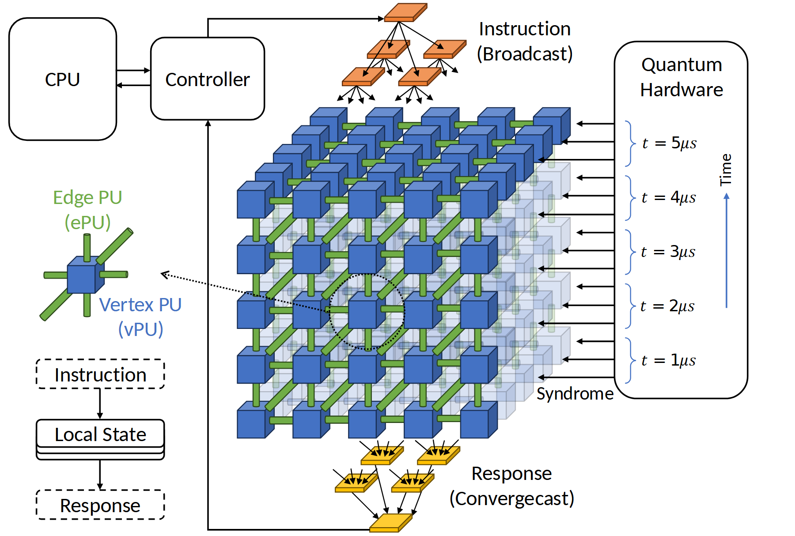

# VA-080 · 广播与汇聚连接的时空协作阵列

中央立体阵列是这张图的主体，蓝色节点与绿色连接单元分别对应两类处理职责。上方树分发指令，下方树收集响应，右侧输入按时间层进入阵列，左侧小图解释单个单元的状态更新。立体深度在当前组织中表达时间轮次，不应未经说明改称物理空间第三维。



## 适用范围

- 同时具有节点计算、边计算和多轮输入的并行系统
- 需要展示树状广播与汇聚包围网格计算

不适合：节点数量很少的普通分布式服务；仅为美观而使用三维效果的串行算法。

## 阅读顺序

1. 先看左上主机与控制器建立指令来源
2. 跟随上方树进入中央网格，辨认蓝节点与绿连接
3. 从右侧时间刻度理解不同层输入
4. 查看下方响应树及左下局部指令—状态—响应循环

## 图形表达

**布局**：大阵列居中偏右，左侧放控制入口和局部图例，上下分布两棵树，右侧为外部设备及时间轴。

**对象**：蓝立方体代表顶点单元，绿色杆状对象代表边单元，透明后层建立深度；树节点采用扁平多边形。

**连线**：上方多级扇出为广播，下方逐级合并为响应汇聚，右侧水平箭头逐层输入；虚线引线只对应局部图例。

**配色**：蓝绿分别编码两类处理单元，橙色广播树与黄色汇聚树区分阶段；同类立方体侧面深浅仅表示朝向。

**文字**：无衬线正文配少量斜体时间符号，图例与阵列标签保持同尺度；时间单位须明确，不能把示意刻度当成实测延迟。

## 部件与复用

| 部件 | 含义 | 改造方法 |
|---|---|---|
| 主机控制入口 (`controller`) | 主机发命令，控制器负责分发并收集响应。 | 改为实际控制来源，保留请求与响应的方向区别。 |
| 广播树 (`broadcast-tree`) | 把一个控制消息多级分发给阵列。 | 依据实际层级增加或减少分支，不把广播树当作依赖图。 |
| 时空协作阵列 (`lattice`) | 节点和边单元构成多层网格。 | 重新定义每个维度；修改网格规模需重画遮挡次序与连接。 |
| 分层输入 (`layer-input`) | 外部观测按时间轮次送到对应层。 | 换成当前输入类型和采样间隔，若层表示空间需重写轴及说明。 |
| 响应汇聚树 (`gather-tree`) | 局部处理结果向控制器归并。 | 明确汇聚操作是求和、投票还是状态归约，不能省略其语义。 |
| 局部状态图例 (`local-state`) | 放大节点、连接以及收到指令后更新状态的过程。 | 同步阵列图元颜色，并把局部状态更新写成当前方法的实际动作。 |

## 改造步骤

1. 先写清二维网格和深度方向各代表什么
2. 删除没有依据的微秒刻度，保留序号或明确示意时间
3. 修改阵列时必须同时更新两棵树和侧向输入端点
4. 若新任务没有边处理单元，用普通连线替换绿色杆并修改图例

## 新情景示例（假设）

可用于假设的分布式网格水流演算。

蓝节点存储网格水位，绿单元计算相邻通量，深度表示时间步，广播树分发步长，汇聚树收集守恒误差。

右侧改为边界条件输入；若所有网格同时更新而不保留多步状态，将深度层改成时间快照示意并明确非物理副本。

## 编辑入口

**入口**：make_figure.py 读取 example.json 生成 fig.svg；加 --parts 导出部件，render_architecture.py 渲染预览及 PDF。

**配置可改**：labels 按 labels.json 对象键改字；components 支持 visible、dx/dy、attributes；elements 改对象属性。位移用图内坐标，连线不自动重布。

**需改代码**：增删模块、改连接和布局须修改 customize()。新对象须有唯一 data-asset-key 并登记部件归属；嵌套部件选一个层级平移，避免重复移动。

**字体**：当前完整字体为 Carlito-Regular, DejaVuSans。font_size 是元素局部坐标单位，受缩放变换影响，不是纸面字号；改长标签后按最终版面宽度复核换行与字距。

准备独立工作副本：

```text
python "<SKILL>/scripts/prepare_architecture.py" --id VA-080 --out figures/architecture
```

在工作副本运行：

```text
python make_figure.py --config example.json --out . --parts
python render_architecture.py fig.svg
```

## 本图检查

- 深度方向是否在轴或图注中被明确定义
- 前后层透明与遮挡是否让连接穿过错误节点
- 广播及汇聚树的叶子是否与阵列接口一致

部件图用于复用局部对象；跨边界的连接和共享容器仍需按新关系处理。示例名称、数值和曲线不是当前研究结果。

来源与许可见 [ATTRIBUTION.md](ATTRIBUTION.md)。
