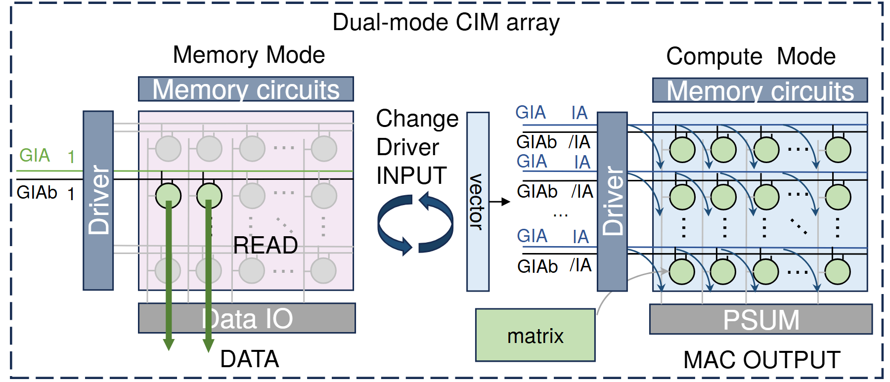

# VA-041 · 共享阵列的双模式切换

左右两幅等结构阵列分别展示读取与并行计算状态，中心循环箭头表达模式切换。相同阵列在不同驱动输入下激活不同单元和信号路径，读者通过对应位置比较变化。此图的密度来自重复单元、驱动条和输出条的真实对应关系，适合硬件或矩阵型对象；它不能直接充当任意两种业务方案的比较图。



## 适用范围

- 同一硬件阵列在两种运行模式下的行为
- 同一网格结构的稀疏激活与并行激活比较

不适合：两套没有共同内部对象的独立系统；仅有抽象状态变化而无阵列或重复单元的机制。

## 阅读顺序

1. 先读左侧阵列：从驱动输入到少量激活单元，再到下方输出。
2. 越过中间模式切换说明，确认改变的是控制输入。
3. 对照右侧同位置单元，读取多路输入、并行路径及汇总输出。

## 图形表达

**布局**：两个阵列横向镜像，中央留窄带放切换关系；同一虚线大边界把两幅状态归为同一对象。

**对象**：圆点表示重复单元，规则网格承载位置；驱动竖条、存储横条和输出横条有明确接口角色。

**连线**：左图少量粗向下箭头突出选中路径，右图多条细曲线显示并行汇聚；中心回转箭头是模式变化而非数据循环。

**配色**：灰色压低未激活单元，浅绿标识激活或输入控制对象，蓝灰用于驱动和接口条；不同模式共享同一颜色词典。

**文字**：纵向接口字可以旋转，但外部信号缩写必须在图注解释；单元内部不放长标签。

## 部件与复用

| 部件 | 含义 | 改造方法 |
|---|---|---|
| 选通读取状态 (`mode-a`) | 同一阵列中少量通道激活并输出数据 | 保持未激活位置可比较，按新对象重新定义选通信号。 |
| 模式切换控制 (`mode-switch`) | 改变驱动输入使阵列进入另一状态 | 说明触发条件；循环箭头不代表自动、连续或无代价切换。 |
| 并行运算状态 (`mode-b`) | 多个单元同时参与并在输出端合成 | 重画真实并行边，输出若不是加和就删除部分和语义。 |

## 改造步骤

1. 确认两种模式共享同一实体与网格坐标，列出真正改变的控制和路径。
2. 固定两边网格与外壳尺寸，再更新激活单元和信号标签。
3. 依据真实输出类型修改底部接口，并检查右图曲线是否均有明确终点。
4. 删除不适用的电路缩写，保留模式切换说明与必要图例。

## 新情景示例（假设）

假设展示可重构传感阵列的巡检和集中采样模式。

左图表示单列轮询，右图表示多列同步采集，驱动条对应时序控制，输出条对应数据汇聚。

计算部分和应改为采样结果集合；删除乘加相关信号，并将同步采样连线按实际读出通道重新布置。

## 编辑入口

**入口**：在工作副本修改 example.json，运行 python make_figure.py --config example.json --out output --parts；再通过 Vivid 的矢量渲染入口检查 SVG 与 PDF。

**配置可改**：labels 按 labels.json 的元素键改字；components 按本页部件 id 设置 visible、dx、dy 或 attributes；elements 修改指定矢量元素属性。重叠部件可能共享元素，避免对父区域和内部区域重复位移。

**需改代码**：网格维度、激活集合和运算连线变化需要在 customize 中重建重复单元及路径，不能仅重命名接口。这些接口不会自动重排，也不会随部件移动自动修复跨部件连线。

**字体**：本资产已记录的完整字形资源：Arimo-Regular.ttf, texgyreheros-regular.otf。修改英文标签优先沿用对应字体族与字重；文字变长时调整框宽和换行，不靠整体缩小压入。其他语言须另选覆盖所需字符的字体并实查导出。

准备独立工作副本：

```text
python "<SKILL>/scripts/prepare_architecture.py" --id VA-041 --out figures/architecture
```

在工作副本运行：

```text
python make_figure.py --config example.json --out . --parts
python render_architecture.py fig.svg
```

## 本图检查

- 左右相同位置是否确实表示同一单元，数量和坐标保持可比？
- 切换箭头是否被误读成物理信号回路？
- 右侧汇聚线是否穿过标签，读出与计算输出是否明确区分？

部件图用于复用局部对象；跨边界的连接和共享容器仍需按新关系处理。示例名称、数值和曲线不是当前研究结果。

来源与许可见 [ATTRIBUTION.md](ATTRIBUTION.md)。
