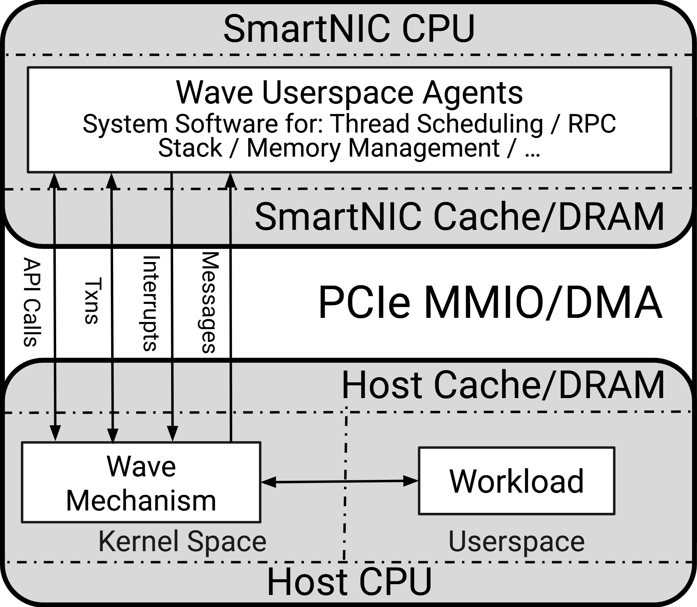

# VA-116 · 互联带分隔的主机与设备双栈

上下两个圆角灰色容器通过中间的完整互联带对应起来，设备代理与主机内核之间的四条竖向通道揭示调用、事务、中断和消息方向，底部再区分内核和用户空间。



## 适用范围

- 主机与外设协同执行的软件栈
- 跨处理器的控制决策和状态交互

不适合：没有物理或权限边界的短流程；大量并行服务及网状通信。

## 阅读顺序

1. 从上部设备CPU和用户态代理进入
2. 识别设备缓存、互联带与主机缓存的三层关系
3. 逐条读左侧API Calls、Txns、Interrupts、Messages箭头
4. 最后看底部内核机制与用户工作负载的双向交互

## 图形表达

**布局**：设备与主机上下镜像排列，互联文字占中间宽带，纵向通道集中左侧。

**对象**：圆角外框表示计算侧，内部白色矩形表示进程或机制，点划线表示层级与权限边界。

**连线**：API与事务通道为双向；Interrupts向下、Messages向上；底部机制与工作负载双向连接。

**配色**：灰色容器和白色组件构成中性配色，没有用颜色编码消息类型。

**文字**：全图为无衬线；外层处理器、缓存和互联名较大，通道名旋转90度，代理内说明较小。

## 部件与复用

| 部件 | 含义 | 改造方法 |
|---|---|---|
| 设备代理区域 (`device-agent`) | 设备端用户态代理及职责 | 职责过长时先换行，不能侵入下方通道 |
| 设备缓存层 (`device-memory`) | 设备端缓存与内存层标识 | 作为层级标签，不误画成独立服务框 |
| 互联带 (`interconnect`) | 主机设备共享的物理互联 | 协议名称改变不代表原四条消息语义仍成立 |
| 主机内核机制 (`host-mechanism`) | 执行设备决策的主机机制及内核标识 | 保留通道落点并重新验证权限 |
| 主机用户工作负载 (`host-workload`) | 受管理的用户空间工作负载 | 替换为工作应用并保留与内核的横向接口 |

## 改造步骤

1. 先确定哪一侧制定策略、哪一侧执行策略，再命名上下容器
2. 逐条给跨互联消息定义方向，不能把所有通道默认双向
3. 保留共享容器和跨区通道在整图；单独移动部件需同步更新连接端点
4. 增加处理侧或权限区时通过代码重新绘制外框、分界和旋转标签

## 新情景示例（假设）

假设的边缘协处理器任务管理

上方代理变为边缘调度服务，下方机制变为设备驱动，工作负载变为实时采集应用

若只有请求/完成两类通信，应删减原四通道并重排通道标签

## 编辑入口

**入口**：运行 make_figure.py --config example.json --out . --parts；example.json 是示例配置，labels.json 记录可定位文字，asset.json 记录部件及元素归属。

**配置可改**：labels 修改已有文字；components 可配色、显隐或位移。配置修改不自动重排容器、表格或连接线。

**需改代码**：在 customize(root, context) 中调整拓扑和几何；新增元素须设置 data-asset-key，并将键加入部件 element_keys。增加处理侧或权限区时通过代码重新绘制外框、分界和旋转标签

**字体**：全图为无衬线；外层处理器、缓存和互联名较大，通道名旋转90度，代理内说明较小。 最终字体文件以构建映射为准；局部 font_size 是源坐标字号，不能直接当成论文纸面 pt。本批构建已确认并嵌入完整字体：Roboto-Regular.otf。映射可能改变原字形和字宽，需按实际论文尺寸复核。

准备独立工作副本：

```text
python "<SKILL>/scripts/prepare_architecture.py" --id VA-116 --out figures/architecture
```

在工作副本运行：

```text
python make_figure.py --config example.json --out . --parts
python render_architecture.py fig.svg
```

## 本图检查

- 点划线是否被误读为数据流
- 四条纵向线的箭头端是否对应消息方向
- 内核与用户空间分隔是否仍落在两块之间
- 长职责列表是否越过设备内框

部件图用于复用局部对象；跨边界的连接和共享容器仍需按新关系处理。示例名称、数值和曲线不是当前研究结果。

来源与许可见 [ATTRIBUTION.md](ATTRIBUTION.md)。
