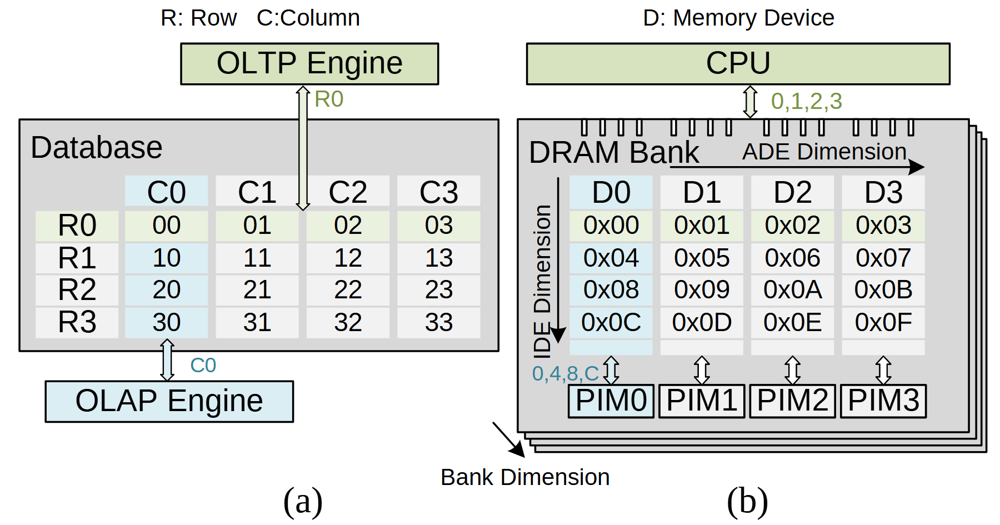

# VA-117 · 逻辑行列访问与物理存储维度对应

左边以数据库表展示行访问和列访问，右边以具有深度的存储阵列展示CPU方向与局部处理方向。两侧复用浅绿行和浅蓝列，使逻辑访问模式与物理结构建立可见对应。



## 适用范围

- 抽象数据组织与硬件布局的对应说明
- 行列访问模式映射到两个物理处理维度

不适合：时间先后顺序；多方案优劣的定量评比。

## 阅读顺序

1. 先看左表行R和列C的定义
2. 读取上方OLTP与下方OLAP分别接出的行列访问
3. 转向右侧CPU、存储阵列和底部PIM单元
4. 结合ADE、IDE与Bank三个方向理解物理维度

## 图形表达

**布局**：左右并列两面板，左为平面表，右为叠放存储层；上下外部组件对应水平与垂直访问。

**对象**：规则表格加浅色高亮行列，右侧多层错位框暗示存储层数，底部一排PIM方块与列对齐。

**连线**：粗黑单箭头标维度，空心双箭头标访问连接；两者语义不同。

**配色**：浅绿贯穿CPU/OLTP和第一行，浅蓝贯穿OLAP及第一列；背景存储灰色。

**文字**：无衬线表头较大，地址和维度标注较小；ADE/IDE有旋转文字，面板编号独立放底部。

## 部件与复用

| 部件 | 含义 | 改造方法 |
|---|---|---|
| 逻辑行列访问 (`logical-access`) | OLTP/OLAP围绕数据库表的两个访问方向 | 替换为新的行列任务时保持颜色与访问对象一致 |
| CPU横向访问 (`cpu-access`) | 顶端CPU对右表行方向访问 | 更换控制单元名称时保留双向连接 |
| 物理存储阵列 (`physical-array`) | 存储设备列与层叠Bank组成的物理空间 | 新增列须同步地址序列和PIM单元 |
| 存储层深度方向 (`bank-axis`) | 斜向箭头解释叠放层次 | 维度名称与真正的叠放方向一致 |

## 改造步骤

1. 确定逻辑表行列各是什么，再定义它们映射的物理维度
2. 同步修改两表的高亮色、地址标签和上下访问组件
3. 保留面板边界，避免把左右两图连成处理流水线
4. 改变行列数量需在代码中重算格宽、访问箭头和PIM对齐

## 新情景示例（假设）

假设的空间数据存储布局教学图

左表行表示时间批次、列表示传感器；右表列映射到设备，层映射到分区

应重写地址样例和所有方向名，并去除不适用的OLTP/PIM术语

## 编辑入口

**入口**：运行 make_figure.py --config example.json --out . --parts；example.json 是示例配置，labels.json 记录可定位文字，asset.json 记录部件及元素归属。

**配置可改**：labels 修改已有文字；components 可配色、显隐或位移。配置修改不自动重排容器、表格或连接线。

**需改代码**：在 customize(root, context) 中调整拓扑和几何；新增元素须设置 data-asset-key，并将键加入部件 element_keys。改变行列数量需在代码中重算格宽、访问箭头和PIM对齐

**字体**：无衬线表头较大，地址和维度标注较小；ADE/IDE有旋转文字，面板编号独立放底部。 最终字体文件以构建映射为准；局部 font_size 是源坐标字号，不能直接当成论文纸面 pt。本批构建已确认并嵌入完整字体：Arimo-Regular.ttf, Tinos-Regular.ttf。映射可能改变原字形和字宽，需按实际论文尺寸复核。

准备独立工作副本：

```text
python "<SKILL>/scripts/prepare_architecture.py" --id VA-117 --out figures/architecture
```

在工作副本运行：

```text
python make_figure.py --config example.json --out . --parts
python render_architecture.py fig.svg
```

## 本图检查

- 绿色行与蓝色列在两面板是否一致
- 右表十六进制地址顺序是否与文字描述相符
- CPU与PIM访问箭头是否与维度箭头混淆
- 叠放后框和Bank方向箭头是否完整保留

部件图用于复用局部对象；跨边界的连接和共享容器仍需按新关系处理。示例名称、数值和曲线不是当前研究结果。

来源与许可见 [ATTRIBUTION.md](ATTRIBUTION.md)。
