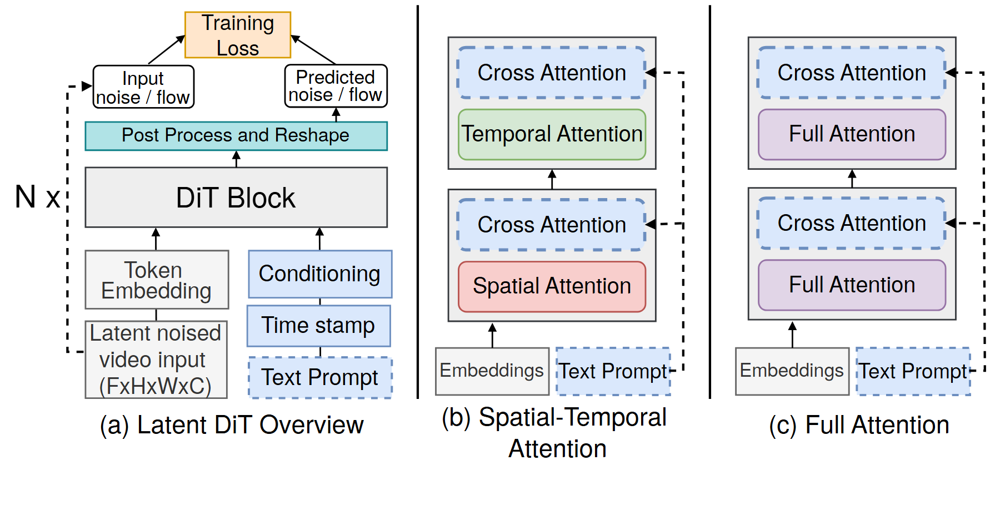

# VA-118 · 模型总览与两种注意力模块展开

左面板交代输入、条件、重复块和训练损失；中右面板用相同外观比较分解式时空注意力与全注意力。统一的蓝色虚线条件块把总览与内部结构联系起来。



## 适用范围

- 一个模型总览加两个可替换子模块说明
- 相同输入条件下的内部结构变体比较

不适合：部署节点的网络拓扑；只有一层且无需展开的简单模型。

## 阅读顺序

1. 左面板从底部带噪输入及文本条件向上读至预测和损失
2. 注意N×标记表示重复模块数量而非一条循环边
3. 中面板从Embeddings进入Spatial再Temporal，并读取文本侧路
4. 右面板沿相同方向读两层Full Attention

## 图形表达

**布局**：三个竖向面板用直线分隔，整体自底向上；后两面板的模块边界和条件支路对齐。

**对象**：矩形是嵌入和处理步骤，圆角色块是注意力类型，虚线蓝框是文本或交叉注意力。

**连线**：实线向上连接主路径，虚线从右侧文本支路进入交叉注意力；左侧输入到损失还有独立监督路径。

**配色**：粉色空间、绿色时间、紫色全注意力，浅蓝用于文本条件/交叉注意力，橙色突出损失。

**文字**：无衬线较大，面板标题位于底部；N×、张量维度、Time stamp的拼写须保留可编辑性。

## 部件与复用

| 部件 | 含义 | 改造方法 |
|---|---|---|
| 条件生成模型总览 (`overview`) | 输入与条件汇合到重复块并输出训练损失 | 推理图应明确移除监督损失分支而非仅换标题 |
| 时空分解模块 (`factorized`) | 空间与时间注意力串接且各接文本条件 | 替换次序时同时更新两层标题与路径 |
| 全注意力模块 (`full-attention`) | 用相同结构展示两层全注意力 | 保持与中面板相同输入及可比层数 |

## 改造步骤

1. 先确定展示的是训练还是推理，以此保留或删除左上损失
2. 为总览块建立真实的内部模块对应，不把后两面板当作串行后续步骤
3. 按新方法更改条件支路及层数，同时保持比较面板的尺度一致
4. 增删注意力层时在代码中重排外框、箭头和重复次数

## 新情景示例（假设）

假设的时空预测模型结构对照

左面板换为观测序列预测总览，中面板表示分离时间空间建模，右面板表示联合建模

如没有文本条件，应替换为真实外生条件或移除整条虚线分支，并检查输入维度

## 编辑入口

**入口**：运行 make_figure.py --config example.json --out . --parts；example.json 是示例配置，labels.json 记录可定位文字，asset.json 记录部件及元素归属。

**配置可改**：labels 修改已有文字；components 可配色、显隐或位移。配置修改不自动重排容器、表格或连接线。

**需改代码**：在 customize(root, context) 中调整拓扑和几何；新增元素须设置 data-asset-key，并将键加入部件 element_keys。增删注意力层时在代码中重排外框、箭头和重复次数

**字体**：无衬线较大，面板标题位于底部；N×、张量维度、Time stamp的拼写须保留可编辑性。 最终字体文件以构建映射为准；局部 font_size 是源坐标字号，不能直接当成论文纸面 pt。本批构建已确认并嵌入完整字体：texgyreheros-regular.otf。映射可能改变原字形和字宽，需按实际论文尺寸复核。

准备独立工作副本：

```text
python "<SKILL>/scripts/prepare_architecture.py" --id VA-118 --out figures/architecture
```

在工作副本运行：

```text
python make_figure.py --config example.json --out . --parts
python render_architecture.py fig.svg
```

## 本图检查

- 主路径是否全部自底向上
- N×是否被错误解释为数据回流
- 中右两种结构是否共享可比输入
- 训练损失是否在推理版中错误保留

部件图用于复用局部对象；跨边界的连接和共享容器仍需按新关系处理。示例名称、数值和曲线不是当前研究结果。

来源与许可见 [ATTRIBUTION.md](ATTRIBUTION.md)。
