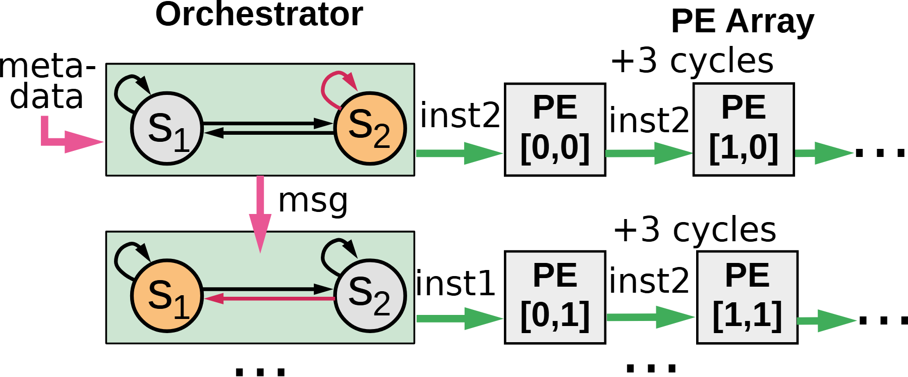

# VA-011 · 跨行事件驱动的状态与执行阵列

用上下两个协同实例解释控制消息怎样改变当前状态，并进一步改变向右发出的执行指令。左半是有记忆的状态机，右半是带位置编号的重复执行单元；两行同时存在，不应解读成同一对象的改造前后。横向错开的指令和延迟标注共同表达传播时序。



## 适用范围

- 多条产线各自控制、又用事件互相触发
- 分行硬件执行或带阶段状态的协同机器人

不适合：只需说明输入到输出的无状态流水线；没有明确传播延迟的普通组织架构。

## 阅读顺序

1. 先读左上状态圆，确认高亮状态及允许的迁移。
2. 沿绿色横箭头读上行指令如何传入连续单元。
3. 沿粉色竖箭头查看跨行事件，再读下行状态与输出变化。

## 图形表达

**布局**：两行左控右执行，列间距重复形成阵列节奏；底部和右端省略号只表示同类实例延伸。

**对象**：圆形表示状态，绿色矩形包围一个控制实例，灰方框表示执行器；橙色只标当前状态。

**连线**：黑弧线为状态迁移，绿色粗箭头为发令，粉色为外部触发；回环不是网络自连接。

**配色**：保持绿色发令与粉色事件两套编码；新场景若增加故障状态，另加文字或轮廓而非挪用粉色。

**文字**：状态符号可简短，指令名应能独立解释；周期标注在两列中间，避免与单元编号争抢位置。

## 部件与复用

| 部件 | 含义 | 改造方法 |
|---|---|---|
| 第一控制实例 (`upper-fsm`) | 两个状态及自环、切换边构成局部状态机。 | 替换状态名称及可达边；高亮必须对应这一行实际输出。 |
| 第二控制实例 (`lower-fsm`) | 接收跨行事件的另一状态机，有不同当前状态。 | 不整块照抄上行；明确事件触发的起止状态。 |
| 分行执行阵列 (`execution-array`) | 按行接收命令、按列呈现传播的重复单元。 | 改执行器坐标与命令；增加列时同步增加连线及延迟位置。 |
| 跨行事件 (`state-message`) | 连接两个控制实例的触发消息。 | 换成具体事件名；数据交换应另画通道。 |

## 改造步骤

1. 先列新任务的状态表，再决定保留哪些圆和迁移边。
2. 删除示例周期数，改为有依据的延迟或不标数值。
3. 为两行分别指定触发、当前状态和输出命令，最后才替换文本。

## 新情景示例（假设）

假设展示两条装配线的联动控制。

上行负责零件备妥，下行在收到备妥事件后从等待切到装配；右侧单元映射连续工位。

删除硬件坐标，改工位号；仅在工位传递确有定时关系时保留间隔标注。

## 编辑入口

**入口**：以 make_figure.py 为入口，example.json 提供编辑配置，labels.json 用于查文字键，asset.json 对应下列部件。

**配置可改**：labels 改指定文字与字号；components 可显隐、平移和改属性；elements 修改单个矢量对象。平移保留固定几何，不会自动重新布线。

**需改代码**：改变状态数、行列数或加入双向事件时，需要重排状态圆、自环及跨行通道。 必须在 customize() 中处理新增矢量对象及连接，不能只扩大文字框。

**字体**：当前字体映射使用 Arimo-Bold.ttf, Arimo-Regular.ttf, DejaVuSans.ttf；换标签后按最终插入宽度检查字宽、上下标和边界，不直接继承小字号。

准备独立工作副本：

```text
python "<SKILL>/scripts/prepare_architecture.py" --id VA-011 --out figures/architecture
```

在工作副本运行：

```text
python make_figure.py --config example.json --out . --parts
python render_architecture.py fig.svg
```

## 本图检查

- 高亮状态是否与行内发出的命令一致。
- 粉色事件箭头是否落在受影响控制器而非执行器。
- 新增列后的省略号、延迟文字和横箭头是否仍有明确对应。

部件图用于复用局部对象；跨边界的连接和共享容器仍需按新关系处理。示例名称、数值和曲线不是当前研究结果。

来源与许可见 [ATTRIBUTION.md](ATTRIBUTION.md)。
