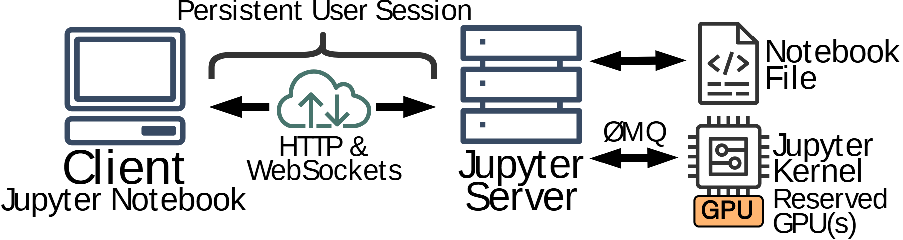

# VA-012 · 交互会话与双后端服务

用大图标展示客户端经持续连接访问服务端，服务端分别维护文档与执行后端。图的重点是会话边界、双向通信和资源绑定，而不是服务器内部算法；适合作为论文读者进入系统前的整体运行环境说明。



## 适用范围

- 交互式分析、远程实验和在线编辑服务
- 需要区分保存产物与执行资源的客户端系统

不适合：多层容器调度细节；无会话状态的离线批处理流水线。

## 阅读顺序

1. 从左侧终端识别用户入口。
2. 读顶部括号和连接图标，确认持续会话的范围。
3. 沿双向箭头到中间服务器。
4. 分别读右上文件与右下计算后端及其资源标注。

## 图形表达

**布局**：短宽横排，左中右三组主对象；右侧上下两支避免把文件与执行进程混在一起。

**对象**：终端、服务器叠层、文件折角和芯片均为可编辑矢量图标；图标表示对象类别，不表示数量。

**连线**：粗双箭头表示双向交换，括号表示会话范围；顶部括号不能替代数据连线。

**配色**：蓝灰给客户端与服务端轮廓，青色连接图标突出通道，橙色小块强调被占用资源。

**文字**：大号无衬线标签配合多行短词；协议标签放在线附近，不能挤进设备轮廓。

## 部件与复用

| 部件 | 含义 | 改造方法 |
|---|---|---|
| 客户端终端 (`client`) | 用户提交操作和接收结果的界面。 | 可替换成浏览器或控制台；保留一个清晰入口。 |
| 持续会话通道 (`session`) | 连接图标、协议和范围括号组成的会话说明。 | 按实际协议更名；无持续连接时删括号并重新标会话语义。 |
| 中心服务端 (`server`) | 协调文件读写及执行请求的中间节点。 | 服务器堆叠只代表服务类别，副本数需另加标注。 |
| 存储与计算后端 (`backend-objects`) | 右侧两种职责不同的对象。 | 文件改为产物，内核改为执行服务；不预留资源时去掉占用标签。 |

## 改造步骤

1. 明确用户操作是否真的保持同一个会话。
2. 把右侧两个后端分别映射到存储职责和计算职责。
3. 协议名、资源绑定和双向通信必须来自当前系统。
4. 增加第三类后端时扩大右区并重绘分支，不能只挤入新文字。

## 新情景示例（假设）

假设绘制在线地理分析平台。

客户端为地图工作台，服务端为分析会话服务，右上为项目文件，右下为栅格计算进程。

若进程按需启动，删除资源预留小块，另加启动请求箭头，而非继续表达持续占用。

## 编辑入口

**入口**：运行 make_figure.py，以 example.json 为改造配置；labels.json 查文字键，--parts 同步导出部件。

**配置可改**：labels 改文字，components 改显示、位移及样式，elements 改单个矢量属性；只选一个部件层级移动，避免重叠归属使对象移动两次。

**需改代码**：这是可编辑矢量结构，未实现自动布局。增删模块、改变连接或重新排版，须在 customize() 中改真实对象并更新部件成员。

**字体**：使用随包完整映射字体；改字后核查换行、符号和最终纸面字号。font_size 是对象局部单位，不能直接当作 PDF 的磅值。

准备独立工作副本：

```text
python "<SKILL>/scripts/prepare_architecture.py" --id VA-012 --out figures/architecture
```

在工作副本运行：

```text
python make_figure.py --config example.json --out . --parts
python render_architecture.py fig.svg
```

## 本图检查

- 括号是否只覆盖真实会话参与方。
- 右侧文件箭头与计算协议箭头是否有各自标签。
- 去掉预留资源后是否还残留 GPU 图标或文字。

部件图用于复用局部对象；跨边界的连接和共享容器仍需按新关系处理。示例名称、数值和曲线不是当前研究结果。

来源与许可见 [ATTRIBUTION.md](ATTRIBUTION.md)。
