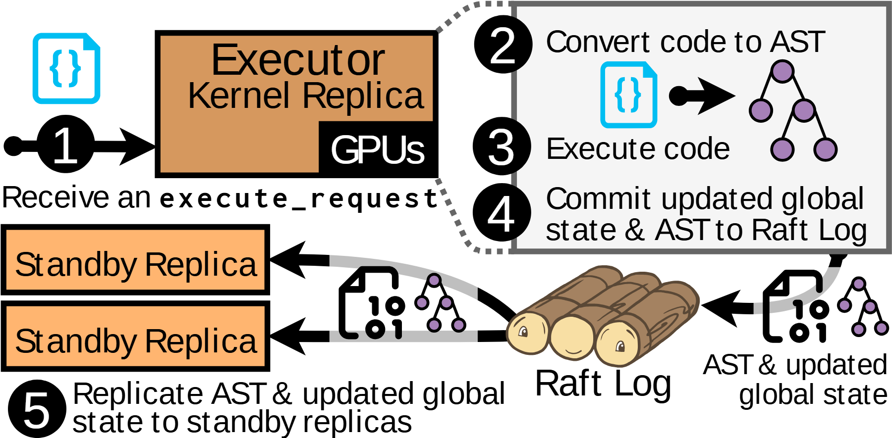

# VA-042 · 主执行副本与日志复制步骤

用五个编号把请求接收、表示转换、执行、提交和备份串起来。主副本右侧的放大框展示内部处理；下方日志对象连接多个待命副本。粗黑箭头和大编号突出先后关系，内部数据结构比模块框更醒目。



## 适用范围

- 带持久日志的主备执行
- 需要解释代码或状态如何复制的流程

不适合：无顺序提交的并行任务；需要展开一致性算法全部消息的协议图。

## 阅读顺序

1. 从左侧请求图标进入主执行框。
2. 沿放大边界进入转换与执行细节。
3. 追踪更新状态进入日志。
4. 由日志向左分发到多个待命副本。

## 图形表达

**布局**：上部主执行与右侧放大框，下部日志居中、备份靠左，构成回折阅读路径。

**对象**：文档图标表示代码，树形节点表示结构化表示，木段式日志仅是持久记录隐喻。

**连线**：粗箭头表达处理顺序；点状放大边界表示细节关系，不是数据通道。

**配色**：主执行与待命副本用橙棕同族色，树节点紫色，输入文档青色。

**文字**：大号步骤编号形成节奏；代码标识用等宽字，长步骤说明应拆行。

## 部件与复用

| 部件 | 含义 | 改造方法 |
|---|---|---|
| 活动执行副本 (`active-executor`) | 接收请求并承担执行责任。 | 改为真实主节点，设备标签按实现保留或删除。 |
| 执行细节窗 (`execution-detail`) | 转换表示、执行以及准备提交。 | 换内部算法时同步替换树形图与步骤说明。 |
| 提交日志 (`replication-log`) | 承载结构化表示与更新状态。 | 定义记录内容及提交时点，不把日志外观当一致性保证。 |
| 待命副本组 (`standby-replicas`) | 接收已记录的可恢复状态。 | 根据复制策略区分同步、异步或按需重放。 |

## 改造步骤

1. 明确日志保存的是命令、状态、增量还是多者组合。
2. 编号只表达图示顺序，不能隐含事务原子性。
3. 改变恢复机制后应重画待命副本接收内容，而不只替换日志名称。

## 新情景示例（假设）

假设用于仿真服务的容错执行。

请求变成仿真脚本，主副本解析任务树并运行，日志保存状态增量，备份服务据此恢复。

将语法树换为仿真任务依赖树，删除不适用的 GPU 标识，并补充恢复触发条件。

## 编辑入口

**入口**：以 make_figure.py 为入口，先复制 example.json 作为当前情景配置；labels.json 定位标签，asset.json 定位部件。

**配置可改**：labels 可改文字和文字样式，components 可做显隐、平移和局部样式调整；elements 可定位矢量元素。配置只作用于已有几何，不会自动解决布局冲突。

**需改代码**：调整步骤顺序、日志形状或主备数量需编辑路径与图元；新增流程不支持自动路由。

**字体**：当前替换字体为 Arimo-Regular、Inconsolata-Bold。改字后检查字宽、基线及 PDF 字体嵌入；原图的逐字定位不保证能容纳更长名称。

准备独立工作副本：

```text
python "<SKILL>/scripts/prepare_architecture.py" --id VA-042 --out figures/architecture
```

在工作副本运行：

```text
python make_figure.py --config example.json --out . --parts
python render_architecture.py fig.svg
```

## 本图检查

- 提交步骤位于复制之前且符合真实协议。
- 放大框内外没有重复计算成两次执行。
- 日志输出与备份输入描述的是同一状态版本。

部件图用于复用局部对象；跨边界的连接和共享容器仍需按新关系处理。示例名称、数值和曲线不是当前研究结果。

来源与许可见 [ATTRIBUTION.md](ATTRIBUTION.md)。
