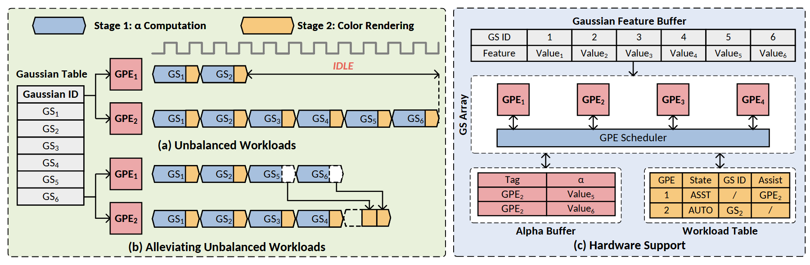

# VA-119 · 负载再分配时序与硬件支持并置

左侧上下两组双执行器轨迹展示空闲与协助后的差别，右侧列出共享特征、执行器阵列、调度器及两张辅助表。两阶段任务用不同颜色和拼接形状表达，可同时解释调度现象及实现结构。



## 适用范围

- 两阶段任务的负载再分配说明
- 调度改进与所需缓冲或状态表联合展示

不适合：只有静态组件关系没有时序；把示意条块当作真实测量耗时。

## 阅读顺序

1. 读取左上蓝色α计算和黄色颜色渲染图例
2. 比较左上Unbalanced与左下Alleviating两组轨迹
3. 沿左下帮助连线观察跨执行器的阶段接续
4. 转向右侧特征缓冲、执行阵列和调度器，再读底部α缓冲与负载表

## 图形表达

**布局**：左大框上下叠放前后时序，右大框上下叠放特征表、阵列调度与辅助表；两个面板高度一致。

**对象**：蓝黄拼接六边形任务片段、粉色执行器小框、矩形状态表和虚线区域共同组成高密度结构。

**连线**：时序水平展开，帮助箭头由上轨迹落入下轨迹；右侧调度器双向连执行器与辅助表。

**配色**：浅绿底为调度示例，浅蓝灰底为硬件结构；蓝为第一阶段、黄为第二阶段，粉为执行器和α数据。

**文字**：小号无衬线，GS/GPE下标与α符号是内容关键；红色斜体IDLE强调空闲。

## 部件与复用

| 部件 | 含义 | 改造方法 |
|---|---|---|
| 两阶段图例 (`stage-legend`) | 蓝黄两段定义任务阶段 | 修改阶段含义时同步所有轨迹段 |
| 输入任务表 (`task-table`) | 任务标识分发给多条轨迹 | 任务数改变需更新所有引用标识 |
| 未均衡轨迹 (`unbalanced`) | 上执行器早空闲、下执行器继续工作 | 展示真实或明确假设的时间比例 |
| 协助执行轨迹 (`assisted`) | 可独立阶段移交空闲执行器并回送后续阶段 | 保持帮助箭头与被迁移阶段对应 |
| 共享特征表 (`feature-store`) | 执行阵列共同读取的特征映射 | 任务编号与左表一一对应 |
| 执行器阵列与调度器 (`scheduler-array`) | 调度器连接多个处理单元 | 增减执行器需同步时序轨迹及表项 |
| 阶段结果缓冲 (`alpha-buffer`) | 保存协助计算所得中间量 | 变更字段需同步消费者 |
| 负载状态表 (`workload-table`) | 记录执行器状态、当前任务与帮助关系 | 不要将示例状态作为经过验证的运行结果 |

## 改造步骤

1. 先确认第一阶段是否可独立提前执行，不能为视觉均衡擅自拆分有依赖的任务
2. 同步左表任务编号、轨迹块和右侧特征列
3. 为协助动作补全中间结果存放与消费关系
4. 增加轨迹或字段时用代码重排表格及箭头，配置换字不能建立新的调度语义

## 新情景示例（假设）

假设的两阶段图像处理任务调度

蓝段映射为独立特征计算，黄段为有顺序约束的合成；右侧为任务特征与帮助状态

若新场景有三个执行器，应同步三条轨迹、三个调度端口及状态表，不保留原两执行器时间形状

## 编辑入口

**入口**：运行 make_figure.py --config example.json --out . --parts；example.json 是示例配置，labels.json 记录可定位文字，asset.json 记录部件及元素归属。

**配置可改**：labels 修改已有文字；components 可配色、显隐或位移。配置修改不自动重排容器、表格或连接线。

**需改代码**：在 customize(root, context) 中调整拓扑和几何；新增元素须设置 data-asset-key，并将键加入部件 element_keys。增加轨迹或字段时用代码重排表格及箭头，配置换字不能建立新的调度语义

**字体**：小号无衬线，GS/GPE下标与α符号是内容关键；红色斜体IDLE强调空闲。 最终字体文件以构建映射为准；局部 font_size 是源坐标字号，不能直接当成论文纸面 pt。本批构建已确认并嵌入完整字体：Carlito-Bold.ttf, Carlito-BoldItalic.ttf, Carlito-Regular.ttf。映射可能改变原字形和字宽，需按实际论文尺寸复核。

准备独立工作副本：

```text
python "<SKILL>/scripts/prepare_architecture.py" --id VA-119 --out figures/architecture
```

在工作副本运行：

```text
python make_figure.py --config example.json --out . --parts
python render_architecture.py fig.svg
```

## 本图检查

- 每个被协助的蓝段是否有后续黄段接续
- 左侧任务编号与特征表列是否一致
- α、GS/GPE下标及ASST/AUTO状态字在目标论文尺寸下是否完整清晰
- IDLE区与帮助后的时间长度是否仅为示意并说明

部件图用于复用局部对象；跨边界的连接和共享容器仍需按新关系处理。示例名称、数值和曲线不是当前研究结果。

来源与许可见 [ATTRIBUTION.md](ATTRIBUTION.md)。
