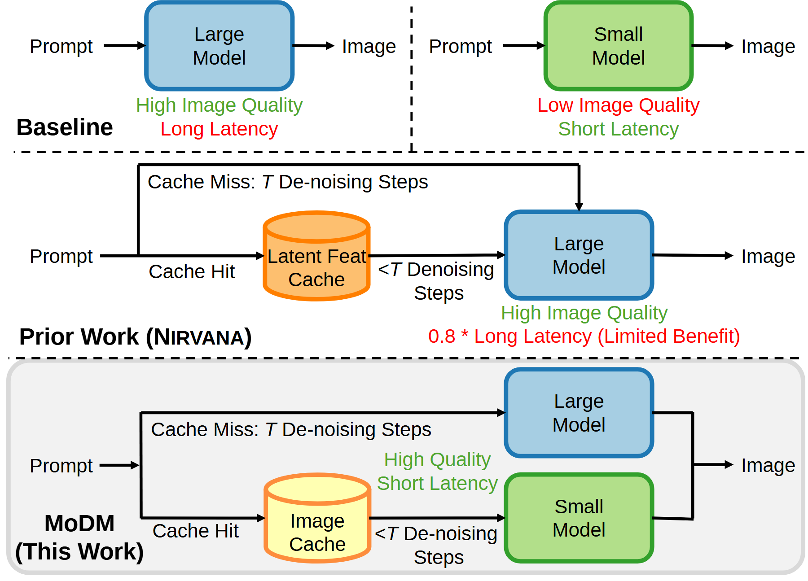

# VA-081 · 直接处理、缓存复用与条件分流对照

三行从最简单的两种直接处理方案，递进到缓存辅助的单处理器，再到按缓存状态选择不同处理器的方案。各行维持输入在左、输出在右，便于对照路径变化；底行浅灰背景突出待解释方案。核心区别是命中与未命中最终进入哪里，不是默认底行在质量和延迟上同时更优。



## 适用范围

- 缓存命中条件下选择不同执行路线的架构比较
- 需要分清直接计算、局部复用和分流策略的方案说明

不适合：不存在可验证命中条件的任意分支流程；没有统一输入输出或评价口径的优劣比较。

## 阅读顺序

1. 先看顶行两个独立直接路径，建立两种处理器的身份。
2. 读中行缓存命中与未命中如何仍汇入同一个处理器。
3. 读底行两种状态如何分别进入两个处理器，再到共同输出。
4. 最后阅读经验证的评价注释，不从框色推断效果。

## 图形表达

**布局**：三行垂直堆叠并用虚线分隔，顶行再分左右两种基线；底行圆角浅底承载新策略。

**对象**：处理器用圆角矩形，缓存用圆柱，同一对象跨行保持外形；输出汇合处应保持干净。

**连线**：未命中上绕、命中横穿缓存形成两条路线；分支标签紧贴各自线段，避免共享箭头造成条件歧义。

**配色**：蓝绿区分两类处理器，黄橙区分缓存；红绿评价文字需配明确词语，不能只靠颜色传达好坏。

**文字**：处理器内使用短两行标签，评价说明放框外；百分比与步数只在有当前证据时出现。

## 部件与复用

| 部件 | 含义 | 改造方法 |
|---|---|---|
| 直接路径对照 (`baseline-pair`) | 两个处理器分别从同类输入得到输出 | 比较前确保任务相同，别把不同输出质量写成已知结论。 |
| 缓存辅助单路线 (`prior-cache`) | 命中减少部分工作但仍调用同一处理器 | 明确缓存内容和可复用阶段；不能泛称所有缓存都减少计算。 |
| 条件分流方案 (`mixed-cache`) | 两种缓存状态分别调用两类处理器 | 把条件写清，保证覆盖输入并定义异常或过期缓存处理。 |
| 缓存与双处理器核心 (`branch-core`) | 可独立复用的命中分支及上下处理模块 | 结构重排后核对分支标签，防止命中和未命中对象交换。 |

## 改造步骤

1. 统一三行的输入、输出和比较条件，删除当前没有证据的评价数字。
2. 说明缓存存储什么以及如何判断命中，再确定两条分支。
3. 将处理器按实际职责命名，若两条分支可并行而非互斥则重画汇合机制。
4. 补充缓存失效或质量检查，只画与当前说明相关的必要分支。

## 新情景示例（假设）

假设对比道路路线规划的直接求解与历史路线复用。

蓝框为完整路径搜索，绿框为局部修补，圆柱保存历史路线；有效命中时局部修补，未命中时完整搜索。

缓存命中需加入路网版本与可行性检查，不能凭请求相似直接复用；删除图中质量和延迟结论，待实验后填写。

## 编辑入口

**入口**：在工作副本修改 example.json，运行 python make_figure.py --config example.json --out output --parts；再通过 Vivid 的矢量渲染入口检查 SVG 与 PDF。

**配置可改**：labels 按 labels.json 的元素键改字；components 按本页部件 id 设置 visible、dx、dy 或 attributes；elements 修改指定矢量元素属性。重叠部件可能共享元素，避免对父区域和内部区域重复位移。

**需改代码**：新增失效分支、校验模块或改汇合关系需要代码重画路径；替换文字不会验证缓存有效性。这些接口不会自动重排，也不会随部件移动自动修复跨部件连线。

**字体**：本资产已记录的完整字形资源：Arimo-Bold.ttf, Arimo-Italic.ttf, Arimo-Regular.ttf。修改英文标签优先沿用对应字体族与字重；文字变长时调整框宽和换行，不靠整体缩小压入。其他语言须另选覆盖所需字符的字体并实查导出。

准备独立工作副本：

```text
python "<SKILL>/scripts/prepare_architecture.py" --id VA-081 --out figures/architecture
```

在工作副本运行：

```text
python make_figure.py --config example.json --out . --parts
python render_architecture.py fig.svg
```

## 本图检查

- 缓存命中与未命中是否互斥且覆盖预期输入，过期情况如何处理？
- 三行是否保持同一输入输出口径，减少步数是否有证据？
- 蓝绿处理器身份是否跨行一致，条件标签是否贴对路线？

部件图用于复用局部对象；跨边界的连接和共享容器仍需按新关系处理。示例名称、数值和曲线不是当前研究结果。

来源与许可见 [ATTRIBUTION.md](ATTRIBUTION.md)。
