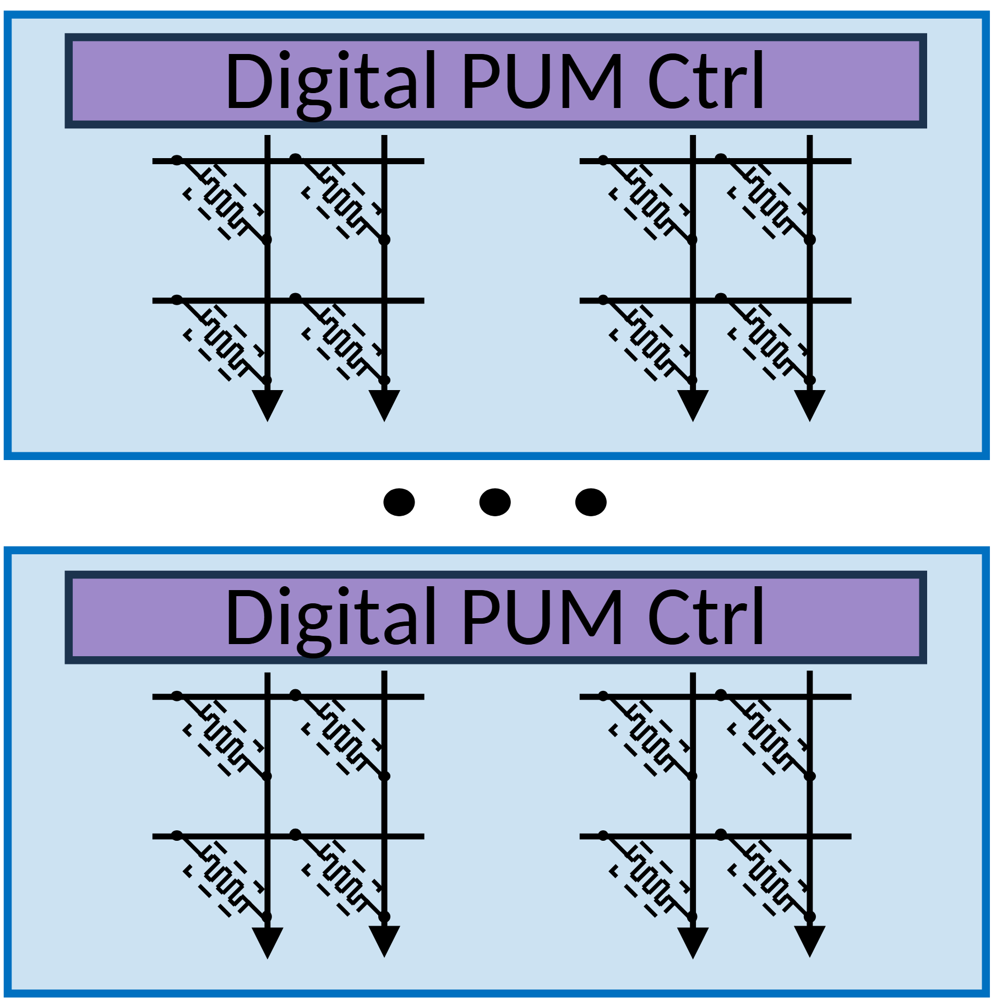

# VA-120 · 重复数字控制器与局部计算阵列

两个同构单元上下排列，中间省略号表示还有更多单元。每个单元由顶部控制条和下方两簇局部网格组成，适合作为可扩展的重复计算节点示意；图中没有模拟/数字/混合三方案比较。



## 适用范围

- 同构局部控制单元的重复部署
- 以首尾实例和省略号表示可扩展阵列

不适合：需要比较三种异构架构；表达完整存储系统或外部CPU数据流。

## 阅读顺序

1. 读顶部单元的Digital PUM Ctrl控制条
2. 观察其下左右两簇网格与局部向下箭头
3. 通过中间省略号理解重复数量未固定为二
4. 核对下方单元与上方结构相同

## 图形表达

**布局**：两个宽蓝框纵向排列，控制条占各框顶部，下方两簇细网格均衡分布。

**对象**：紫色控制长条、蓝色外框和交叉线网格组合；中间三个黑点表省略。

**连线**：网格内部有密集斜向和竖向箭头，未画上下两单元之间的通信。

**配色**：淡蓝背景区分完整单元，紫色条标控制层，黑色细线绘计算连接。

**文字**：控制器标签为无衬线；图无额外图例或编号，细网格在缩小后难辨。

## 部件与复用

| 部件 | 含义 | 改造方法 |
|---|---|---|
| 上方控制计算单元 (`upper-unit`) | 一个本地控制器及其局部计算网格 | 复制完整单元保留控制与计算关系 |
| 重复省略号 (`repeat-marker`) | 存在未逐个画出的同构单元 | 若要表示固定两个节点应去掉省略号 |
| 下方控制计算单元 (`lower-unit`) | 另一个重复的本地控制计算单元 | 独立改名后需说明是否仍与上方同构 |

## 改造步骤

1. 先把本图定位为重复单元片段，勿补造图上没有的三方案对比
2. 替换控制条名称时解释下方网格代表的计算对象
3. 需要跨单元通信时新增明确端口和连接，不从省略号推断连通
4. 节点数变化需代码复制或删除完整单元，并重算画布和省略号位置

## 新情景示例（假设）

假设的多个本地网格处理节点

每个蓝框映射为一个带本地控制器的采样阵列；省略号表示中间节点

若用于串行处理链，必须新增真实方向连线，不能直接把纵向排版解释为流水线

## 编辑入口

**入口**：运行 make_figure.py --config example.json --out . --parts；example.json 是示例配置，labels.json 记录可定位文字，asset.json 记录部件及元素归属。

**配置可改**：labels 修改已有文字；components 可配色、显隐或位移。配置修改不自动重排容器、表格或连接线。

**需改代码**：在 customize(root, context) 中调整拓扑和几何；新增元素须设置 data-asset-key，并将键加入部件 element_keys。节点数变化需代码复制或删除完整单元，并重算画布和省略号位置

**字体**：控制器标签为无衬线；图无额外图例或编号，细网格在缩小后难辨。 最终字体文件以构建映射为准；局部 font_size 是源坐标字号，不能直接当成论文纸面 pt。本批构建已确认并嵌入完整字体：Carlito-Regular.ttf。映射可能改变原字形和字宽，需按实际论文尺寸复核。

准备独立工作副本：

```text
python "<SKILL>/scripts/prepare_architecture.py" --id VA-120 --out figures/architecture
```

在工作副本运行：

```text
python make_figure.py --config example.json --out . --parts
python render_architecture.py fig.svg
```

## 本图检查

- 上下一致性是否符合所声称的同构关系
- 省略号是否位于两单元之外
- 细网格箭头在论文尺寸下是否可辨
- 说明是否错误声称存在模拟阵列或外部CPU

部件图用于复用局部对象；跨边界的连接和共享容器仍需按新关系处理。示例名称、数值和曲线不是当前研究结果。

来源与许可见 [ATTRIBUTION.md](ATTRIBUTION.md)。
