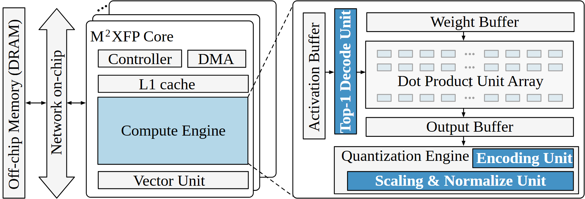

# VA-121 · 多核系统与计算引擎局部放大

左侧以存储、片上网络和堆叠核心建立系统层级，右侧用虚线从核心内部计算引擎引出大幅细节。蓝色新增处理块嵌入灰白基线通路，突出解码与量化的具体位置。



## 适用范围

- 系统总览加一个关键模块的内部展开
- 在既有硬件通路中突出新增算子或处理模块

不适合：多个互不相关方案并列比较；所有模块同等重要且不需要局部展开。

## 阅读顺序

1. 从左端片外存储经片上网络进入多核栈
2. 定位核心中的蓝色Compute Engine
3. 沿虚线放大边界进入右侧
4. 从激活解码、权重输入读到点积阵列、输出和量化引擎

## 图形表达

**布局**：左系统栈占约一半，右放大框占另一半；上下两根虚线把计算引擎边界映射到放大框。

**对象**：双向空心大箭头表示片上网络，重叠圆角框表示多核，点积阵列采用重复小格。

**连线**：左侧存储网络为双向连接；右侧激活向右、权重向下汇入阵列再经输出流向量化。

**配色**：浅蓝计算引擎对应右侧重点模块；深蓝白字突出解码、编码和缩放归一化，其他组件灰白。

**文字**：主要为大号模块标签，竖排Activation/Decode与横排表头混合；蓝条白字更粗。

## 部件与复用

| 部件 | 含义 | 改造方法 |
|---|---|---|
| 存储与片上网络 (`memory-network`) | 核心共享的外部存储与互联 | 改变连接协议需同步双向箭头 |
| 核心堆叠 (`core-stack`) | 一个展开核心和若干背景核心 | 新增核心只表达数量时可保留省略式堆叠 |
| 激活与解码入口 (`activation-decode`) | 激活缓存经解码送入阵列 | 替换为其他前处理时明确输入表示变化 |
| 权重阵列与输出 (`weight-array-output`) | 权重和激活在重复点积单元融合后形成输出 | 修改阵列规模须同步单元数量和缓冲尺寸 |
| 量化输出组件 (`quantization`) | 输出后的编码及缩放归一化组合 | 按新数值格式调整顺序，勿只换引擎名 |

## 改造步骤

1. 选择唯一需要展开的子模块，保持左框高亮区域与右框内容一致
2. 给深蓝模块建立明确的创新或改动含义，再决定哪些基线模块保留灰白
3. 重写数据表示和缓冲标签，检查右图真实处理先后
4. 改动计算引擎尺寸或放大布局时用代码重连两根虚线和全部输入输出

## 新情景示例（假设）

假设的边缘推理加速器精度处理图

左侧为多个推理核，右侧为解压、矩阵计算和重定标通路

若重定标放在阵列前，应重画相应路径与缓冲，不能沿用原输出后量化箭头

## 编辑入口

**入口**：运行 make_figure.py --config example.json --out . --parts；example.json 是示例配置，labels.json 记录可定位文字，asset.json 记录部件及元素归属。

**配置可改**：labels 修改已有文字；components 可配色、显隐或位移。配置修改不自动重排容器、表格或连接线。

**需改代码**：在 customize(root, context) 中调整拓扑和几何；新增元素须设置 data-asset-key，并将键加入部件 element_keys。改动计算引擎尺寸或放大布局时用代码重连两根虚线和全部输入输出

**字体**：主要为大号模块标签，竖排Activation/Decode与横排表头混合；蓝条白字更粗。 最终字体文件以构建映射为准；局部 font_size 是源坐标字号，不能直接当成论文纸面 pt。本批构建已确认并嵌入完整字体：Tinos-Bold.ttf, Tinos-Regular.ttf。映射可能改变原字形和字宽，需按实际论文尺寸复核。

准备独立工作副本：

```text
python "<SKILL>/scripts/prepare_architecture.py" --id VA-121 --out figures/architecture
```

在工作副本运行：

```text
python make_figure.py --config example.json --out . --parts
python render_architecture.py fig.svg
```

## 本图检查

- 虚线是否准确从左侧计算引擎边界发出
- 权重与激活是否汇入同一阵列
- 深蓝白字是否越界或与背景对比不足
- 右侧输出与量化顺序是否符合新算法

部件图用于复用局部对象；跨边界的连接和共享容器仍需按新关系处理。示例名称、数值和曲线不是当前研究结果。

来源与许可见 [ATTRIBUTION.md](ATTRIBUTION.md)。
