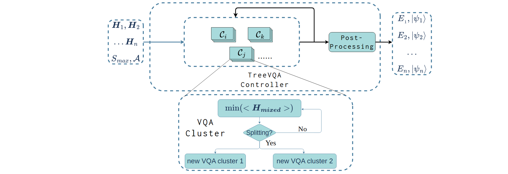

# VA-013 · 任务群组求解与条件拆分展开

横向主线展示一组问题进入并行群组，经过集中处理得到逐问题输出；下方展开一个群组的内部循环：优化后判断是否拆分，否则继续迭代。主图说明整体组织，插图解释群组为何发生变化，两者通过引出线建立包含关系。



## 适用范围

- 相似任务联合处理并在条件满足时分组
- 需要兼顾总览和局部判定逻辑

不适合：固定无迭代的串行流水线；多层递归树需要全部展开的场景。

## 阅读顺序

1. 先读左侧输入集合与求解设置。
2. 顺主线辨认控制区中的多个叠片群组及后处理。
3. 从被选群组沿细引线进入下方展开区。
4. 读优化、条件判定、继续回路与两个子群，最后回到右侧结果集。

## 图形表达

**布局**：宽横向总览上置，小型局部流程下置；上下区域用圆角虚线边界区别。

**对象**：叠片代表多个任务群，菱形表示拆分判定，两个底部小框表示子群。

**连线**：黑色箭头承担计算流和回路；从群组到插图的细线只表示放大解释，不是新增计算步骤。

**配色**：浅青色统一计算对象，深蓝色边界标示控制范围；不以色深表达质量或收敛程度。

**文字**：普通文字、等宽控制名称和衬线数学符号并用；替换公式时检查上下标与窄输出列。

## 部件与复用

| 部件 | 含义 | 改造方法 |
|---|---|---|
| 输入集合 (`input-set`) | 一组问题和共同约束进入求解。 | 改为新任务符号，移除不适用参数。 |
| 群组控制范围 (`cluster-controller`) | 并行群组与后处理位于同一管理区域。 | 明确反馈更新的对象，不能只改总标题。 |
| 并行群组 (`cluster-cards`) | 若干叠片强调集合而非执行顺序。 | 增加群组时重排卡片和回路。 |
| 拆分条件展开 (`split-inset`) | 优化后依据条件决定继续或分成两组。 | 替换判据，并检查是否确实为二分。 |
| 逐项输出 (`output-set`) | 每个输入问题对应一个输出记录。 | 输出项数量和符号应与输入匹配。 |

## 改造步骤

1. 先写出群组的业务定义及共享目标。
2. 将 Yes/No 两条边改成可核实的条件。
3. 若子群要回到总览，应显式补画返回关系。

## 新情景示例（假设）

可用于相似区域的联合需求预测。

问题集合映射为区域序列，群组映射为相似区域集合，优化框映射为联合拟合，拆分判据可设为残差差异。

删除量子态记号，补充拆分后群组重新入队的连接；该场景只是设计建议。

## 编辑入口

**入口**：运行 make_figure.py；example.json 为配置，labels.json 查文字键，asset.json 查部件。使用 --parts 导出独立矢量部件。

**配置可改**：labels 可改文字及字体；components 可设置 visible、dx/dy、attributes；elements 可按键改图元属性。移动量使用整图 viewBox 单位，重叠部件只选一个层级移动。

**需改代码**：增删节点、调整连接和重排结构须在 customize() 中处理；新增图元使用唯一 data-asset-key，并登记至相应部件 element_keys。配置不会自动排版。

**字体**：本图使用 Arimo-Regular.ttf、Inconsolata-Regular.ttf、Tinos-Regular.ttf。font_size 是图元局部坐标单位，受既有缩放影响，不等于纸面 pt；改字后检查实际字宽与最终阅读尺寸。

准备独立工作副本：

```text
python "<SKILL>/scripts/prepare_architecture.py" --id VA-013 --out figures/architecture
```

在工作副本运行：

```text
python make_figure.py --config example.json --out . --parts
python render_architecture.py fig.svg
```

## 本图检查

- 放大引线是否仍指向对应群组。
- 判定的两种结果是否互斥且方向清楚。
- 数学符号和新标签是否挤出窄侧栏。

部件图用于复用局部对象；跨边界的连接和共享容器仍需按新关系处理。示例名称、数值和曲线不是当前研究结果。

来源与许可见 [ATTRIBUTION.md](ATTRIBUTION.md)。
