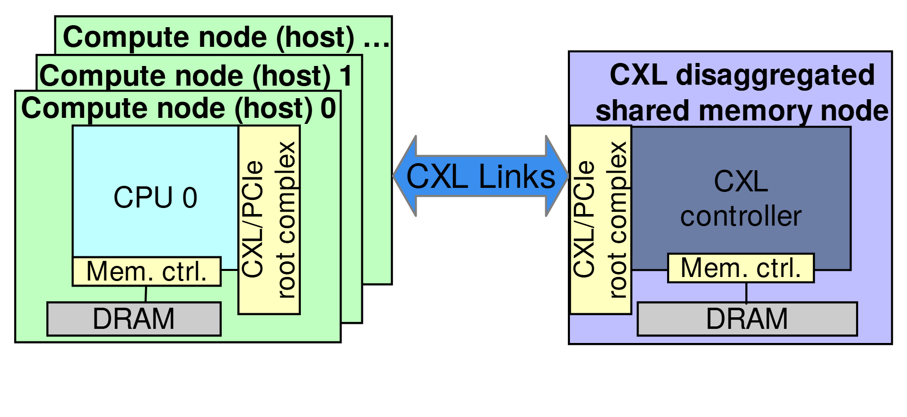

# VA-122 · 多主机连接共享内存节点

左侧错位叠放主机强调多个访问方，右侧单个内存节点强调共享资源，中央粗双向箭头给出统一互联。两侧重复根复合体与内存控制器，让本地内存和远端共享内存的区别清晰。



## 适用范围

- 多个计算侧访问一个共享资源侧
- 保留本地资源的主机与远程扩展设备关系

不适合：多级网络路由细节；单向数据采集流程。

## 阅读顺序

1. 从左前景主机读取CPU、本地内存和根复合体
2. 通过后方叠层与主机编号识别多个主机
3. 沿中央CXL Links双向箭头转向共享侧
4. 读右侧接口、共享控制器、内存控制器和DRAM

## 图形表达

**布局**：左侧多层绿色主机与右侧单层紫色资源节点横向对置，中间宽箭头连接。

**对象**：容器矩形嵌套子组件，接口为黄色竖条，内存为灰色横条，堆叠偏移表达多实例。

**连线**：中央双向大箭头表达互联关系；内部细线仅连接处理器、内存控制和DRAM，未画每个主机独立端口。

**配色**：绿色区分主机、紫色区分共享节点，黄色重复接口角色，青色CPU与深蓝控制器区分功能。

**文字**：主机和共享节点标题加粗，接口标签旋转；内存控制器短写Mem. ctrl.以适配窄条。

## 部件与复用

| 部件 | 含义 | 改造方法 |
|---|---|---|
| 多主机栈 (`host-stack`) | 多个拥有CPU与本地内存的访问节点 | 保留前景一个详图，后方只表示额外实例 |
| 双向共享互联 (`shared-link`) | 两侧协议连接关系 | 如果实际是交换网络，应新增交换层而非只改箭头文字 |
| 共享内存节点 (`memory-node`) | 接口、控制器与共享DRAM组成的资源侧 | 替换资源种类时连同控制器和内部接口一起重构 |

## 改造步骤

1. 定义多个访问方与共享资源的关系，不能凭图假定一致性保证
2. 区分主机本地内存与远端资源，统一重复组件的色义
3. 如果需表达逐主机带宽或多个端口，把堆叠图改为显式节点连线
4. 增加交换机、分区或资源节点时用代码修改拓扑及中央连接

## 新情景示例（假设）

假设的多工作站共享存储扩展

左边为带本地缓存的工作站，右边为共享存储控制节点

将CXL标签替换前先确定实际协议，必要时增加网络交换机并取消隐含直连

## 编辑入口

**入口**：运行 make_figure.py --config example.json --out . --parts；example.json 是示例配置，labels.json 记录可定位文字，asset.json 记录部件及元素归属。

**配置可改**：labels 修改已有文字；components 可配色、显隐或位移。配置修改不自动重排容器、表格或连接线。

**需改代码**：在 customize(root, context) 中调整拓扑和几何；新增元素须设置 data-asset-key，并将键加入部件 element_keys。增加交换机、分区或资源节点时用代码修改拓扑及中央连接

**字体**：主机和共享节点标题加粗，接口标签旋转；内存控制器短写Mem. ctrl.以适配窄条。 最终字体文件以构建映射为准；局部 font_size 是源坐标字号，不能直接当成论文纸面 pt。本批构建已确认并嵌入完整字体：texgyreheros-bold.otf, texgyreheros-regular.otf。映射可能改变原字形和字宽，需按实际论文尺寸复核。

准备独立工作副本：

```text
python "<SKILL>/scripts/prepare_architecture.py" --id VA-122 --out figures/architecture
```

在工作副本运行：

```text
python make_figure.py --config example.json --out . --parts
python render_architecture.py fig.svg
```

## 本图检查

- 后方主机标题是否被前景遮住过多
- 两侧黄色接口是否表达同一协议层
- DRAM与内存控制器是否保持正确连接
- 箭头宽度和位置是否进入接口而不是标题区域

部件图用于复用局部对象；跨边界的连接和共享容器仍需按新关系处理。示例名称、数值和曲线不是当前研究结果。

来源与许可见 [ATTRIBUTION.md](ATTRIBUTION.md)。
