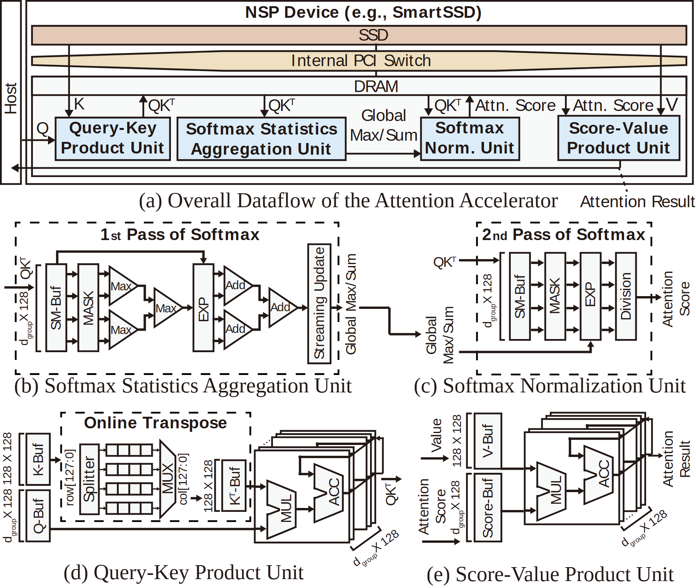

# VA-123 · 设备数据流总览与四个运算单元展开

顶部一条完整设备数据流给出存储、互联、内存与四类运算单元，下面两行分别展示统计归约、归一化、查询键乘积及分数值乘积。读者可从系统位置追到内部缓冲与算术结构。



## 适用范围

- 硬件总览需要与多个局部数据通路对应
- 同时解释归约树、转置和乘加阵列的复合架构

不适合：仅需要表达输入输出的一页简图；没有明确模块对应关系的四张零散插图。

## 阅读顺序

1. 先读顶部(a)主机与设备，定位四个运算框
2. 第二行左(b)看第一遍统计归约，再右(c)看第二遍归一化
3. 第三行左(d)看查询键乘积与在线转置
4. 第三行右(e)看分数值乘积，并回查顶部输出

## 图形表达

**布局**：顶部横向总览占约三成高度，下方2×2细节面板按(b)(c)(d)(e)排列；细节顺序与顶层模块从左至右不完全相同。

**对象**：长条呈存储与总线层，虚线框包围局部阶段；三角形算子树、竖缓冲条、层叠乘加块各有独立图形语义。

**连线**：顶部数据主线以Q、K、QKᵀ、Attn. Score等标签连接；下方用黑色箭头表示缓冲至算子，统计结果跨面板输给归一化。

**配色**：顶部存储浅棕、交换浅黄、运算浅蓝，内部细节基本黑白，保持算子可读。

**文字**：顶层模块加粗无衬线，公式变量和维度使用细小混合字体；竖排缓冲名、上标转置符号及d_group须单独检查。

## 部件与复用

| 部件 | 含义 | 改造方法 |
|---|---|---|
| 设备级总览 (`device-overview`) | 主机、存储层和四运算单元的位置及数据关系 | 改动单元名字须同步其下细节面板 |
| 统计归约单元 (`statistics-unit`) | 最大值归约、指数、加法归约及流式更新 | 归约宽度变化需重算算子树而不只换维度 |
| 归一化单元 (`normalization-unit`) | 利用全局统计对每块进行指数与除法 | 明确统计输入与数据输入的不同端口 |
| 查询键乘积单元 (`query-key-unit`) | 输入缓冲、在线转置和层叠乘加阵列 | 改动矩阵布局时同步转置网格与维度标签 |
| 分数值乘积单元 (`score-value-unit`) | 分数和值缓冲汇入乘加阵列产生结果 | 输入次序与顶部Attn.Score/Value端口保持一致 |

## 改造步骤

1. 建立顶层四单元与下方面板的明确对应表，勿按面板位置误配功能
2. 把每条数据边映射到真实张量或统计量，修改维度与上标
3. 针对新算法重新确定归约树、转置和两遍处理是否仍必要
4. 增删单元时用代码重排总览和细节面板，重接跨面板统计输入

## 新情景示例（假设）

假设的分块信号相关性加速器

顶部换为采样存储与四段运算，细节分别映射相关乘积、统计、归一化及加权输出

如果不需要在线转置，应重画(d)输入通路；不能保留矩阵转置图样装饰新场景

## 编辑入口

**入口**：运行 make_figure.py --config example.json --out . --parts；example.json 是示例配置，labels.json 记录可定位文字，asset.json 记录部件及元素归属。

**配置可改**：labels 修改已有文字；components 可配色、显隐或位移。配置修改不自动重排容器、表格或连接线。

**需改代码**：在 customize(root, context) 中调整拓扑和几何；新增元素须设置 data-asset-key，并将键加入部件 element_keys。增删单元时用代码重排总览和细节面板，重接跨面板统计输入

**字体**：顶层模块加粗无衬线，公式变量和维度使用细小混合字体；竖排缓冲名、上标转置符号及d_group须单独检查。 最终字体文件以构建映射为准；局部 font_size 是源坐标字号，不能直接当成论文纸面 pt。本批构建已确认并嵌入完整字体：Arimo-Bold.ttf, Arimo-Regular.ttf, Tinos-Regular.ttf。映射可能改变原字形和字宽，需按实际论文尺寸复核。

准备独立工作副本：

```text
python "<SKILL>/scripts/prepare_architecture.py" --id VA-123 --out figures/architecture
```

在工作副本运行：

```text
python make_figure.py --config example.json --out . --parts
python render_architecture.py fig.svg
```

## 本图检查

- (b)(c)(d)(e)是否与真实功能名对应
- 统计Global Max/Sum是否进入归一化而非输出缓冲
- 所有转置符号、维度和下标是否完整
- 顶部Attn.Result及右侧标签是否被画布裁切

部件图用于复用局部对象；跨边界的连接和共享容器仍需按新关系处理。示例名称、数值和曲线不是当前研究结果。

来源与许可见 [ATTRIBUTION.md](ATTRIBUTION.md)。
