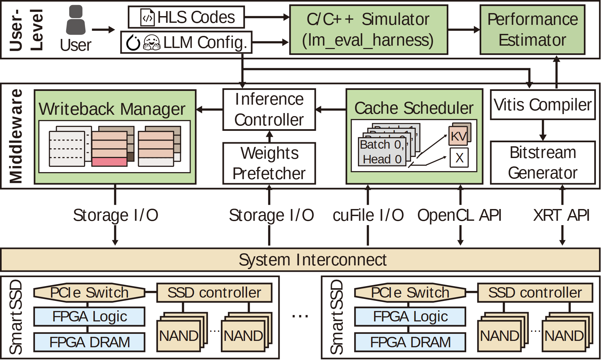

# VA-082 · 工具链与运行管理贯通设备阵列

把用户工具、中间件和硬件阵列排成三层：顶部代码与配置经过仿真估计，中央同时包含运行控制和编译部署，底部通过互连访问重复设备。它能说明设计期产物怎样进入运行期，但必须避免把编译路径误读成每次推理都执行的步骤。



## 适用范围

- 软件工具与硬件部署共同设计
- 缓存或存储管理需要展开具体对象的系统

不适合：单纯算法步骤；只有一个软件服务且无需设备接口的结构。

## 阅读顺序

1. 先看顶部代码、配置与验证估计链。
2. 向中层区分运行管理和编译部署两条路径。
3. 沿接口名进入横向系统互连。
4. 查看底部代表设备的控制器、逻辑、内存与存储。

## 图形表达

**布局**：三层水平结构，中层左大右窄；底部画首尾两个设备并以省略号延伸。

**对象**：缓存管理框内含表格和叠卡，设备内含控制器方框及存储圆柱，具体对象避免全图只有方框。

**连线**：顶层横箭头是工具输出，竖线连接部署或运行接口；接口名称不能仅靠位置猜测方向。

**配色**：绿色突出重点软件模块，米色表示互连和设备背景，白框保留常规功能。

**文字**：侧边竖排层名节约横向空间；接口标签密集，宜缩短命名而非不断减字号。

## 部件与复用

| 部件 | 含义 | 改造方法 |
|---|---|---|
| 用户工具链 (`user-tools`) | 输入代码与配置，验证并估计行为。 | 换成实际可运行工具，性能估计不可当成测量结果。 |
| 运行管理 (`runtime-manager`) | 组织回写、预取、控制和缓存。 | 缓存小图需重新定义对象和生命周期。 |
| 编译部署链 (`compile-path`) | 生成面向设备的配置产物。 | 按目标平台替换产物，不保留无关比特流概念。 |
| 接口与互连 (`interconnect`) | 连接软件操作和硬件访问。 | 每个接口应有明确调用方与目标。 |
| 重复设备 (`device-array`) | 展开一类计算存储设备内部组成。 | 设备异构时应分别画而非用省略号暗示相同。 |

## 改造步骤

1. 先标清哪些步骤离线执行，哪些在每次任务中执行。
2. 重点颜色代表本方法关注范围，不能自动等同原创贡献。
3. 把缓存叠卡、表格和底部硬件换成当前任务真实数据结构。

## 新情景示例（假设）

假设用于边缘图像推理加速平台。

顶部为模型导出与延迟估计，中部为批次调度、缓存和设备编译，下层为带本地存储的加速卡。

替换编译器及接口名，重画缓存条目为图像批次，并区分模型部署与在线请求。

## 编辑入口

**入口**：以 make_figure.py 为入口，先复制 example.json 作为当前情景配置；labels.json 定位标签，asset.json 定位部件。

**配置可改**：labels 可改文字和文字样式，components 可做显隐、平移和局部样式调整；elements 可定位矢量元素。配置只作用于已有几何，不会自动解决布局冲突。

**需改代码**：改变层数、硬件类型或接口归属需修改组成图元与连线；已有表格和缓存卡不会根据新数据自动布局。

**字体**：当前替换字体为 Arimo-Bold、Arimo-Regular。改字后检查字宽、基线及 PDF 字体嵌入；原图的逐字定位不保证能容纳更长名称。

准备独立工作副本：

```text
python "<SKILL>/scripts/prepare_architecture.py" --id VA-082 --out figures/architecture
```

在工作副本运行：

```text
python make_figure.py --config example.json --out . --parts
python render_architecture.py fig.svg
```

## 本图检查

- 编译部署路径没有被画成逐请求执行。
- 每条接口竖线能追溯到具体中间件模块。
- 缓存颜色在写回与调度小图中含义一致。

部件图用于复用局部对象；跨边界的连接和共享容器仍需按新关系处理。示例名称、数值和曲线不是当前研究结果。

来源与许可见 [ATTRIBUTION.md](ATTRIBUTION.md)。
