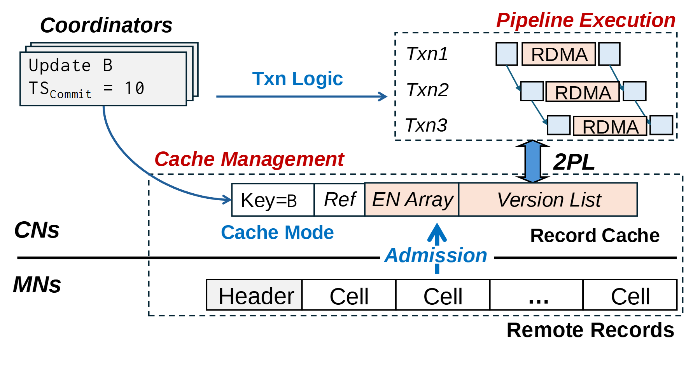

# VA-124 · 事务流水线与跨层记录缓存

左上叠放协调器发出事务逻辑，右上三条错位交易轨迹展示流水执行；中下用缓存记录与远端记录两条字段带连接计算层和内存层。曲线、粗箭头和层分隔线共同解释调度与数据位置。



## 适用范围

- 计算与存储分离下的流水执行和本地缓存
- 事务协调路径与记录格式需要同时说明

不适合：纯粹分层部署且没有时序；要表达真实事务耗时或锁等待统计。

## 阅读顺序

1. 从左上协调器沿Txn Logic进入右上流水事务
2. 观察三行RDMA的错位执行及2PL入口
3. 沿弧线读取Cache Mode进入Record Cache
4. 跨CNs/MNs边界查看Remote Records和向上的Admission

## 图形表达

**布局**：上半左协调器右流水，下半缓存与远端记录横向对齐；CNs/MNs只用左侧标签和粗线区分。

**对象**：叠卡表示协调器，阶梯小条表示事务进度，字段长条表示记录结构，虚线区域限定局部功能。

**连线**：协调器到缓存用蓝色曲线，逻辑到流水用蓝色直箭头，Admission向上从远端层进入缓存；2PL粗箭头连接缓存和事务区域。

**配色**：Pipeline Execution与Cache Management实际均为红色粗斜体；蓝色标逻辑与缓存动作，浅粉字段、浅蓝小状态块辅助区分。

**文字**：粗斜体功能名与细斜体事务编号并用，TS_commit等下标和EN Array字段需保留；横向字段宽度取决于文字。

## 部件与复用

| 部件 | 含义 | 改造方法 |
|---|---|---|
| 协调器叠卡 (`coordinators`) | 持有事务更新及提交时间的协调器实例 | 更新样例值仅代表假设事务，不作性能结论 |
| 三事务流水区 (`pipeline`) | 三条交易以错位RDMA阶段示意重叠执行 | 增减事务需重排阶梯块和连接 |
| 本地记录缓存 (`record-cache`) | Key、Ref、EN Array、Version List构成缓存字段 | 改变数据模型需同步字段布局和外部引用 |
| 远端记录条 (`remote-records`) | Header和多个Cell构成内存侧记录 | 字段数变化需更新省略号与准入目标 |

## 改造步骤

1. 先区分协调逻辑、缓存动作和远端数据所在层，再替换各自标签
2. 使用真实字段模型重写缓存与远端记录，不能将Version List随意改为无关内容
3. 保持准入箭头向上和CNs/MNs边界语义；跨区曲线与共享虚线边框留在整图
4. 改变事务数或缓存字段数时通过代码重排阶梯条、字段框及2PL连接

## 新情景示例（假设）

假设的分布式任务元数据缓存

协调器变为任务协调服务，流水区为重叠远程访问，缓存记录为任务版本状态

若新系统不用2PL，应替换整个控制关系和箭头标签；远端记录字段按真实模型重新划分

## 编辑入口

**入口**：运行 make_figure.py --config example.json --out . --parts；example.json 是示例配置，labels.json 记录可定位文字，asset.json 记录部件及元素归属。

**配置可改**：labels 修改已有文字；components 可配色、显隐或位移。配置修改不自动重排容器、表格或连接线。

**需改代码**：在 customize(root, context) 中调整拓扑和几何；新增元素须设置 data-asset-key，并将键加入部件 element_keys。改变事务数或缓存字段数时通过代码重排阶梯条、字段框及2PL连接

**字体**：粗斜体功能名与细斜体事务编号并用，TS_commit等下标和EN Array字段需保留；横向字段宽度取决于文字。 最终字体文件以构建映射为准；局部 font_size 是源坐标字号，不能直接当成论文纸面 pt。本批构建已确认并嵌入完整字体：Arimo-Bold.ttf, Arimo-BoldItalic.ttf, Arimo-Italic.ttf, Arimo-Regular.ttf, Inconsolata-Regular.ttf。映射可能改变原字形和字宽，需按实际论文尺寸复核。

准备独立工作副本：

```text
python "<SKILL>/scripts/prepare_architecture.py" --id VA-124 --out figures/architecture
```

在工作副本运行：

```text
python make_figure.py --config example.json --out . --parts
python render_architecture.py fig.svg
```

## 本图检查

- Admission是否从远端层指向本地缓存
- 字段条与CNs/MNs边界是否错位
- 两段红色标题是否被说明误称为两种颜色
- TS_commit及事务编号是否正确显示
- 阶梯条长度是否被误当实测时长

部件图用于复用局部对象；跨边界的连接和共享容器仍需按新关系处理。示例名称、数值和曲线不是当前研究结果。

来源与许可见 [ATTRIBUTION.md](ATTRIBUTION.md)。
