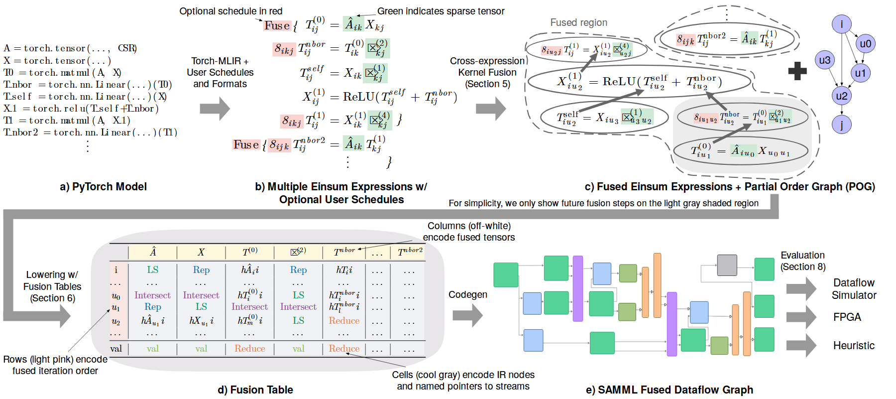

# VA-043 · 代码到符号表与数据流的多表示转换

以五个面板串联代码、符号表达、融合约束、表格中间表示和数据流网络。价值在于同一计算跨多种表示仍能被追踪：表达式中的颜色标记延续到表格，最后落到带分支的算子图。它适合说明编译或转换链，不适合把复杂公式当成装饰填充。



## 适用范围

- 存在多层中间表示的编译器或计算转换
- 需要证明同一依赖关系在表格与图中持续保留

不适合：面向非技术读者的简短总览；不能给出真实公式映射的普通业务流程。

## 阅读顺序

1. 上排从代码读取输入计算，再看带注释的符号表达。
2. 进入右上融合分组及偏序约束图，确认可合并范围。
3. 沿回折粗箭头进入下排表格，再向右看生成的数据流与目标。

## 图形表达

**布局**：上三下二折返排布，长箭头跨整行连接上下层；各面板保留字母序号避免误读。

**对象**：代码块、数学式、虚线融合圈、二维表与彩色算子块分别表达不同信息层级。

**连线**：粗灰箭头只表示表示法转换，细黑边表示计算依赖；虚线圈表示融合范围而非边界传输。

**配色**：红色标调度注记，绿色标稀疏信息；算子图的多色表示算子种类，需另设对应说明。

**文字**：代码用等宽，公式用数学字体，面板标题用无衬线；公式上下标与表格小字是主要缩放风险。

## 部件与复用

| 部件 | 含义 | 改造方法 |
|---|---|---|
| 源程序 (`source-code`) | 提供最初的运算语义与数据变量。 | 换成能实际对应后续表达式的短程序。 |
| 符号中间表示 (`symbolic-ir`) | 数学式连同调度或格式注记描述运算。 | 逐条对应源程序；不沿用陌生符号。 |
| 融合及依赖约束 (`fusion-graph`) | 圈出合并区域，邻接小图说明合法次序。 | 调整融合范围时同步更新偏序边。 |
| 迭代编码表 (`fusion-table`) | 行、列与单元格分别携带迭代和对象信息。 | 重新定义行列含义，再填入自有例子。 |
| 生成数据流 (`dataflow-result`) | 不同类型算子和分支落实到执行结构。 | 按生成规则重连，输出目标也随工具链改变。 |

## 改造步骤

1. 先选一个足够小的贯穿例子，保证五种表示逐项可对应。
2. 把颜色语义写成独立图例，避免依赖正文才能理解红绿标记。
3. 删除旧章节标注，并在每个转换箭头旁写真实变换名称。

## 新情景示例（假设）

假设说明稀疏线性计算的教学编译器。

用一个稀疏乘法加激活函数作为源程序，表达式、迭代表与算子图共享同一变量名。

缩减至两条表达式和一个分支；重新生成表中索引与数据流连接，末端改为解释器执行。

## 编辑入口

**入口**：以 make_figure.py 为入口，example.json 提供编辑配置，labels.json 用于查文字键，asset.json 对应下列部件。

**配置可改**：labels 改指定文字与字号；components 可显隐、平移和改属性；elements 修改单个矢量对象。平移保留固定几何，不会自动重新布线。

**需改代码**：换贯穿例子必须同时改公式对象、表格和数据流拓扑；该图没有从代码自动生成所有面板的能力。 必须在 customize() 中处理新增矢量对象及连接，不能只扩大文字框。

**字体**：当前字体映射使用 Inconsolata-Regular.ttf, lmroman10-italic.otf, lmroman10-regular.otf, texgyreheros-bold.otf, texgyreheros-regular.otf；换标签后按最终插入宽度检查字宽、上下标和边界，不直接继承小字号。

准备独立工作副本：

```text
python "<SKILL>/scripts/prepare_architecture.py" --id VA-043 --out figures/architecture
```

在工作副本运行：

```text
python make_figure.py --config example.json --out . --parts
python render_architecture.py fig.svg
```

## 本图检查

- 五个面板中变量、索引及张量维数是否一致。
- 粗转换箭头是否与细依赖边视觉区分。
- 融合圈中的算子是否满足旁边偏序图的约束。

部件图用于复用局部对象；跨边界的连接和共享容器仍需按新关系处理。示例名称、数值和曲线不是当前研究结果。

来源与许可见 [ATTRIBUTION.md](ATTRIBUTION.md)。
