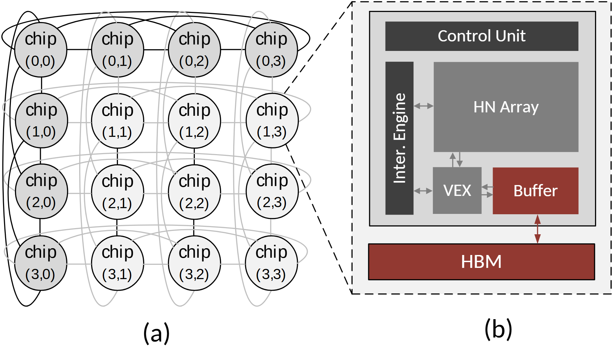

# VA-125 · 行列互连阵列与单节点内部放大

左侧用十六个圆节点表达行列连接，右侧以虚线引出单节点内部模块。复用重点是系统级拓扑与节点级构成同页并置，并通过一条底部存储条带统一内部数据资源。



## 适用范围

- 重复节点组成的行列互连计算阵列
- 需要同时说明网络结构与单节点内部职责的系统

不适合：任意全连接网络：图中是按行列组织，不能称所有节点两两直连；各节点内部差异很大、无法用一个节点代表全部的异构系统。

## 阅读顺序

1. 先看左侧四行四列节点及行列坐标。
2. 沿虚线引线转入右侧节点放大区。
3. 从顶部控制模块读到互连、计算和缓存，最后读底部共享存储。

## 图形表达

**布局**：左侧拓扑约占一半画幅，右侧虚线放大框内有深色竖条和灰色计算块，下方独立横条表示存储。

**对象**：圆形是重复计算节点，矩形是内部功能模块，虚线大框界定放大范围。

**连线**：左侧曲线交织表示行列链路；右侧短双向箭头表示相邻内部模块交换。跨面板虚线仅表示放大，不是数据通道。

**配色**：主图灰阶；右侧 Buffer 与 HBM 使用暗红强调存储职责，控制与互连深灰，计算区中灰。

**文字**：左侧节点名和坐标为衬线字，右侧模块为无衬线白字；坐标与模块名称大小层次不同。

## 部件与复用

| 部件 | 含义 | 改造方法 |
|---|---|---|
| 行列互连阵列 (`fabric`) | 十六节点及其行列连接共同构成系统拓扑。 | 改变阵列规模时重算坐标和每行每列链路，不复制一个圆就结束。 |
| 节点内部计算控制区 (`chip-core`) | 控制、互连、运算和缓存聚合在单个节点内。 | 整体作为同构节点说明复用；改变接口时连同短箭头改写。 |
| 底部共享存储条 (`shared-memory`) | 单条 HBM 与上方缓存以双向箭头相连。 | 可替换为共享存储或公共资源池，同时明确服务对象。 |

## 改造步骤

1. 先判断新网络是否确实有行列通信；一般网格不能直接复用这些跨节点长曲线。
2. 把放大模块映射到新节点职责，保持控制、计算、存储的形状分工。
3. 增加节点或修改缓存位置时在代码中重布线，跨面板引线仍只承担放大指示。

## 新情景示例（假设）

假设场景：四乘四城市感知处理节点。

圆节点为街区处理站；内部块对应调度、融合计算、消息互连和缓存，底条为共享历史数据。

若实际链路仅邻接，必须删除跨行列直连并重建邻接边；存储是否共享需按新模型确定。

## 编辑入口

**入口**：运行 make_figure.py 读取 example.json 的迁移配置；labels.json 登记文字，asset.json 登记部件。使用 --parts 可导出部件；准备后的工作副本通过 render_architecture.py 输出论文图。

**配置可改**：labels、components 可设置文字、配色、显隐和位移；不会自动加宽文本框或重排连线。先保留示例几何再逐项调整。

**需改代码**：改变节点数量、分支和跨区域连线须修改 customize(root, context)。新增元素设置 data-asset-key，并加入对应部件的 element_keys；共享边框与跨区箭头保留整图级，避免重叠移动。

**字体**：左侧节点名和坐标为衬线字，右侧模块为无衬线白字；坐标与模块名称大小层次不同。 最终字体文件以构建映射为准；局部 font_size 受 SVG 变换影响，不直接等于纸面 pt。本批构建已确认并嵌入完整字体：Arimo-Regular.ttf, Carlito-Regular.ttf。映射可能改变原字形和字宽，需按实际论文尺寸复核。

准备独立工作副本：

```text
python "<SKILL>/scripts/prepare_architecture.py" --id VA-125 --out figures/architecture
```

在工作副本运行：

```text
python make_figure.py --config example.json --out . --parts
python render_architecture.py fig.svg
```

## 本图检查

- 核对坐标与节点数相符。
- 检查曲线是否误读为全局全连接。
- 放大虚线应能明确关联代表节点。
- 检查暗红块白字在缩小后的对比度。
- 部件按语义区域抽取，端口处可能保留跨区连接的箭头头部或短线；完整连接以整图为准，独立移动时须重新接线。

部件图用于复用局部对象；跨边界的连接和共享容器仍需按新关系处理。示例名称、数值和曲线不是当前研究结果。

来源与许可见 [ATTRIBUTION.md](ATTRIBUTION.md)。
